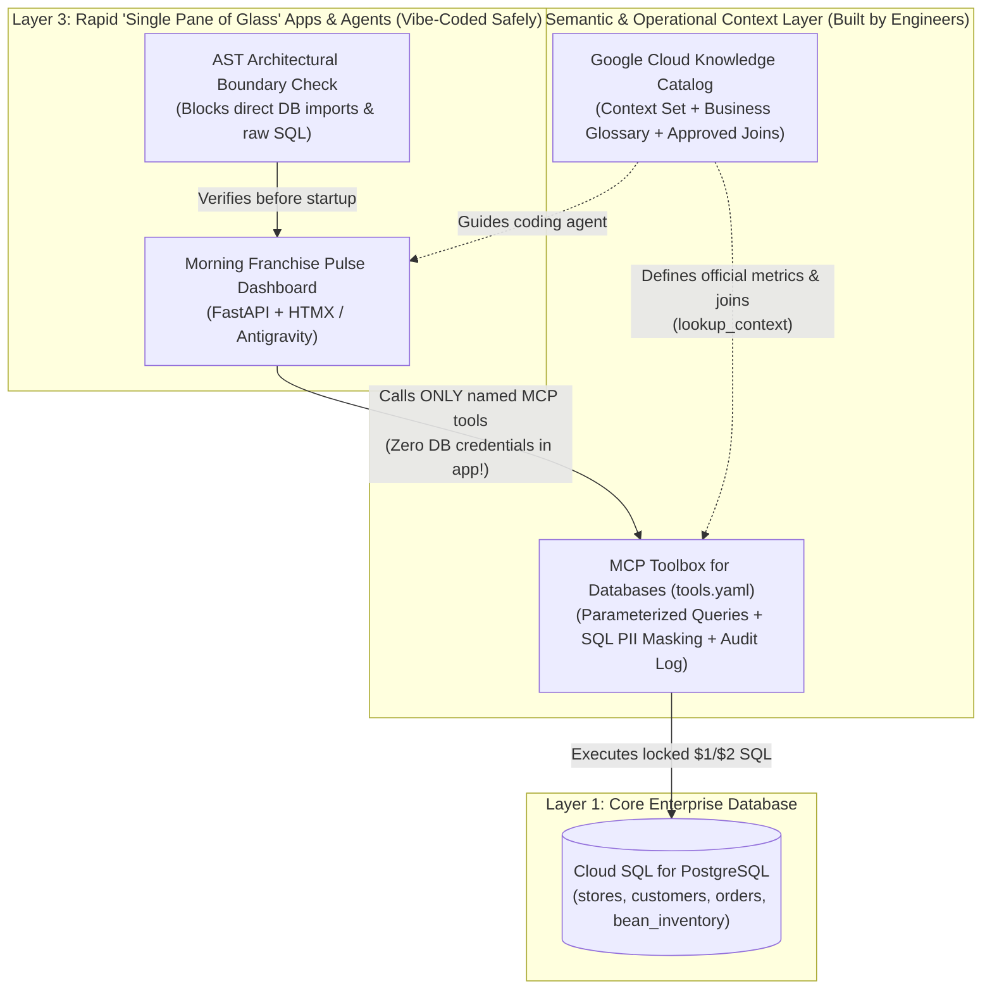

# Vibe Coding, Meet Reality: Building a Governed Context Layer with Cloud SQL for PostgreSQL, Google Cloud Knowledge Catalog, and MCP Toolbox for Databases

*By Romin Irani*

A few days ago, I read Rod Johnson’s article, ***[Vibe Coding, Meet Reality](https://medium.com/@springrod/vibe-coding-meet-reality-0fb1e4e04053)***. If you haven't read it yet, stop and give it five minutes—it is one of the clearest reality checks on AI-assisted software development written this year.

Rod opens with a real-world story that should make every developer and engineering leader sit up straight: **Bootlegger**, a South African coffee franchise, had its internal company data and customer personal information (PII) exposed to the open internet. Why? Because the CEO used an AI coding assistant to "vibe code" a web dashboard directly on top of company data without engineering guardrails.

Now, it is easy to laugh at stories like that and say, *"Well, non-programmers shouldn't be building apps."*

But as Rod points out, that misses the whole point! For over forty years—from James Martin’s 1982 book *Application Development Without Programmers* (4GLs) to 1990s CASE tools, 2000s UML modeling, and 2020s low-code "citizen developer" platforms—business users and domain experts have been desperate for a way to build **custom "Single Pane of Glass" dashboards and workflows** that bring together sales, inventory, and customer activity on one screen without waiting six months in an IT backlog.

Today, coding agents like **Google Antigravity** and **Gemini 3** can genuinely generate those custom dashboards in minutes. **The mistake isn't letting people use AI to build dashboards. The mistake is letting those generated apps connect directly to your raw database.**

In this step-by-step tutorial, we are going to build the exact **3-Layer Context Architecture** that Rod Johnson proposes—using **Google Cloud SQL for PostgreSQL**, **Google Cloud Knowledge Catalog**, and **MCP Toolbox for Databases**—so that anyone can rapidly generate "Single Pane of Glass" apps and agents that are **physically incapable** of leaking customer PII or hallucinating business metrics.

> 📂 **All Companion Code Is Ready to Run**: Every SQL script, YAML configuration, Python gateway, FastAPI dashboard, and AST static verifier in this post lives in [`blog-vibe-coding-meet-reality/`](./blog-vibe-coding-meet-reality/).

---

## 1. The Architecture: Why "Prompting Straight to Postgres" Fails (and What to Build Instead)

Let's look at what happens when someone prompts an AI coding agent with:
> *"Here is our PostgreSQL connection string. Build me a Morning Franchise Pulse dashboard showing total store revenue, low bean inventory, and recent VIP customer orders."*

When the AI connects directly to your raw database tables, **two things go wrong immediately**:

1. **The Business Logic Trap (Wrong Numbers)**: The AI sees an `orders` table with a `gross_amount_usd` column, so it writes `SELECT SUM(gross_amount_usd) FROM orders`. It has no idea that in your company, **Net Store Revenue** must subtract `discount_usd` and **must exclude `'REFUNDED'` and `'CANCELLED'` orders**. Suddenly, the dashboard tells the CEO that morning revenue is **\$258.00** when it is actually **\$182.50** (an error of more than 41%!).
2. **The Security & PII Trap (Data Leaks)**: To show recent VIP orders, the AI joins `orders` with `customers` using `SELECT *`, accidentally bundling customer email addresses, mobile phone numbers (`+27-82-555-0191`), home street addresses, and confidential wholesale supplier costs right into the web response.

### How We Fix Both: The 3-Layer Reality Stack

Instead of letting prompt-built apps talk directly to raw database tables, we split our system into **three layers**:



Look at the division of labor in this diagram:
- **Layer 1 (`Cloud SQL for PostgreSQL`)**: Holds our real operational tables (`stores`, `customers`, `orders`, `bean_inventory`, `restock_requests`).
- **Layer 2A (`Google Cloud Knowledge Catalog`)**: Acts as our **Semantic Brain**. Data engineers define the official **Business Glossary** (*Net Store Revenue*, *At-Risk Inventory*), mark `customers.email` and `phone_number` as restricted PII, and register explicit `schema-join` links.
- **Layer 2B (`MCP Toolbox for Databases`)**: Acts as our **Operational Gatekeeper**. We define a declarative [`tools.yaml`](./blog-vibe-coding-meet-reality/tools.yaml) file that exposes **only four pre-approved, parameterized SQL queries**. The generated app never gets a database password and cannot run arbitrary SQL.
- **Layer 3 (`Single Pane of Glass Dashboard + AST Verifier`)**: Now a product manager, analyst, or developer can prompt Antigravity to build custom dashboards all day long—because the app only consumes the 4 governed tools, and a 35-line Python AST check blocks any code that tries to `import psycopg` or `sqlite3` directly!

Let's build this entire system step by step.

---

## Step 1: Provisioning the Database & Sample Data on Cloud SQL for PostgreSQL

Inspired by the coffee franchise story in Rod’s article, our sample database is for **Roast & Co.**, a coffee chain with locations in **Cape Town**, **Johannesburg**, and **Durban**.

### 1.1 Create Your Cloud SQL for PostgreSQL Instance (or Run Locally)

If you are deploying on Google Cloud, create a Cloud SQL for PostgreSQL instance and database:

```bash
export GOOGLE_CLOUD_PROJECT="your-gcp-project-id"
export CLOUD_SQL_INSTANCE="roast-and-co-pg"
export CLOUD_SQL_REGION="us-central1"

# 1. Create a Cloud SQL for PostgreSQL 16 instance
gcloud sql instances create "$CLOUD_SQL_INSTANCE" \
  --database-version=POSTGRES_16 \
  --tier=db-f1-micro \
  --region="$CLOUD_SQL_REGION" \
  --project="$GOOGLE_CLOUD_PROJECT"

# 2. Create the roast_and_co database
gcloud sql databases create roast_and_co \
  --instance="$CLOUD_SQL_INSTANCE" \
  --project="$GOOGLE_CLOUD_PROJECT"
```

### 1.2 Load the Schema and Seed Data (`sql/01_schema_and_seed.sql`)

Open [`blog-vibe-coding-meet-reality/sql/01_schema_and_seed.sql`](./blog-vibe-coding-meet-reality/sql/01_schema_and_seed.sql). Notice how we intentionally include the exact two traps that trip up naive AI apps:

```sql
-- 2. Loyalty Customers (CONTAINS THE PII TRAP: email, phone_number, home_address)
CREATE TABLE customers (
    customer_id VARCHAR(32) PRIMARY KEY,
    full_name VARCHAR(120) NOT NULL,
    email VARCHAR(160) NOT NULL UNIQUE,
    phone_number VARCHAR(40) NOT NULL,
    home_address TEXT NOT NULL,
    loyalty_tier VARCHAR(20) NOT NULL CHECK (loyalty_tier IN ('BRONZE', 'SILVER', 'GOLD')),
    loyalty_points INTEGER NOT NULL DEFAULT 0 CHECK (loyalty_points >= 0)
);

-- 3. Customer Orders (CONTAINS THE BUSINESS LOGIC TRAP: REFUNDED & CANCELLED rows)
-- Business Rule in Knowledge Catalog:
--   Net Store Revenue = SUM(gross_amount_usd - discount_usd) WHERE status = 'COMPLETED'
CREATE TABLE orders (
    order_id VARCHAR(32) PRIMARY KEY,
    store_id VARCHAR(32) NOT NULL REFERENCES stores(store_id),
    customer_id VARCHAR(32) NOT NULL REFERENCES customers(customer_id),
    order_timestamp TIMESTAMPTZ NOT NULL,
    status VARCHAR(20) NOT NULL CHECK (status IN ('COMPLETED', 'REFUNDED', 'CANCELLED')),
    gross_amount_usd NUMERIC(10, 2) NOT NULL CHECK (gross_amount_usd >= 0),
    discount_usd NUMERIC(10, 2) NOT NULL DEFAULT 0.00 CHECK (discount_usd >= 0),
    tax_usd NUMERIC(10, 2) NOT NULL DEFAULT 0.00 CHECK (tax_usd >= 0)
);
```

And look at the 6 sample orders we insert in [`01_schema_and_seed.sql`](./blog-vibe-coding-meet-reality/sql/01_schema_and_seed.sql#L88-L94):

```sql
INSERT INTO orders (order_id, store_id, customer_id, order_timestamp, status, gross_amount_usd, discount_usd, tax_usd) VALUES
    ('ord-9001', 'store-ct-01',  'cust-101', '2026-11-05 07:15:00+02', 'COMPLETED', 42.00,  4.00, 5.70),
    ('ord-9002', 'store-ct-01',  'cust-104', '2026-11-05 08:05:00+02', 'COMPLETED', 28.50,  0.00, 4.28),
    ('ord-9003', 'store-ct-01',  'cust-101', '2026-11-05 08:45:00+02', 'REFUNDED',  36.00,  0.00, 5.40),
    ('ord-9004', 'store-jhb-02', 'cust-102', '2026-11-05 07:30:00+02', 'COMPLETED', 65.00,  5.00, 9.00),
    ('ord-9005', 'store-jhb-02', 'cust-102', '2026-11-05 09:10:00+02', 'CANCELLED', 28.50,  0.00, 0.00),
    ('ord-9006', 'store-dbn-03', 'cust-103', '2026-11-05 08:20:00+02', 'COMPLETED', 58.00,  2.00, 8.40);
```

Look closely at those numbers:
- If a naive AI script runs `SELECT SUM(gross_amount_usd) FROM orders`, it gets **\$258.00** (`42.00 + 28.50 + 36.00 + 65.00 + 28.50 + 58.00`).
- But `ord-9003` (**\$36.00**) was **REFUNDED**, `ord-9005` (**\$28.50**) was **CANCELLED**, and the completed orders had **\$11.00** in loyalty discounts!
- The true **Net Store Revenue** across all three stores is **\$182.50** (`38.00 + 28.50 + 60.00 + 56.00`).

---

## Step 2: Teaching the AI What Our Data Means with Google Cloud Knowledge Catalog

How do we make sure that no developer—and no AI agent—ever has to guess how **Net Store Revenue** is calculated or which columns in `customers` are off-limits?

We register our business semantics in **Google Cloud Knowledge Catalog** (formerly Dataplex Universal Catalog) using the **`datacloud_knowledge_catalog_remote`** MCP server (or `gcloud dataplex`).

Open [`blog-vibe-coding-meet-reality/knowledge_catalog_setup.py`](./blog-vibe-coding-meet-reality/knowledge_catalog_setup.py). We perform three steps in Knowledge Catalog:

### 2.1 Create a Context Set (`create_entry_group` with `type="context-set"`)

In Knowledge Catalog, a **Context Set** is a dedicated container designed specifically to feed progressive-disclosure business context to AI agents:

```python
def build_context_set_payload(cfg: KnowledgeCatalogConfig) -> dict[str, Any]:
    return {
        "projectId": cfg.project_id,
        "location": cfg.location,
        "entryGroupId": cfg.entry_group_id,  # "roast-and-co-context-set"
        "type": "context-set",
        "displayName": "Roast & Co. Franchise Operations Context Set",
        "description": (
            "Governed semantic layer for Roast & Co. coffee stores, orders, loyalty customers, "
            "and bean inventory. Enforces Net Store Revenue rules and PII masking boundaries."
        ),
        "labels": {
            "domain": "franchise-operations",
            "governance": "pii-masked",
        },
    }
```

### 2.2 Register Business Glossary Definitions, Column Rules & Verified Queries (`upsert_entry`)

Next, in [`build_glossary_and_table_entries()`](./blog-vibe-coding-meet-reality/knowledge_catalog_setup.py#L46-L157), we attach four Knowledge Catalog system aspects to our entries:
1. **`dataplex-types.global.document`**: Marks `"glossary-net-store-revenue"` as a `"glossary"` entry and `"table-orders-context"` / `"table-customers-context"` as `"table-context"` entries.
2. **`dataplex-types.global.overview`**: Stores the exact Markdown formula for **Net Store Revenue**:
   - `SUM(gross_amount_usd - discount_usd) FILTER (WHERE status = 'COMPLETED')`
3. **`dataplex-types.global.descriptions`**: Annotates `customers.email`, `customers.phone_number`, and `customers.home_address` with `"RESTRICTED PII: Never select in agent or dashboard queries."`
4. **`dataplex-types.global.queries`**: Attaches the pre-vetted SQL query directly to the table entry so any agent calling `lookup_context` sees the exact SQL pattern to use!

### 2.3 Connect Terms and Tables with Entry Links (`upsert_entry_link`)

Finally, in [`build_schema_join_links()`](./blog-vibe-coding-meet-reality/knowledge_catalog_setup.py#L160-L197), we create two explicit **Entry Links**:
- A **`definition` link** (`projects/dataplex-types/locations/global/entryLinkTypes/definition`) linking our **Net Store Revenue** glossary entry directly to `orders.Schema.gross_amount_usd`.
- A **`schema-join` link** (`projects/dataplex-types/locations/global/entryLinkTypes/schema-join`) explicitly defining that `orders.customer_id` joins to `customers.customer_id`.

When an AI coding agent (like Google Antigravity) queries Knowledge Catalog using `lookup_context` (or `gcloud dataplex context lookup`), it receives a clean, LLM-optimized YAML summary. Run [`knowledge_catalog_setup.py`](./blog-vibe-coding-meet-reality/knowledge_catalog_setup.py) to see it:

```bash
uv run python blog-vibe-coding-meet-reality/knowledge_catalog_setup.py
```

```yaml
=== Knowledge Catalog `lookup_context` YAML Summary ===
contextSet: projects/roast-and-co-prod/locations/us-central1/entryGroups/roast-and-co-context-set
governedMetrics:
  net_store_revenue:
    formula: SUM(gross_amount_usd - discount_usd) FILTER (WHERE status = 'COMPLETED')
    excludedStatuses:
    - REFUNDED
    - CANCELLED
  at_risk_inventory:
    formula: stock_on_hand <= reorder_threshold
    hiddenColumns:
    - supplier_cost_usd
piiGovernanceRules:
  customers:
    blockedColumns:
    - email
    - phone_number
    - home_address
    approvedMcpTool: lookup_vip_orders_masked
registeredEntriesCount: 3
approvedJoinLinksCount: 2
```

---

## Step 3: Locking the Front Door with MCP Toolbox for Databases (`tools.yaml`)

Knowledge Catalog teaches the AI what our data means. Now, how do we **enforce** those rules at runtime so a vibe-coded dashboard can never run `SELECT * FROM customers` or `DROP TABLE orders`?

We put **Google's MCP Toolbox for Databases** (`googleapis/genai-toolbox`) in front of our Cloud SQL for PostgreSQL database!

Instead of handing database credentials to the AI agent or the web app, we give the database credentials **only to the MCP Toolbox server**, and configure it with [`blog-vibe-coding-meet-reality/tools.yaml`](./blog-vibe-coding-meet-reality/tools.yaml):

```yaml
sources:
  roast-cloudsql-pg:
    kind: cloud-sql-postgres
    project: ${GOOGLE_CLOUD_PROJECT}
    region: ${CLOUD_SQL_REGION:-us-central1}
    instance: ${CLOUD_SQL_INSTANCE:-roast-and-co-pg}
    database: ${DB_NAME:-roast_and_co}
    user: ${DB_USER}
    password: ${DB_PASS}

tools:
  get_store_net_revenue_summary:
    kind: postgres-sql
    source: roast-cloudsql-pg
    description: >-
      Returns verified Net Store Revenue (gross_amount_usd minus discount_usd for
      COMPLETED orders only) and order counts per store, following the official
      Knowledge Catalog 'Net Store Revenue' glossary definition.
    parameters:
      - name: city_filter
        type: string
        description: "City name to filter stores (e.g., 'Cape Town', 'Johannesburg', 'Durban'), or 'ALL' for all cities."
    statement: |
      SELECT
        s.store_id,
        s.store_name,
        s.city,
        s.manager_name,
        s.daily_target_usd,
        COUNT(o.order_id) FILTER (WHERE o.status = 'COMPLETED') AS completed_orders,
        COUNT(o.order_id) FILTER (WHERE o.status IN ('REFUNDED', 'CANCELLED')) AS excluded_orders,
        COALESCE(
          SUM(o.gross_amount_usd - o.discount_usd) FILTER (WHERE o.status = 'COMPLETED'),
          0.00
        ) AS net_revenue_usd
      FROM stores s
      LEFT JOIN orders o ON o.store_id = s.store_id
      WHERE ($1 = 'ALL' OR LOWER(s.city) = LOWER($1))
      GROUP BY s.store_id, s.store_name, s.city, s.manager_name, s.daily_target_usd
      ORDER BY net_revenue_usd DESC;
```

And look at how `lookup_vip_orders_masked` in [`tools.yaml`](./blog-vibe-coding-meet-reality/tools.yaml#L66-L89) protects customer privacy right inside PostgreSQL:

```yaml
  lookup_vip_orders_masked:
    kind: postgres-sql
    source: roast-cloudsql-pg
    description: >-
      Returns recent completed orders from GOLD and SILVER loyalty members with
      strict SQL-level PII masking. Customer email, phone_number, and home_address
      are NEVER selected or returned.
    parameters:
      - name: loyalty_tier_filter
        type: string
        description: "Loyalty tier to inspect ('GOLD' or 'SILVER')."
    statement: |
      SELECT
        o.order_id,
        o.store_id,
        CONCAT(SPLIT_PART(c.full_name, ' ', 1), ' ', LEFT(SPLIT_PART(c.full_name, ' ', 2), 1), '.') AS customer_display_name,
        c.loyalty_tier,
        o.status,
        (o.gross_amount_usd - o.discount_usd) AS net_order_usd,
        o.order_timestamp
      FROM orders o
      JOIN customers c ON c.customer_id = o.customer_id
      WHERE o.status = 'COMPLETED'
        AND UPPER(c.loyalty_tier) = UPPER($1)
      ORDER BY o.order_timestamp DESC
      LIMIT 25;
```

Why is this such a game-changer for security?
1. **Zero Arbitrary SQL**: The caller can only pass `$1` (`loyalty_tier_filter`). There is no way to inject `OR 1=1` or `UNION SELECT email, phone_number FROM customers`.
2. **PII Never Leaves the Database Engine**: `email`, `phone_number`, and `home_address` are not in the `SELECT` list, and `full_name` (`"Thabo Mbeki-Smith"`) is truncated inside PostgreSQL to `"Thabo M."` before it ever crosses the network!
3. **Wholesale Margins Stay Secret**: In `get_low_stock_inventory_alerts`, `supplier_cost_usd` is omitted from the `SELECT` clause so store dashboards see stock quantities without leaking franchisor wholesale pricing.

### Running the Side-by-Side Comparison (`context_layer_gateway.py`)

We built a runnable Python module in [`blog-vibe-coding-meet-reality/context_layer_gateway.py`](./blog-vibe-coding-meet-reality/context_layer_gateway.py) that lets you compare the **Naive Direct-to-DB Vibe-Coded App** against our **Governed Context Layer** on your laptop right now:

```bash
uv run python blog-vibe-coding-meet-reality/context_layer_gateway.py
```

Look at the output:

```text
=== Vibe Coding, Meet Reality: Naive Direct-to-DB vs. Governed Context Layer ===
1. Naive Unconstrained SQL Revenue : $258.00 (OVERSTATED by $75.50!)
2. Governed Context Layer Revenue  : $182.50 (Exact Net Store Revenue)
3. Naive Leaked Customer Phone #   : +27-82-555-0191
4. Governed Masked VIP Order       : {"order_id":"ord-9004","store_id":"store-jhb-02","customer_display_name":"Anika N.","loyalty_tier":"GOLD","status":"COMPLETED","net_order_usd":"60.00","order_timestamp":"2026-11-05T07:30:00+02:00"}
```

That 4-line printout is the entire lesson of *Vibe Coding, Meet Reality* in action:
- **Without the Context Layer**: Revenue is overstated by **\$75.50**, and Thabo’s private mobile number (`+27-82-555-0191`) is leaked.
- **With the Context Layer**: Revenue is penny-exact (**\$182.50**), and customer identity is safely masked (`"Anika N."`).

---

## Step 4: Vibe-Coding the "Single Pane of Glass" Dashboard Safely (`single_pane_app.py`)

Now comes the fun part! Once our Platform/Data Engineers have set up **Knowledge Catalog** and **MCP Toolbox (`tools.yaml`)**, a franchise operations manager or developer can open **Google Antigravity** and prompt:

> *"Build me a 'Morning Franchise Pulse' Single-Pane-of-Glass dashboard in `single_pane_app.py` that shows Store Net Revenue, At-Risk Bean & Milk Inventory Alerts, and Recent GOLD Loyalty Activity on one page, plus an endpoint to submit a bean restock order. Use ONLY our `ContextLayerGateway`—do not import any database drivers or write raw SQL."*

Open [`blog-vibe-coding-meet-reality/single_pane_app.py`](./blog-vibe-coding-meet-reality/single_pane_app.py). Notice what is **completely absent** from the web application code:
- **Zero database drivers** (`no sqlite3`, `no psycopg`, `no sqlalchemy`).
- **Zero database connection strings or passwords**.
- **Zero raw SQL queries**.

Instead, `/api/pulse` consolidates three domain views into a single pane of glass by calling our governed Context Layer methods:

```python
@app.get("/api/pulse")
def get_franchise_single_pane_pulse(
    city: str = Query(default="ALL", max_length=60),
) -> dict[str, Any]:
    """Consolidate Store Revenue, Low-Stock Inventory, and Masked VIP Activity in one call."""
    revenues = GATEWAY.get_store_net_revenue_summary(
        city_filter=city, caller_identity="single-pane-web-ui"
    )
    low_stock = GATEWAY.get_low_stock_inventory_alerts(
        store_id_filter="ALL", caller_identity="single-pane-web-ui"
    )
    vip_orders = GATEWAY.lookup_vip_orders_masked(
        loyalty_tier_filter="GOLD", caller_identity="single-pane-web-ui"
    )
    total_net_rev = sum((item.net_revenue_usd for item in revenues), Decimal("0.00"))
    return {
        "city_filter": city,
        "total_net_revenue_usd": str(total_net_rev),
        "stores": [item.model_dump(mode="json") for item in revenues],
        "low_stock_alerts": [item.model_dump(mode="json") for item in low_stock],
        "recent_gold_vip_orders": [item.model_dump(mode="json") for item in vip_orders],
    }
```

And every single call through `GATEWAY` automatically appends an immutable entry to `/api/audit-log` (`timestamp_utc`, `caller_identity`, `tool_name`, `parameters`, `row_count`) so IT and security teams have 100% visibility into what every dashboard and agent is doing!

---

## Step 5: The Final Reality Check — Enforcing the Boundary with Static Analysis

In his article, Rod Johnson highlights a critical platform capability: **Automated Static Analysis & Validation** before a vibe-coded application is allowed to run.

What if an AI coding agent gets creative during a prompt session and tries to bypass our Context Layer by adding `import psycopg` and querying Cloud SQL directly inside `single_pane_app.py`?

At the bottom of [`single_pane_app.py`](./blog-vibe-coding-meet-reality/single_pane_app.py#L149-L185), we wrote a 35-line Python **Abstract Syntax Tree (`ast`) Architectural Boundary Verifier** (`verify_no_direct_db_access`) that you can run in CI, at app startup, or inside an Antigravity `PostToolUse` hook (`.agents/hooks.json`):

```python
FORBIDDEN_DB_IMPORTS = {
    "sqlite3",
    "psycopg",
    "psycopg2",
    "asyncpg",
    "sqlalchemy",
    "pymysql",
    "google.cloud.sql.connector",
}

RAW_SQL_KEYWORDS = ("select ", "insert into ", "update ", "delete from ", "drop table ")


def verify_no_direct_db_access(python_source: str) -> dict[str, Any]:
    """Statically analyze generated app code to ensure it cannot bypass the Context Layer."""
    tree = ast.parse(python_source)
    violations: list[str] = []

    for node in ast.walk(tree):
        if isinstance(node, ast.Import):
            for alias in node.names:
                root_pkg = alias.name.split(".")[0]
                if alias.name in FORBIDDEN_DB_IMPORTS or root_pkg in FORBIDDEN_DB_IMPORTS:
                    violations.append(f"Forbidden direct database import: '{alias.name}'")
        elif isinstance(node, ast.ImportFrom):
            module_name = node.module or ""
            root_pkg = module_name.split(".")[0]
            if module_name in FORBIDDEN_DB_IMPORTS or root_pkg in FORBIDDEN_DB_IMPORTS:
                violations.append(f"Forbidden direct database import: 'from {module_name} import ...'")
        elif isinstance(node, ast.Constant) and isinstance(node.value, str):
            lowered = node.value.strip().lower()
            if any(lowered.startswith(kw) and " from " in lowered for kw in RAW_SQL_KEYWORDS):
                violations.append(f"Forbidden raw SQL string in UI layer: '{node.value[:50]}...'")

    return {
        "approved": len(violations) == 0,
        "violations": violations,
    }
```

Let's run the automated test suite in [`blog-vibe-coding-meet-reality/test_context_layer_blog.py`](./blog-vibe-coding-meet-reality/test_context_layer_blog.py) to see all five verification checks pass:

```bash
uv run python blog-vibe-coding-meet-reality/test_context_layer_blog.py
```

```text
  [PASS] test_naive_vs_governed_revenue_and_pii_protection
  [PASS] test_mcp_toolbox_yaml_governance_validation
  [PASS] test_knowledge_catalog_context_set_and_links
  [PASS] test_single_pane_of_glass_fastapi_dashboard_and_audit_log
  [PASS] test_ast_architectural_boundary_verifier

All 5/5 blog companion tests passed!
```

---

## Wrapping Up: Elevate the Engineer, Empower the Builder

Rod Johnson’s conclusion in *[Vibe Coding, Meet Reality](https://medium.com/@springrod/vibe-coding-meet-reality-0fb1e4e04053)* is spot on: AI coding agents are not here to replace software engineers—they make skilled software and data engineers **more leveraged than ever**.

When engineers invest their energy in building a governed **Semantic & Operational Context Layer**:
1. **Cloud SQL for PostgreSQL** stores the transactional truth with strict database constraints.
2. **Google Cloud Knowledge Catalog** captures the business meaning, glossary formulas, PII rules, and approved joins so AI agents never guess what a metric means.
3. **MCP Toolbox for Databases (`tools.yaml`)** locks the front door so generated apps and agents can only call pre-approved, parameterized, PII-masked tools.
4. **Google Antigravity + AST Boundary Checks** let anyone spin up custom "Single Pane of Glass" dashboards in minutes—with zero risk of a Bootlegger-style data leak.
