# From Prompt to Production with Python & Google AI

Welcome! If you've been having fun building scripts and prototypes by chatting with AI, you already know how exciting it feels when an idea comes to life in five minutes.

You probably also know what happens on Day 2:
- You ask the AI for one small tweak, and it accidentally breaks three other features you built yesterday.
- A user types `"free"` into a price field, and your whole Python script crashes.
- You want to connect your app to a real database and put it on a public `https://` web URL, and suddenly there are twenty new terms (`uv`, `Git`, `Pydantic`, `pytest`, `FastAPI`, `MCP`, `ADK`, `Docker`, `Cloud Run`) that nobody explained from scratch.

That is what this 10-chapter hands-on book is for. We take you from your very first prompt in **Google AI Studio** all the way to deploying a tested, secure, multi-agent Python application on **Google Cloud Run**—explaining **every single concept and Google tool from scratch**, in plain English, with zero buzzwords.

---

## 📖 Two Ways to Read & Review This Book

1. **Read the Complete Single-File Edition**:
   👉 **[Open `BOOK.md` (All 10 Chapters + Appendix on One Page)](./BOOK.md)** — Ideal if you want to read continuously from start to finish or use `Cmd+F` / `Ctrl+F` across the entire manuscript.
2. **Browse Chapter-by-Chapter + Hands-On Python Labs**:
   Use the interactive chapter table below to jump into any individual chapter in [`chapters/`](./chapters/) alongside its runnable Python lab in [`labs/`](./labs/).

---

## 🗺️ The 4-Part, 10-Chapter Journey

```mermaid
flowchart LR
    subgraph P1["Part 1: Getting Started"]
        C1["Ch 1: Google AI Studio<br/>& How Gemini 3 Works"]
        C2["Ch 2: Python, uv, Git<br/>& Antigravity Setup"]
    end

    subgraph P2["Part 2: Writing Solid Code"]
        C3["Ch 3: Data Checks & Tests<br/>(Pydantic & pytest)"]
        C4["Ch 4: Teaching Antigravity<br/>Your Rules & Skills"]
        C5["Ch 5: Web APIs & Databases<br/>(FastAPI & SQL)"]
    end

    subgraph P3["Part 3: Connecting Tools & UI"]
        C6["Ch 6: Connecting Live Data<br/>with MCP"]
        C7["Ch 7: Building & Testing<br/>Web Pages (/browser)"]
    end

    subgraph P4["Part 4: Agents & Cloud"]
        C8["Ch 8: Building AI Agents<br/>with Google ADK"]
        C9["Ch 9: Deploying Safely to<br/>Google Cloud Run"]
        C10["Ch 10: Automating Tasks with<br/>Antigravity SDK & Cloud Build"]
    end

    P1 --> P2 --> P3 --> P4
```



| Part | Chapter | Tutorial Guide | What You Learn From Scratch | Hands-On Python Lab |
| :--- | :--- | :--- | :--- | :--- |
| **Part 1: Getting Started** | **Chapter 1** | [How Gemini Actually Works (and Your First Steps in Google AI Studio)](./chapters/ch01-how-gemini-works-ai-studio.md) | Tokens, Context Windows, System Instructions, Temperature, `ThinkingLevel`, Structured Outputs, Google Search Grounding & URL Context, Google AI Studio & `google-genai` | [`labs/lab01-ai-studio-basics/`](./labs/lab01-ai-studio-basics/) — Receipt & Note JSON Extractor |
| **Part 1: Getting Started** | **Chapter 2** | [Setting Up Your Coding Setup From Scratch — Terminal, `uv`, Git, and Google Antigravity](./chapters/ch02-setting-up-your-coding-setup.md) | 5 Terminal commands, `.env` secrets, `uv` & `pyproject.toml`, Git save points & branches, Antigravity IDE / 2.0 / `agy` CLI (`Tab`, `Cmd+I`, `/plan`) | [`labs/lab02-antigravity-setup/`](./labs/lab02-antigravity-setup/) — Study Flashcard & Quiz CLI App |
| **Part 2: Writing Solid Code** | **Chapter 3** | [Stopping Bad Data and Catching Bugs Automatically (`Pydantic` & `pytest` 101)](./chapters/ch03-stopping-bad-data-and-testing.md) | Python type hints, `Decimal` vs. `float` money math, `Pydantic v2`, `pytest`, property-based edge case testing, `/grill-me` | [`labs/lab03-data-and-tests/`](./labs/lab03-data-and-tests/) — Penny-Exact Trip Expense Splitter |
| **Part 2: Writing Solid Code** | **Chapter 4** | [Teaching Antigravity How You Like to Work (`GEMINI.md`, Skills, and Hooks)](./chapters/ch04-teaching-antigravity-your-rules.md) | Clean `src/` & `tests/` project layout, `ruff`, `GEMINI.md` & `AGENTS.md`, All 3 Levels of Agent Skills (Workspace `SKILL.md`, Runtime `/.agent/skills`, Google Cloud Skill Registry), `hooks.json`, `/compact`, `/learn`, Subagents | [`labs/lab04-customizing-antigravity/`](./labs/lab04-customizing-antigravity/) — Modular Study Tracker + Custom Skill & Hook |
| **Part 2: Writing Solid Code** | **Chapter 5** | [Building a Real Web Backend with a Database (`FastAPI` & SQL 101)](./chapters/ch05-building-web-apis-and-databases.md) | HTTP methods & status codes, `FastAPI` routes & `/docs`, SQL tables & ACID transactions, parameterized `?` queries, SQLite to Cloud SQL / AlloyDB | [`labs/lab05-fastapi-database/`](./labs/lab05-fastapi-database/) — Workshop & Event Registration API |
| **Part 3: Connecting Tools & UI** | **Chapter 6** | [Connecting Antigravity to Live Docs and Tools with MCP (Model Context Protocol)](./chapters/ch06-connecting-live-data-with-mcp.md) | MCP 101, Google Developer Knowledge MCP & BigQuery MCP, Lazy Loading vs. CLI, building a read-only Python `FastMCP` server with PII masking | [`labs/lab06-mcp-tools/`](./labs/lab06-mcp-tools/) — Custom Python `FastMCP` Event Inspector Server |
| **Part 3: Connecting Tools & UI** | **Chapter 7** | [From Sketch to Full-Stack Web App (and Testing It with Antigravity `/browser`)](./chapters/ch07-sketch-to-fullstack-web-app.md) | `FastAPI` + `HTMX`, Sketch-to-Code with Gemini 3, XSS defense (`html.escape` + CSP headers), Antigravity Generative UI & `/browser` testing | [`labs/lab07-web-ui-and-browser/`](./labs/lab07-web-ui-and-browser/) — Smart Pantry & Recipe Tracker Web App |
| **Part 4: Agents & Cloud** | **Chapter 8** | [Building Apps with Their Own AI Agents Using Google ADK (Agent Development Kit)](./chapters/ch08-building-agents-with-google-adk.md) | `google-adk` & the 8-Phase `agents-cli` workflow, Zero-Maintenance RAG, `session.state` vs. Vertex AI Memory Bank, Human-in-the-Loop approvals, Model Armor safety plugins, Gemini Live API (`run_live`), Quality Flywheel (`agents-cli eval`), A2A & `agents-cli publish` | [`labs/lab08-google-adk-agent/`](./labs/lab08-google-adk-agent/) — Multi-Agent Event Concierge & Eval Suite |
| **Part 4: Agents & Cloud** | **Chapter 9** | [Going Live on Google Cloud Run (Docker, Security Checks, and Load Testing 101)](./chapters/ch09-going-live-on-cloud-run.md) | Cloud Run (`cloud_run`) vs. Vertex AI Agent Engine (`agent_runtime`), Docker 101, Secret Manager, OSV checks, 5-line TTL caching, rate limiting, `Locust`, OpenTelemetry & BigQuery Agent Analytics (`--bq-analytics`) | [`labs/lab09-cloud-run-deploy/`](./labs/lab09-cloud-run-deploy/) — Hardened Cloud Run Service + Before/After Demo |
| **Part 4: Agents & Cloud** | **Chapter 10** | [Automating Your Workflow & Controlling Costs (Cloud Build, Vertex AI, and the `google-antigravity` SDK)](./chapters/ch10-automating-with-antigravity-sdk.md) | CI/CD with Google Cloud Build & `agents-cli`, Gemini 3 model routing, Context Caching & Batch API, `google-antigravity` Python SDK, Gemini Enterprise Managed Agents API & `/schedule` | [`labs/lab10-sdk-and-automation/`](./labs/lab10-sdk-and-automation/) — Gemini 3 Cost Router & Antigravity SDK Bot |
| **Bonus Reference** | **Appendix** | [The AI Builder's Cheat Sheet, Tool Picker & Troubleshooting Guide](./chapters/appendix-cheatsheet-and-troubleshooting.md) | Decision flowchart, Gemini 3 model picker, command reference (`uv`, `git`, Antigravity, `agents-cli`, `gcloud`), Top 10 Security Rules & Top 8 Bug Fixes | [`run_all_labs.py`](./run_all_labs.py) — One-command test runner across all 10 labs |

---

## ⚡ Quick Start: Run & Verify All 10 Labs Locally

Every lab in this repository is designed so you can run and test it immediately on your laptop—even before you set up a live `GEMINI_API_KEY` or Google Cloud project. When `GEMINI_API_KEY` is set in your `.env` file, the labs connect to live **Gemini 3** models (`gemini-3-flash-preview`, `gemini-3.1-pro-preview`, `gemini-3.1-flash-lite`); when running automated tests (or running offline), they use a built-in deterministic local mode so you can verify every line of logic for free.

```bash
# 1. Create the Python 3.12 virtual environment and install dependencies with uv
uv venv --python 3.12
uv pip install pydantic fastapi uvicorn httpx google-genai google-adk mcp python-dotenv aiosqlite pyyaml

# 2. Run all 10 lab test suites (63 automated test suites) in one command
uv run python run_all_labs.py
```

### Expected Verification Output

```text
==============================================================================
 From Prompt to Production with Python & Google AI — Full Lab Verification
==============================================================================
[PASS] Lab 01: AI Studio & Structured Receipts            (7 tests,  312.2 ms)
[PASS] Lab 02: Antigravity Setup & Flashcard Quiz         (4 tests,  251.5 ms)
[PASS] Lab 03: Pydantic & Penny-Exact Expense Splitter    (7 tests,   87.4 ms)
[PASS] Lab 04: Customizing Antigravity (Skills & Hooks)   (6 tests,   78.6 ms)
[PASS] Lab 05: FastAPI & SQL Workshop Backend             (6 tests,  252.2 ms)
[PASS] Lab 06: FastMCP Live Event Inspector Server        (7 tests,  394.1 ms)
[PASS] Lab 07: Full-Stack HTMX Smart Pantry & Security    (6 tests,  342.1 ms)
[PASS] Lab 08: Google ADK Multi-Agent Concierge & Eval    (7 tests,  345.4 ms)
[PASS] Lab 09: Cloud Run Hardened Service & OSV Scanner   (7 tests,  462.7 ms)
[PASS] Lab 10: Gemini Cost Router & Antigravity SDK Bot   (6 tests,  111.2 ms)
------------------------------------------------------------------------------
Summary: 10/10 labs passed | 63 automated test suites verified in 2639 ms
==============================================================================
```

---

## 📂 Repository Layout

```text
from-prompt-to-production/
├── README.md                                  # Landing page, chapter index & quickstart
├── BOOK.md                                    # Complete single-file edition (all 10 chapters + Appendix)
├── build_book.py                              # Script that assembles BOOK.md from chapters/
├── run_all_labs.py                            # One-command test runner for all 10 Python labs
├── pyproject.toml                             # Root uv workspace configuration (Python 3.12+)
├── GEMINI.md                                  # Project-wide rules read by Google Antigravity
├── AGENTS.md                                  # Repository operating guide for coding agents
├── .agents/                                   # Antigravity custom skills & lifecycle hooks
│   ├── hooks.json
│   └── skills/new-endpoint/SKILL.md
├── chapters/                                  # Individual chapter markdown tutorials
│   ├── ch01-how-gemini-works-ai-studio.md
│   ├── ch02-setting-up-your-coding-setup.md
│   ├── ch03-stopping-bad-data-and-testing.md
│   ├── ch04-teaching-antigravity-your-rules.md
│   ├── ch05-building-web-apis-and-databases.md
│   ├── ch06-connecting-live-data-with-mcp.md
│   ├── ch07-sketch-to-fullstack-web-app.md
│   ├── ch08-building-agents-with-google-adk.md
│   ├── ch09-going-live-on-cloud-run.md
│   ├── ch10-automating-with-antigravity-sdk.md
│   └── appendix-cheatsheet-and-troubleshooting.md
└── labs/                                      # Self-contained, runnable Python labs + automated tests
    ├── lab01-ai-studio-basics/
    ├── lab02-antigravity-setup/
    ├── lab03-data-and-tests/
    ├── lab04-customizing-antigravity/
    ├── lab05-fastapi-database/
    ├── lab06-mcp-tools/
    ├── lab07-web-ui-and-browser/
    ├── lab08-google-adk-agent/
    ├── lab09-cloud-run-deploy/
    └── lab10-sdk-and-automation/
```
