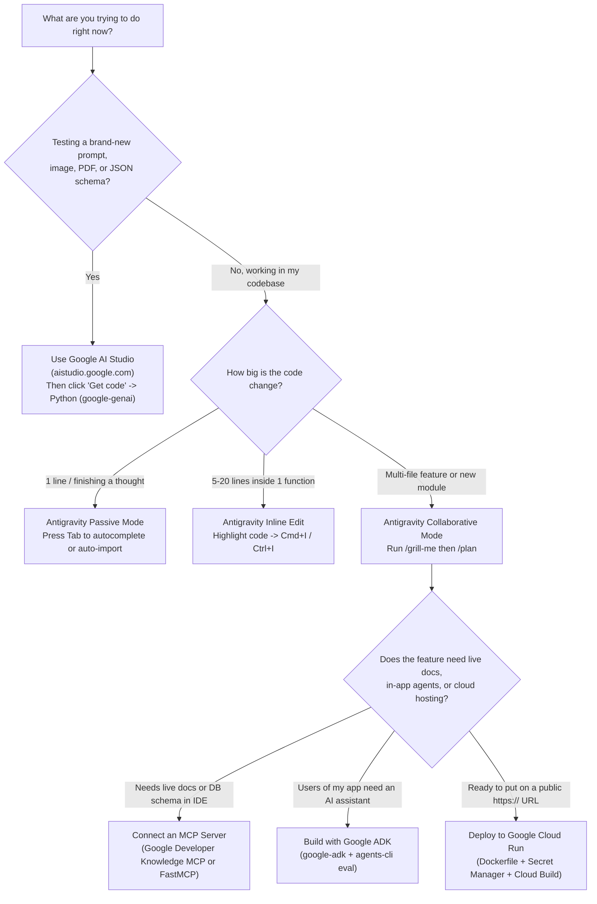

# Appendix: The AI Builder's Cheat Sheet, Tool Picker & Troubleshooting Guide

When you are deep in the middle of building an app, the last thing you want to do is hunt through ten chapters just to remember a `git` command, a `gcloud run` flag, or which Google tool to reach for.

Bookmark this page! It puts every essential command, decision rule, and 30-second bug fix from the book onto a single reference sheet.

---

## 1. Which Google AI & Cloud Tool Should I Reach For?

Whenever you start a new task or feature, follow this simple map:



### Quick Model Picker (`google-genai`)

| Model Name | Speed & Cost | Reach For It When... |
| :--- | :--- | :--- |
| **`gemini-3.1-flash-lite`** | Fastest & lowest cost | You are classifying text, tagging sentiment, routing tickets, or filtering thousands of items per minute. |
| **`gemini-3-flash-preview`** | Fast, affordable & smart *(Default!)* | You are extracting structured JSON (`response_schema`), summarizing notes, reading receipt photos, or running Google ADK tool-calling loops. |
| **`gemini-3.1-pro-preview`** | Deepest reasoning | You are debugging a tricky multi-file problem, designing complex architecture, or analyzing a huge document with subtle constraints. |
| **Local Gemma (via Ollama)** | Free (runs on your laptop) | You are testing offline on an airplane or processing local text that never leaves your laptop. |

---

## 2. The Everyday Command Cheat Sheet

### Python & Package Management (`uv`)
```bash
uv init my-new-app                       # Create a new Python project folder with pyproject.toml
uv venv --python 3.12                    # Create an isolated Python 3.12 virtual environment (.venv)
uv add google-genai pydantic fastapi     # Install libraries into this project's .venv
uv run python my_script.py               # Run a Python file using the project's .venv
uv run pytest                            # Run all automated tests (test_*.py)
uv run ruff check . --fix                # Lint and auto-fix common Python style issues
uv run ruff format .                     # Format all Python files cleanly in milliseconds
```

### Code Save Points (`git`)
```bash
git init                                 # Turn on Git save points in the current folder
git status                               # See which files were edited or created
git diff                                 # See exact line-by-line changes (+ added, - removed)
git add . && git commit -m "Message"     # Save a clean checkpoint before/after an AI edit
git checkout -- .                        # Undo all uncommitted changes back to your last save point
git checkout -b try-risky-idea           # Create a safe scratch branch to test an experiment
```

### Google Antigravity Shortcuts & Slash Commands
| Shortcut / Command | What It Does |
| :--- | :--- |
| **`Tab`** | Accept inline autocomplete ghost text, jump to the next edit location, or auto-import a symbol. |
| **`Cmd+I` / `Ctrl+I`** | Edit the highlighted block of code inline with a red/green diff preview. |
| **`@filename` / `@terminal`** | Attach a specific file or your latest terminal output directly to your chat prompt. |
| **`/grill-me`** | Have Antigravity ask you 3–5 clarifying questions to uncover edge cases *before* writing code. |
| **`/plan`** | Generate a step-by-step Implementation Plan artifact for your review before any files are changed. |
| **`/browser`** | Launch Chrome so Antigravity can click through your web UI, inspect the DOM, and check console logs. |
| **`/compact`** | Summarize a long conversation so your context window stays fast, sharp, and focused. |
| **`/learn`** | Save a rule or correction into your workspace customizations so you never have to repeat yourself. |
| **`/schedule`** | Create a recurring scheduled automation (e.g., a daily morning code health or PR review run). |

### Google ADK, `agents-cli`, Agent Registry & Google Cloud Run Commands
```bash
# 1. Install agents-cli and wire the 7 official agent skills into your workspace
uv tool install google-agents-cli
uvx google-agents-cli setup

# 2. Scaffold a prototype ADK agent with A2A & GEMINI.md guidance
agents-cli scaffold create my-agent --agent adk --prototype --agent-guidance-filename GEMINI.md

# 3. Run and visually debug your agent locally
uv run agents-cli run "Test prompt" --start-server
uv run agents-cli playground

# 4. Run the Quality Flywheel (eval, synthesize, analyze, optimize, compare)
uv run agents-cli eval run --config-path tests/eval/eval_config.yaml
uv run agents-cli eval dataset synthesize --num-scenarios 10 --output tests/eval/datasets/expanded.json
uv run agents-cli eval optimize --apply

# 5. Add deployment target (Vertex AI Agent Engine or Cloud Run) + Cloud Build CI/CD
agents-cli scaffold enhance . --deployment-target agent_runtime --cicd-runner google_cloud_build
agents-cli deploy
agents-cli publish gemini-enterprise

# 6. Provision Cloud Trace, GCS Prompt-Response Logging & BigQuery Agent Analytics
agents-cli infra single-project --project "$GOOGLE_CLOUD_PROJECT" --agent-name my-agent --bq-analytics --apply

# 7. Discover enterprise skills & agents in Google Cloud Agent Registry
gcloud alpha agent-registry skills list --project="$GOOGLE_CLOUD_PROJECT" --location="global"
gcloud alpha agent-registry agents list --project="$GOOGLE_CLOUD_PROJECT" --location="global"

# 8. Deploy a containerized Python FastAPI/HTMX app to Google Cloud Run with Secret Manager
printf "my-secret-value" | gcloud secrets create my-api-key --data-file=-
gcloud run deploy my-python-service \
    --source . \
    --region us-central1 \
    --set-secrets SERVICE_API_KEY=my-api-key:latest \
    --set-env-vars APP_ENV=production

# 9. Send 10% of live traffic to a new revision (Canary rollout)
gcloud run services update-traffic my-python-service --to-revisions LATEST=10
```

---

## 3. Top 10 Production & Security Rules to Live By

Whenever you review code—whether you wrote it by hand or generated it with AI—run down this 10-point checklist:

1. **No hardcoded secrets (and no hardcoded fallback secrets!)**: Never write `os.environ.get("API_KEY", "default-secret")`. Load from `.env` locally and Google Cloud Secret Manager in production, and fail closed if a production secret is missing.
2. **Use `google-genai`, never `google-generativeai`**: Always write `from google import genai`.
3. **Lock AI outputs with `Pydantic` (`response_schema`)**: Whenever your Python code reads Gemini's output, enforce `response_mime_type="application/json"` and `response_schema=YourPydanticModel`.
4. **Let Gemini read messy text, let Python do the math**: Always use `Decimal("0.00")` (never `float`) for money, and verify totals in plain Python.
5. **Parameterize every SQL query (`?`)**: Always write `cursor.execute("SELECT * FROM users WHERE email = ?", (email,))`. Never build SQL strings with `f"..."` or `+`.
6. **Escape every untrusted string in HTML (`html.escape`)**: Always call `html.escape(value, quote=True)` and quote every HTML attribute (`class="..."`). Never use `innerHTML` with user text.
7. **Include HTTP security headers**: Add `X-Content-Type-Options: nosniff`, `X-Frame-Options: DENY`, and a strict `Content-Security-Policy` to your FastAPI responses.
8. **Bind local test servers to `127.0.0.1`**: Only bind to `0.0.0.0` inside a production Docker container (`PORT=8080`).
9. **Verify new packages before installing**: Make sure every package suggested by AI actually exists on PyPI, isn't a typosquat ("slopsquatting"), and has no known advisories on **OSV.dev**.
10. **Run your automated tests on every change**: Run `uv run python run_all_labs.py` (or `uv run pytest`) locally and in `cloudbuild.yaml` before deploying.

---

## 4. Troubleshooting: Top 8 Errors & 30-Second Fixes

| Error Message | What Caused It | How to Fix It in 30 Seconds |
| :--- | :--- | :--- |
| `ValidationError: ... Input should be a valid decimal` | Invalid user input or unexpected JSON field reached your Pydantic model. | Check the exact field name listed in the `ValidationError` message—your Pydantic guard did its job and caught bad data early! |
| `sqlite3.OperationalError: attempt to write a readonly database` | A tool (like our Chapter 6 MCP server) opened SQLite with `?mode=ro` and tried to `INSERT`, `UPDATE`, or `DELETE`. | Keep inspection/MCP tools strictly `SELECT`-only, and perform writes through your validated service layer. |
| `409 Conflict: Workshop is already at full capacity` | All seats in the workshop were taken, or the same email tried to register twice. | Expected guardrail behavior! Check `seats_remaining` before booking or test with a new workshop ID. |
| `401 Unauthorized` or `429 Too Many Requests` on Lab 09 endpoints | Missing/incorrect `X-API-Key` header (`401`), or you sent more requests per second than the token-bucket rate limiter allows (`429`). | Pass the valid `X-API-Key` header and wait for the rate-limit bucket window to refill (or use a separate client key in tests). |
| `429 RESOURCE_EXHAUSTED` from the Gemini API | You hit the free-tier requests-per-minute limit on `gemini-3.1-pro-preview`. | Switch everyday calls to `gemini-3-flash-preview` or `gemini-3.1-flash-lite`, enable Context Caching, or add exponential backoff with `tenacity`. |
| `ModuleNotFoundError` when running `python my_file.py` | You ran global system `python` instead of the project's virtual environment. | Run `uv run python my_file.py` so Python uses your `.venv` packages. |
| Browser blocks inline scripts or external styles | Your `Content-Security-Policy` header is set to `default-src 'self'` (which blocks unapproved external scripts). | Either serve static scripts from `'self'` or explicitly allow the specific trusted origin/nonce in your CSP header. |
| Cloud Run deploy fails with `Container failed to start and listen on port 8080` | Your `Dockerfile` `CMD` bound to `127.0.0.1` or the wrong port number. | Set `CMD ["uvicorn", "production_app:app", "--host", "0.0.0.0", "--port", "8080"]` in your `Dockerfile`. |

---

**Navigation**: [← Previous: Chapter 10 — Automating Your Workflow & Controlling Costs](./ch10-automating-with-antigravity-sdk.md) | [🏠 Back to Book Index](../README.md)
