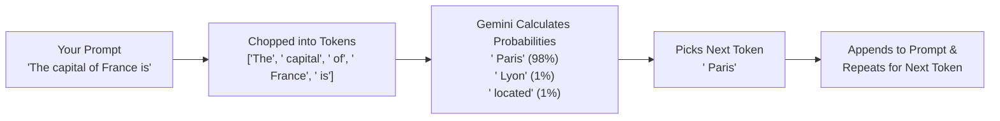

# Chapter 1: How Gemini Actually Works (and Your First Steps in Google AI Studio)

If you have spent any time building apps or scripts with AI over the last few months, you already know the magic moment: you type a few sentences describing what you want, hit Enter, and thirty seconds later you have working Python code.

You probably also know the frustrating moment that comes right after.

You run the exact same prompt a second time—maybe on a slightly different input, or maybe just to see what happens—and the AI gives you a completely different answer. Sometimes it adds conversational filler like *"Sure! Here is your data:"* right in the middle of output that your Python script was trying to read. Other times, it invents a Python function that looks totally believable, except it doesn't actually exist.

When I talk to developers and builders who are getting started with AI, this is the #1 question that comes up: *"Why doesn't the AI give me the same clean result every time, and how do I build something reliable on top of it?"*

In this first chapter, we are going to lift the hood on how **Google Gemini** actually works—in plain English, without any math or buzzwords. Then we'll open **Google AI Studio**, tour every knob on the screen from scratch, and build our very first Python script using the `google-genai` SDK that extracts structured receipt data cleanly every single time.

---

## 1. What We're Building & Why It Matters

Imagine you're building a small tool to track expenses for a coffee shop run or a team lunch. You have messy text notes or photos of receipts like this:

```text
Sunrise Cafe - Seattle WA
Date: 2026-05-14
2x Oat Milk Latte @ $5.50 each
1x Blueberry Muffin $4.25
1x Avocado Toast $9.75
Tax: $2.50
Total Paid: $27.50 (Visa)
```

If you paste that note into a regular chat prompt and ask, *"Pull out the items and the total,"* you might get a bulleted list today, a markdown table tomorrow, and a paragraph on Friday. You can't feed a random paragraph into a database or a spreadsheet without your Python code breaking.

By the end of this chapter, we will build a Python tool (`labs/lab01-ai-studio-basics/receipt_extractor.py`) that takes any messy receipt note (or photo), sends it to Gemini using **System Instructions**, low **Temperature**, and **Structured Outputs**, and guarantees that the result comes back matching a strict Python `Pydantic` data blueprint—complete with a sanity check that verifies whether the line items and tax actually add up to the printed total.

---

## 2. The Concept from Scratch: How Gemini Thinks (and Python Basics)

Before we touch a single line of code, let's talk about what happens inside Gemini when you send it a prompt.

### Gemini Is a Next-Piece-of-Word Predictor, Not a Calculator

When you send a sentence to Gemini, it doesn't read whole English words the way you and I do. First, it chops your text into small chunks called **tokens**. A token might be a whole short word like `"cat"`, part of a longer word like `"ing"`, or a single punctuation mark. As a rough rule of thumb, **100 tokens is about 75 English words**.

Once your prompt is chopped into tokens, Gemini does one job over and over again: **given all the tokens so far, it calculates a probability score for what the very next token should be.**



That simple loop explains almost every quirky behavior you've ever seen from an AI:

1. **Why running the same prompt twice can give different code**: When picking the next token, Gemini doesn't always pick the #1 highest-scoring token every single time—otherwise its writing would sound robotic and repetitive. By default, it rolls a weighted die among the top candidates.
2. **Why AI sometimes invents fake function names ("hallucinations")**: If a function name like `client.generate_clean_json()` *sounds* like it belongs after `from google import genai`, it gets a high probability score—even if no human ever wrote that function in the real library.
3. **Why AI can make silly arithmetic mistakes on raw text**: Gemini is predicting what number *looks right* next in a sentence, not running a hardware calculator chip—unless we give it code or check its math in Python (which we'll do in our lab!).

### The Four Knobs That Control Gemini

Every time you talk to Gemini—whether in Google AI Studio or from Python—there are four settings you control:

| Setting | What It Means in Plain English | How We Use It |
| :--- | :--- | :--- |
| **Context Window** | Gemini's "working desk." Everything you want Gemini to know right now—your instructions, your examples, the user's question, and Gemini's reply—has to fit on this desk at the same time. Gemini models have a huge desk (1 million+ tokens), but a cluttered desk still makes it harder to focus. | Keep prompts clear and focused; start a fresh chat when switching tasks. |
| **System Instructions** | The permanent "job description" pinned to the top of Gemini's desk. Unlike a normal chat message, Gemini treats System Instructions as the ground rules for how it should behave, what role it plays, and what rules it must never break. | Put your formatting rules, tone, and safety rules here. |
| **Temperature** | The "creativity dial" (usually from `0.0` to `2.0`). At a high temperature (`1.0+`), Gemini takes more chances when picking the next token—great for brainstorming story ideas or names. At a low temperature (`0.0` to `0.2`), Gemini sticks to the most likely, predictable tokens. | Use **`0.0` or `0.1`** when extracting data or generating code where you want consistency. |
| **Structured Outputs (`response_schema`)** | Instead of letting Gemini reply with free-form English text, you hand Gemini a strict blueprint (a schema) and say: *"You are only allowed to pick tokens that form valid JSON matching these exact field names and types."* | Use this whenever your Python code needs to read Gemini's output! |

### Python 101: The 4 Building Blocks You Need to Read AI Code

If you are brand new to Python and have mostly been letting AI write scripts for you, here are the four Python building blocks you'll see in almost every file we build:

1. **Variables (Labeled Boxes)**:
   ```python
   merchant_name = "Sunrise Cafe"   # Text (called a string, or str)
   item_count = 3                   # Whole number (called an int)
   total_paid = 27.50               # Decimal number (float / Decimal)
   ```
2. **Dictionaries (`dict`) and JSON (Key-Value Pairs)**:
   Think of a Python dictionary like a contact card where every label (key) has a value. JSON is simply the text version of a dictionary that web APIs and AI models use to send data back and forth:
   ```python
   receipt_item = {
       "name": "Oat Milk Latte",
       "quantity": 2,
       "unit_price": 5.50
   }
   ```
3. **Lists (`list`)**:
   An ordered row of items inside square brackets `[...]`:
   ```python
   items = ["Oat Milk Latte", "Blueberry Muffin", "Avocado Toast"]
   ```
4. **Functions (`def`)**:
   A reusable mini-recipe that takes inputs (Inside parentheses), does some work, and hands back a result using `return`:
   ```python
   def calculate_line_total(quantity: int, unit_price: float) -> float:
       return quantity * unit_price
   ```
   Notice those `: int` and `-> float` labels? Those are called **type hints**. They tell both you and your AI coding assistant what kind of data goes in and what comes out. We'll dive even deeper into type hints in Chapter 3.

---

## 3. The Google Tool from Scratch: Google AI Studio 101

Whenever you have a new idea for an AI feature, **don't start by writing Python code.** Start in **Google AI Studio** (`https://aistudio.google.com`).

Why? Because Google AI Studio is a free, browser-based workbench where you can test prompts, swap Gemini models with one click, upload images or PDFs, design Structured Output schemas visually, and—once your prompt works the way you want—click **"Get code"** to export the exact Python snippet.

### Step-by-Step Tour of Google AI Studio

1. **Open Google AI Studio**: Go to [https://aistudio.google.com](https://aistudio.google.com) and sign in with your Google account.
2. **Create a New Prompt**: Click **Create Prompt** in the left navigation bar. You'll see three main areas on your screen:
   - **Top Toolbar (`System Instructions`)**: Click the **System Instructions** box at the top and type the job description for your model, for example:
     > *"You are a careful bookkeeping assistant. Extract receipt details accurately. Never guess or invent items that are not listed on the receipt."*
   - **Center Chat Area**: Where you type your test prompt—and where you can click the **`+` button** to drop in an image (like a photo of a crumpled coffee receipt), an audio clip, a video, or a PDF! Because Gemini was built from the ground up to understand text, images, audio, and video together (what engineers call *multimodal*), you don't need a separate OCR plugin just to read a photo of a receipt.
   - **Right-Hand Run Settings Panel**:
     - **Model Selector**: Which Gemini 3 model should you pick? Here is a simple rule of thumb:
       - **`gemini-3.1-flash-lite`**: Fastest and lowest cost. Great for quick classification, tagging, or high-volume simple tasks.
       - **`gemini-3-flash-preview`** *(Our default choice!)*: The sweet spot of frontier intelligence, speed, and low cost. Use this for 80–90% of your everyday app features, receipt extraction, and agentic tool use.
       - **`gemini-3.1-pro-preview`**: The deep thinker. Use this for complex coding problems, tricky multi-step math/logic, or analyzing huge documents.
     - **Temperature Slider**: Drag it down to **`0.1`** (or `0.0`) so our receipt extractor gives consistent results.
     - **Structured Outputs Toggle**: Turn on **Structured outputs** and click **Edit**. Here you can define the exact JSON fields you want back (`merchant_name`, `date`, `items`, `tax`, `total`).
3. **Click "Get code"**: In the top-right corner, click **Get code** -> choose **Python**. You will see clean Python code using the official `google-genai` SDK!

> [!IMPORTANT]
> **Always use the new `google-genai` library!**
> Older blog posts from 2023–2024 sometimes import `google.generativeai`. Google has replaced that older library with the unified **`google-genai`** SDK (`from google import genai`). Whenever you write Python code—or tell an AI coding assistant to write code for you—make sure it uses `from google import genai`.

---

## 4. Hands-On Python Lab: Building the Receipt & Note Extractor

Let's look at the complete, runnable lab in [`labs/lab01-ai-studio-basics/`](../labs/lab01-ai-studio-basics/).

Instead of just hoping Gemini's math is right, we are going to do something that separates reliable AI apps from fragile demos:
1. We'll define a strict **Pydantic** blueprint (`ReceiptExtraction`) and pass it to Gemini's `response_schema` so Gemini **must** reply with matching JSON.
2. Once Gemini extracts the numbers, we'll use **plain Python** (`verify_receipt_math`) to check whether the sum of the items plus tax actually equals the printed total!

> [!TIP]
> **Why let Gemini extract the text, and let Python check the math?**
> Because Gemini is awesome at reading messy human text ("2x Oat Milk Latte @ \$5.50 each"), and Python is 100% exact at arithmetic (`2 * 5.50 = 11.00`). Combining the two gives you the best of both worlds!

### Step 1: Inspect the Blueprint and Extractor (`receipt_extractor.py`)

Open [`labs/lab01-ai-studio-basics/receipt_extractor.py`](../labs/lab01-ai-studio-basics/receipt_extractor.py). Here is how it works step by step:

```python
from decimal import Decimal
from pydantic import BaseModel, Field

class ReceiptLineItem(BaseModel):
    """A single item purchased on a receipt."""
    name: str = Field(description="Name of the item purchased")
    quantity: int = Field(ge=1, description="Quantity purchased (must be at least 1)")
    unit_price: Decimal = Field(ge=Decimal("0.00"), description="Price for a single unit")

    @property
    def line_total(self) -> Decimal:
        return self.unit_price * Decimal(self.quantity)


class ReceiptExtraction(BaseModel):
    """Structured receipt data returned by Gemini."""
    merchant_name: str = Field(description="Name of the store, restaurant, or vendor")
    receipt_date: str = Field(description="Date on the receipt in YYYY-MM-DD format")
    items: list[ReceiptLineItem] = Field(description="Line items listed on the receipt")
    tax: Decimal = Field(ge=Decimal("0.00"), description="Tax amount on the receipt")
    total_paid: Decimal = Field(ge=Decimal("0.00"), description="Final total printed on the receipt")
    payment_method: str = Field(default="Unknown", description="Payment method such as Visa, Cash, etc.")
```

Notice how readable that is! Even if you've never used `Pydantic` before (we'll cover it in detail in Chapter 3), you can see right away what it does:
- Every field has a clear name and type (`str`, `int`, `Decimal`, `list[ReceiptLineItem]`).
- Each `Field(...)` has a plain-English `description`. **Gemini actually reads these field descriptions** when filling out your Structured Output!

Next, let's look at how we call Gemini with `google-genai` inside `extract_receipt_from_text()`:

```python
from google import genai
from google.genai import types

client = genai.Client(api_key=api_key)
response = client.models.generate_content(
    model="gemini-3-flash-preview",
    contents=raw_receipt_text,
    config=types.GenerateContentConfig(
        system_instruction=SYSTEM_INSTRUCTION,
        temperature=0.1,
        response_mime_type="application/json",
        response_schema=ReceiptExtraction,
    ),
)
return ReceiptExtraction.model_validate_json(response.text)
```

Look at the four lines inside `types.GenerateContentConfig(...)`:
- `system_instruction=SYSTEM_INSTRUCTION`: Pins our bookkeeping rules to the top of Gemini's context window.
- `temperature=0.1`: Turns down randomness so the extraction is steady and repeatable.
- `response_mime_type="application/json"` and `response_schema=ReceiptExtraction`: Locks Gemini into returning valid JSON that matches our `ReceiptExtraction` class.

And what if you want to run and test the lab right now before you've even created a `GEMINI_API_KEY`? We built a clean local offline parser fallback into `extract_receipt_from_text()` so you can run the script and its automated tests immediately on your laptop, and then plug in your real `GEMINI_API_KEY` from Google AI Studio whenever you're ready.

### Step 2: Sending Receipt Photos & PDFs from Python (`build_multimodal_receipt_part`)

What if your user doesn't have typed text—what if they snap a photo of a paper receipt with their phone or upload a PDF invoice?

In `receipt_extractor.py`, look at how `build_multimodal_receipt_part()` prepares an image or PDF for Gemini:

```python
def build_multimodal_receipt_part(image_path: str | Path, mime_type: str = "image/jpeg") -> types.Part:
    """Create a `google-genai` multimodal Part from a local receipt photo safely."""
    resolved = Path(image_path).resolve()
    if not resolved.is_file():
        raise FileNotFoundError(f"Receipt image not found: {resolved.name}")

    max_bytes = 5 * 1024 * 1024
    file_size = resolved.stat().st_size
    if file_size > max_bytes:
        raise ValueError(f"Receipt image exceeds 5 MB limit ({file_size} bytes).")

    allowed_mimes = {"image/jpeg", "image/png", "image/webp", "application/pdf"}
    if mime_type not in allowed_mimes:
        raise ValueError(f"Unsupported mime_type '{mime_type}'. Allowed: {sorted(allowed_mimes)}")

    return types.Part.from_bytes(data=resolved.read_bytes(), mime_type=mime_type)
```

Notice two important habits we build right from Day 1:
1. **Check the file size first (`max_bytes = 5 * 1024 * 1024`)**: Never let a user accidentally (or maliciously) upload a 2 GB video file when your app expects a receipt photo.
2. **Check an explicit allow-list of file types (`allowed_mimes`)**: Only allow `image/jpeg`, `image/png`, `image/webp`, or `application/pdf`. Once verified, `types.Part.from_bytes(...)` wraps the file bytes so you can pass `[image_part, "Extract this receipt"]` straight into `contents=`!

### Step 3: Controlling Gemini 3's Thinking Level (`ThinkingConfig` & `ThinkingLevel`)

One of the best features of the **Gemini 3** model family (`gemini-3-flash-preview` and `gemini-3.1-pro-preview`) is **dynamic thinking**: the model can reason step-by-step internally before writing its final answer.

In Google AI Studio (and in Python with `google-genai`), you can control how deeply Gemini 3 thinks before responding using `thinking_level` (`MINIMAL`, `LOW`, `MEDIUM`, or `HIGH`):

```python
config = types.GenerateContentConfig(
    system_instruction=SYSTEM_INSTRUCTION,
    temperature=0.1,
    response_mime_type="application/json",
    response_schema=ReceiptExtraction,
    # Use LOW or MINIMAL for fast, simple extraction, or HIGH for complex multi-step logic!
    thinking_config=types.ThinkingConfig(
        thinking_level=types.ThinkingLevel.LOW,
    ),
)
```

- **When to set `ThinkingLevel.MINIMAL` or `ThinkingLevel.LOW`**: When you want the fastest possible response time and lowest token usage on straightforward extraction or classification tasks.
- **When to set `ThinkingLevel.MEDIUM` or `ThinkingLevel.HIGH`**: When the receipt or document is messy, has split discounts applied across items, or requires multi-step logic before filling out the JSON fields.

### Step 4: Run the Script and Tests

From the root of the repository, run the extractor script:

```bash
uv run python labs/lab01-ai-studio-basics/receipt_extractor.py
```

Then run the automated test suite to verify that both the extraction and the math verification check work as expected:

```bash
uv run python labs/lab01-ai-studio-basics/test_receipt_extractor.py
```

### Common Gotchas in AI Studio & `google-genai` (and How to Fix Them)

| Symptom / Error | Why It Happens | The 30-Second Fix |
| :--- | :--- | :--- |
| `ModuleNotFoundError: No module named 'google.generativeai'` (or deprecation warnings) | An AI assistant generated code using the old 2023 library. | Always install `google-genai` and write `from google import genai`. |
| `json.decoder.JSONDecodeError` when parsing Gemini's reply | You asked for JSON in English (*"Please return JSON"*), and Gemini wrapped it in ```` ```json ... ``` ```` markdown backticks. | Set `response_mime_type="application/json"` and `response_schema=YourPydanticModel` in `GenerateContentConfig`. |
| Receipt items add up to `$25.00`, tax is `$2.50`, but Gemini says `total_paid` is `$26.50` | Either the printed receipt had a typo, or the photo was blurry and the model misread a digit. | Always run a deterministic Python check like `verify_receipt_math(receipt)` and check `report.is_math_consistent` before saving financial data! |
| `400 INVALID_ARGUMENT: API key not valid` | Your `.env` file still has the placeholder `your_gemini_api_key_here` or an extra space around the key. | Copy a fresh key from [https://aistudio.google.com/apikey](https://aistudio.google.com/apikey) into `.env` with no quotes or spaces. |

---

## 5. Wrapping Up & What's Next

Let's pause and look at what we accomplished in Chapter 1:
- We learned how **Gemini** predicts tokens, why default prompts can vary from run to run, and how **System Instructions**, **Temperature**, **Thinking Config**, and **Structured Outputs** make Gemini predictable.
- We toured **Google AI Studio**, learned when to choose **Gemini Flash-Lite**, **Gemini Flash**, or **Gemini Pro**, and saw how to turn a prompt into Python code using the unified **`google-genai`** SDK.
- We combined Gemini's text extraction with a deterministic Python math check (`verify_receipt_math`) so our app catches receipt calculation errors automatically.

In **Chapter 2**, we are going to move out of the browser and set up a real, rock-solid local coding workspace from scratch—learning the 5 terminal commands you actually need, keeping API keys safe in `.env` files, managing Python projects with **`uv`**, creating code save points with **Git**, and touring **Google Antigravity** (IDE, 2.0 App, and `agy` CLI).

---

**Navigation**: [🏠 Book Index](../README.md) | [Next: Chapter 2 — Setting Up Your Coding Setup From Scratch →](./ch02-setting-up-your-coding-setup.md)
