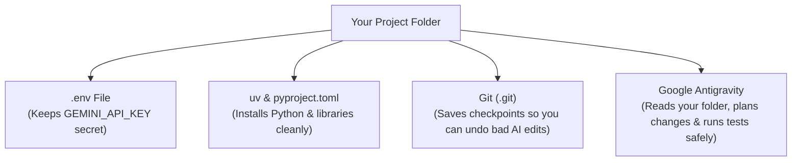

# Chapter 2: Setting Up Your Coding Setup From Scratch — Terminal, `uv`, Git, and Google Antigravity

In Chapter 1, we designed a prompt in Google AI Studio, clicked **Get code**, and ran our first Python script.

If you've built a few small scripts that way, you know what happens next. You want to add a second feature, then a third. Pretty soon you have five browser tabs open, you're copy-pasting code back and forth into `script_final_v3_working.py`, and then—disaster strikes. You ask the AI to "clean up the code," paste in the new version, run it, and your app crashes. Even worse, you can't remember what the working code looked like ten minutes ago!

Don't feel bad if you've done that (`script_v2_really_final.py` is a rite of passage for almost everyone). The good news is that software engineers solved this exact problem years ago with three simple habits—and when you combine those habits with **Google Antigravity**, coding with AI goes from stressful to calm and predictable.

In this chapter, we are going to set up your local coding workspace from scratch. We'll cover the 5 terminal commands you actually need, how `.env` files keep your API keys safe, why **`uv`** makes Python setup painless, how **Git** gives you an "Undo button" for your entire project, and how to use **Google Antigravity** (the IDE, the Antigravity 2.0 app, and the `agy` CLI).

---

## 1. What We're Building & Why It Matters

By the end of this chapter, we will build a command-line **Study Flashcard & Quiz App** (`labs/lab02-antigravity-setup/flashcard_quiz.py`) that:
1. Takes any study topic or messy lecture notes and asks **Gemini** (`google-genai`) to generate structured study flashcards (question, answer, hint, and difficulty level).
2. Saves and loads flashcard decks safely on disk as JSON so you don't pay API tokens to regenerate the same deck twice.
3. Grades your quiz answers and tracks your study score.

More importantly, we'll build it using the exact workflow you'll use for the rest of this book: a clean `uv` project, a `.env` file for secrets, Git save points before and after AI edits, and Google Antigravity's `/plan` mode.

---

## 2. The Concept from Scratch: Terminal, `.env`, `uv`, and Git 101

Let's demystify the four tools every Python builder uses on their laptop.



### 1. The Terminal (5 Commands You Actually Need)

When people talk about "opening the terminal" (or command line), all they mean is talking to your computer's folders using text instead of clicking icons in Finder or File Explorer. You only need five commands for 95% of your daily work:

```bash
pwd                  # "Print Working Directory" — Where am I right now?
ls -la               # "List" — Show me all files in this folder (including hidden files like .env)
mkdir my-app         # "Make Directory" — Create a new folder called my-app
cd my-app            # "Change Directory" — Step inside the my-app folder (use 'cd ..' to step back out)
cat pyproject.toml   # Print the contents of a text file right in the terminal
```

### 2. Keeping Secrets Out of Your Code with `.env` Files

When you get a `GEMINI_API_KEY` from Google AI Studio, it can be tempting to paste it right into your Python file:

```python
# DO NOT DO THIS!
api_key = "AIzaSyYourSecretKey..."
```

Why is that dangerous? Because the moment you share your code, upload it to GitHub, or paste it into a forum, strangers (and automated bots that scan GitHub every second) can steal your key and run up charges on your account.

Instead, we store secrets in a hidden file named **`.env`** inside your project folder:

```ini
GEMINI_API_KEY=AIzaSyYourSecretKeyHere
```

And in Python, we read it using `os.environ.get("GEMINI_API_KEY")` (with the `python-dotenv` library loading `.env` automatically). That way, your Python code never contains the secret itself!

### 3. Python Projects Made Easy with `uv`

If you have ever tried to install a Python library using `pip install something` and gotten a scary screen about "externally managed environments" or broken permissions, here is why: your operating system uses Python for its own internal chores, and installing packages globally mixes all your projects into one big drawer. If Project A needs version 1.0 of a library and Project B needs version 2.0, one of them breaks.

**`uv`** fixes this completely. When you use `uv`, it creates a private folder called **`.venv`** (short for *virtual environment*) right inside your project, plus a clean shopping list file called **`pyproject.toml`**.

Here are the only `uv` commands you need:

```bash
uv init my-flashcard-app      # Create a clean new Python project folder
cd my-flashcard-app
uv add google-genai pydantic python-dotenv   # Install libraries into this project's private .venv
uv run python flashcard_quiz.py              # Run your script using the project's private Python!
```

> [!TIP]
> **One Golden Rule**: Always run your scripts and tests with **`uv run python ...`** (or `uv run pytest`). Never run `pip install` globally again!

### 4. Git 101: Save Points for Your Code

Think of **Git** like save points in a video game. Before you walk into a boss fight—or before you ask an AI to refactor 200 lines of code—you save your game. If the AI nails it, you save a new checkpoint. If the AI breaks everything, you reload your last checkpoint in one second.

Here is the 4-step Git loop:

```bash
# 1. Turn on Git in your project folder (you only do this once per project)
git init

# 2. Check which files you or the AI have changed since your last save point
git status
git diff

# 3. Save a checkpoint ("commit") when your code is working!
git add .
git commit -m "Working flashcard generator and quiz scorer"

# 4. Did the AI just break your working code? Undo all uncommitted edits back to your last save point:
git checkout -- .
```

> [!IMPORTANT]
> **Always check `.gitignore` before your first `git add .`!**
> A `.gitignore` file is a simple list of files that Git should *never* save or upload—most importantly your **`.env`** file (where your API keys live) and your **`.venv/`** folder.

---

## 3. The Google Tool from Scratch: Google Antigravity 101

While Google AI Studio is where we test single prompts in the browser, **Google Antigravity** is your AI pair programmer that lives right inside your project folder.

Antigravity comes in three surfaces that work together:
1. **Antigravity IDE**: A full code editor (built on familiar VS Code foundations) where you can edit files side by side with the AI.
2. **Antigravity 2.0 (Desktop App)**: An agent-first workspace where you can manage conversations, multi-file tasks, browser testing, and scheduled automations from a clean chat canvas.
3. **Antigravity CLI (`agy`)**: A command-line tool you can launch straight from your terminal (`agy chat` or `agy .`).

### Choosing the Right Antigravity Mode for the Job

One of the biggest mistakes beginners make is using a giant chat prompt for a two-word fix—or trying to use autocomplete to build a whole application. In Antigravity, you have three speeds:

| Mode | How to Trigger It | When to Use It |
| :--- | :--- | :--- |
| **1. Passive (`Tab` Autocomplete)** | Just type in the editor and press **`Tab`** to accept ghost text (or `Tab` to jump to the next logical edit spot / auto-import a missing library). | Finishing a single line of code, filling in repetitive dictionary keys, or adding a quick `import`. |
| **2. Instructive (`Cmd+I` / `Ctrl+I` Inline Edit)** | Highlight 5–20 lines of code in a file, press **`Cmd+I`** (Mac) or **`Ctrl+I`** (Windows/Linux), and type a short instruction like *"Add a check for empty strings."* | Changing a single function or fixing a small bug without leaving your file. Antigravity shows you green (added) and red (removed) lines so you can click **Accept** or **Reject**. |
| **3. Collaborative (Agent Mode & `/plan`)** | Open the Chat panel (or Antigravity 2.0) and type **`/plan`** followed by your feature goal. | Building a new feature across multiple files, creating a project from scratch, or running tests. |

### Why `/plan` Mode Is a Superpower for AI Builders

When you type `/plan Build a study flashcard generator and quiz CLI with tests`, Antigravity doesn't immediately start overwriting your files. Instead, it writes out a clear **Implementation Plan** artifact showing:
- Which files it plans to create or change,
- What data models it will use, and
- How it will test the changes.

You can read the plan in plain English, leave a comment if you want something changed, and click **Proceed** only when you're happy with the approach.

### How the Antigravity Terminal Sandbox Keeps Your Laptop Safe

When Antigravity runs a terminal command like `uv run python test_flashcard_quiz.py` on your behalf, it runs inside a built-in **Terminal Sandbox**:
- By default, the sandbox allows reading and writing **only inside your current project workspace** (plus temporary folders like `/tmp`), and blocks unauthorized background network calls or changes to personal folders outside your project.
- If a command ever needs to do something outside the sandbox, Antigravity pauses and asks for your explicit permission first.

---

## 4. Hands-On Python Lab: Building the Study Flashcard & Quiz App

Let's walk through the code in [`labs/lab02-antigravity-setup/`](../labs/lab02-antigravity-setup/).

We want a tool where a learner can feed in study notes (or a topic like `"Python & Git Basics"`), generate a deck of flashcards with Gemini, save the deck safely to a local JSON file, and run an interactive or automated quiz that checks their answers.

### Step 1: Data Models for Flashcards and Quiz Results (`flashcard_quiz.py`)

Open [`labs/lab02-antigravity-setup/flashcard_quiz.py`](../labs/lab02-antigravity-setup/flashcard_quiz.py). First, we define our flashcard structure using `Pydantic`:

```python
class Flashcard(BaseModel):
    """A single study flashcard."""
    question: str = Field(min_length=3, description="Clear study question")
    answer: str = Field(min_length=1, description="Concise, accurate answer")
    hint: str = Field(default="", description="Helpful hint without giving away the full answer")
    difficulty: Literal["easy", "medium", "hard"] = Field(default="medium")


class FlashcardDeck(BaseModel):
    """A collection of flashcards on a specific study topic."""
    topic: str = Field(min_length=1, description="Title of the study topic")
    cards: list[Flashcard] = Field(min_length=1, description="List of study flashcards")
```

Notice `Literal["easy", "medium", "hard"]`! That tells both Python and Gemini that `difficulty` can *only* be one of those three exact strings—never `"super hard"` or `"level 4"`.

### Step 2: Safe File Saving (Preventing Path Traversal)

When saving a flashcard deck to a `.json` file on disk, we also include a simple security check inside `save_deck_to_file()` and `load_deck_from_file()`:

```python
def _resolve_safe_deck_path(filename: str, base_dir: Path) -> Path:
    """Ensure the deck filename stays strictly inside base_dir (no '../' path traversal)."""
    clean_name = Path(filename).name
    if not clean_name.endswith(".json"):
        clean_name = f"{clean_name}.json"
    resolved_base = base_dir.resolve()
    resolved_target = (resolved_base / clean_name).resolve()
    if resolved_target.parent != resolved_base:
        raise ValueError("Invalid deck filename path.")
    return resolved_target
```

Why do we do `Path(filename).name` and check `resolved_target.parent != resolved_base`? Because if a user ever typed `../../something_important` as a deck name, stripping the path down to its base filename ensures our program only ever reads and writes inside our designated deck directory!

### Step 3: A Real-World Git Rescue (Reading `git diff` and Using Branches)

Before we finish our lab, let's practice the exact Git rescue you will use dozens of times when coding with AI.

Suppose your `flashcard_quiz.py` script is working and all tests pass. First, you save a checkpoint:

```bash
git add .
git commit -m "Working flashcard generator and quiz grader"
```

Five minutes later, you ask an AI assistant to *"make the quiz grader stricter,"* and suddenly your tests start failing. Instead of guessing what changed, run:

```bash
git diff
```

Git will show you the exact lines removed (`-` in red) and added (`+` in green):

```diff
 def normalize_answer(text: str) -> str:
-    return " ".join(text.strip().lower().split())
+    return text.strip()
```

Aha! You can see in two seconds that the AI removed `.lower()`, breaking case-insensitive grading. And what if you want to try a big, risky experiment without touching your working `main` branch at all? Create a temporary **Git branch**:

```bash
# Create and switch to a scratch branch called 'experiment-timed-quiz'
git checkout -b experiment-timed-quiz

# If the experiment works great, merge it back into main!
# If it turns into a mess, switch back to main and delete the scratch branch:
git checkout main
git branch -D experiment-timed-quiz
```

### Step 4: Giving Antigravity Pinpoint Context (`@` Mentions & Slash Commands)

When chatting with Google Antigravity, you don't have to copy-paste code or error messages into the chat box. Use **`@` mentions** and **`/` slash commands**:

- **`@flashcard_quiz.py`**: Attaches a specific file directly to your prompt so Antigravity looks right at the code you mean.
- **`@terminal`**: Attaches the recent output from your terminal (super handy when a test fails and you want to say, *"@terminal Why did this test fail?"*).
- **`/plan`**: Asks Antigravity to write a step-by-step implementation plan and wait for your approval before editing files.
- **`/grill-me`**: Asks Antigravity to interview you with 3–4 quick questions to clarify edge cases before building a feature (we'll use this in Chapter 3!).
- **`/compact`**: Summarizes a long conversation so your context window stays fast and focused.
- **`/learn`**: Tells Antigravity to remember a correction or project setup rule for future tasks.

### Step 5: Run the Lab and Its Automated Tests

From the root of the repository, run the flashcard & quiz demo:

```bash
uv run python labs/lab02-antigravity-setup/flashcard_quiz.py
```

Then run the automated test suite:

```bash
uv run python labs/lab02-antigravity-setup/test_flashcard_quiz.py
```

---

## 5. Wrapping Up & What's Next

Congratulations—you have completed **Part 1** of the book! Let's recap what you now have in your toolkit:
- You know how to navigate the **Terminal**, protect your `GEMINI_API_KEY` in a **`.env`** file, manage dependencies cleanly with **`uv`**, and create **Git** save points and branches before and after AI edits.
- You know when to use **Google AI Studio** vs. **Google Antigravity**, and when to reach for **`Tab`**, **`Cmd+I`**, **`/plan`**, or **`@` mentions**.
- You built and tested a working **Study Flashcard & Quiz App** powered by Gemini.

In **Part 2 (Chapters 3–5)**, we're going to level up how we write and organize Python code—starting in **Chapter 3** with catching sneaky data and money-rounding bugs automatically using **Pydantic**, **pytest**, and property-based edge case testing.

---

**Navigation**: [← Previous: Chapter 1 — How Gemini Actually Works](./ch01-how-gemini-works-ai-studio.md) | [🏠 Book Index](../README.md) | [Next: Chapter 3 — Stopping Bad Data and Catching Bugs Automatically →](./ch03-stopping-bad-data-and-testing.md)
