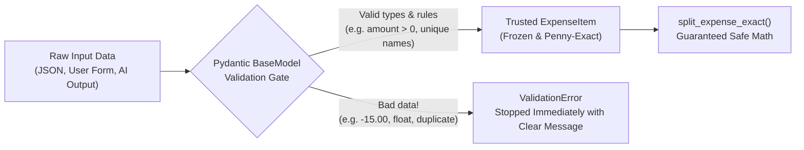

# Chapter 3: Stopping Bad Data and Catching Bugs Automatically (`Pydantic` & `pytest` 101)

If you have been building Python apps with AI recently, you know how magical the first five minutes feel. You type a quick prompt—*"Write me a script to split our weekend trip expenses among friends"*—and ten seconds later you have working Python code. You try it with a `$60` pizza split between three people, see `$20.00` each, and think, *"Done! Let's ship it."*

Then real life happens.

One friend enters a `$100.00` grocery receipt split three ways, and the app says everyone owes `$33.333333333333336`—losing a penny when rounded. Another friend accidentally types `-25.00` for gas, and your app cheerfully tells the group to pay them back negative money. Someone else leaves a name blank (`"   "`) or lists `"Liam"` twice on the same receipt, and the whole settlement calculation quietly produces nonsense.

Let's pause here and see what just happened. When we prompt an AI to write a quick script, it naturally writes code for the **sunny day**—the moment when every input is clean, every number divides evenly, and nobody makes a typo. In production software, the sunny day lasts about thirty seconds.

In this chapter, we are going to learn the two fundamental habits that separate fragile scripts from rock-solid software:
1. **Strict Data Validation (`Pydantic v2` + `Decimal`)**: Putting a bouncer at the front door of your code so bad data is rejected immediately with a clear message before it can corrupt your math.
2. **Automated Testing (`pytest` + Property Checks)**: Writing small, automatic checkups that verify your code works across dozens of tricky edge cases in a fraction of a second.

And we will see how to pair these tools with **Google Antigravity's `/grill-me` and `/plan` slash commands** so your AI coding partner helps you design your data rules and test cases *before* it writes the implementation.

---

## 1. What We're Building & Why It Matters

Before we look at any libraries, let's look at the exact five-line bug that almost every builder runs into when prompting AI to write code that handles money or numbers.

### The Five-Line Expense Bug

Suppose we ask an AI assistant for a simple function to split a bill, and it gives us a standard Python dictionary and floating-point math:

```python
# ❌ THE FRAGILE WAY: Raw dictionaries and Python floats
def split_bill_fragile(expense: dict) -> dict:
    share = round(expense["amount"] / len(expense["participants"]), 2)
    return {person: share for person in expense["participants"]}

# Try splitting a $100.00 dinner among 3 friends:
result = split_bill_fragile({
    "amount": 100.00,
    "participants": ["Maya", "Liam", "Noah"],
})
print(result)
# Output: {'Maya': 33.33, 'Liam': 33.33, 'Noah': 33.33}
# Wait: $33.33 + $33.33 + $33.33 = $99.99! Where did the last penny go?!
```

That tiny snippet has three ticking time bombs hiding inside it:

1. **The Missing Penny Bug**: `$100.00` divided by `3` is `$33.33` with `$0.01` left over. By rounding everyone's share to `33.33`, a penny vanishes into thin air. If Maya paid `$100.00` on her credit card and everyone pays her back `$33.33`, Maya is short a cent. In a banking or billing system, a one-cent mismatch causes reconciliation failures and angry customers.
2. **The Binary Floating-Point Trap**: Open a Python terminal right now and type `0.1 + 0.2`. Python will reply with `0.30000000000000004`. Why? Because Python's `float` stores numbers in base-2 (binary) fractions, and just like `1/3` cannot be written cleanly in base-10 (`0.3333...`), `0.1` (`1/10`) cannot be written cleanly in binary. Using `float` for money is a classic trap.
3. **Zero Input Protection**: What happens if someone passes `"amount": -50`, or `"participants": ["Maya", "Maya"]`, or `"participants": [""]`? The dictionary doesn't care! Python dictionaries will happily hold any garbage you put inside them until your app crashes ten steps later—or worse, silently calculates the wrong answer.

### What We're Building Instead

In our hands-on lab (`labs/lab03-data-and-tests/`), we will build a **Trip Budget & Penny-Exact Expense Splitter** that:
- Uses **`Decimal`** instead of `float` so math happens in exact base-10 dollars and cents.
- Uses **`Pydantic v2`** models (`ExpenseItem`, `SplitShare`, `SettlementTransfer`) to validate every expense at creation time—blocking negative amounts, raw floats, blank names, and duplicate participants automatically.
- Distributes remainder pennies deterministically (`$33.34`, `$33.33`, `$33.33`) so the shares **always** add up to the exact receipt total.
- Includes an automated **`pytest`** suite that tests 100 tricky combinations of amounts and group sizes in milliseconds.

---

## 2. The Concept from Scratch

If you have never formally studied Python type hints, `Decimal`, `Pydantic`, or `pytest`, don't worry—we are going to build each idea from the ground up in plain English.

### Step 1: Python Type Hints (`str`, `int`, `Decimal`, `list`)

In early Python scripts, variables Often had no labels telling you what kind of data they held:

```python
# Without type hints: What is 'amount'? A float? A string? Cents?
def format_receipt(description, amount, participants):
    ...
```

When you or an AI agent comes back to that function a week later, nobody knows whether `participants` is a comma-separated string (`"Maya,Liam"`) or a Python list (`["Maya", "Liam"]`).

**Type hints** are simple labels you attach to variables and functions using a colon (`:`) for arguments and an arrow (`->`) for the return value:

```python
from decimal import Decimal

def format_receipt(
    description: str,
    amount: Decimal,
    participants: list[str],
) -> str:
    return f"{description}: ${amount} split by {', '.join(participants)}"
```

Think of type hints as clear labels on kitchen jars. They tell your code editor, your teammates, and Google Antigravity exactly what goes in and what comes out.

### Step 2: Why `Decimal` Fixes Money Math

To avoid the `0.1 + 0.2 == 0.30000000000000004` binary float bug, Python comes with a built-in module called `decimal`. When you create a `Decimal` from a string, Python does math the exact same way you learned in elementary school—in base 10:

```python
from decimal import Decimal

# ❌ Float math (base-2 approximation)
print(0.1 + 0.2)
# 0.30000000000000004

# ✅ Decimal math (exact base-10 arithmetic)
print(Decimal("0.10") + Decimal("0.20"))
# 0.30
```

> [!IMPORTANT]
> Always pass a **string** (like `Decimal("19.99")`) or an integer to `Decimal()`, never a `float` (like `Decimal(19.99)`). If you write `Decimal(19.99)`, Python first turns `19.99` into a slightly inaccurate binary float (`19.9899999999999984368...`) before handing it to `Decimal`!

### Step 3: Data Validation with `Pydantic v2`

Here is a surprise that trips up many Python beginners: **Python does not enforce type hints by itself when your program runs.** Even if you write `amount: Decimal`, Python won't stop someone from calling your function with `amount=-999` or `amount="banana"`.

That is where **Pydantic v2** comes in. Pydantic takes your Python type hints and turns them into an active security guard that inspects every piece of data the moment it enters your program.

Here is how the data flows when Pydantic guards your functions:



In Pydantic v2, we use four building blocks that you will see in almost every lab in this book:

1. **`BaseModel`**: The base class your data model inherits from (`class ExpenseItem(BaseModel):`).
2. **`Field(...)`**: Lets you add built-in rules right next to a field, such as `gt=Decimal("0.00")` (*greater than zero*) or `min_length=1` (*cannot be empty*).
3. **`@field_validator("field_name")`**: A custom Python function you write inside the model when you need your own business rule—like checking that no participant name appears twice on the same expense.
4. **`ConfigDict`**: Model-wide settings, such as `str_strip_whitespace=True` (automatically trims accidental spaces like `"  Maya  "` into `"Maya"`) and `frozen=True` (makes the validated object read-only so no function can accidentally mutate it later).

### Step 4: Automated Testing with `pytest`

How do most beginners test their code? They run the script, type in one or two numbers by hand, squint at the terminal output, and say *"Looks good!"*

The problem with manual testing is that the next time you ask AI to add a feature, you won't re-type all twenty test cases by hand. **Automated tests** with `pytest` solve this with a remarkably simple idea: a test is just a regular Python function whose name starts with `test_` and uses Python's `assert` keyword to check that an expectation is true:

```python
def test_even_split_three_ways() -> None:
    expense = ExpenseItem(
        description="Pizza",
        amount=Decimal("60.00"),
        paid_by="Maya",
        participants=["Maya", "Liam", "Noah"],
    )
    shares = split_expense_exact(expense)
    assert [s.amount_owed for s in shares] == [
        Decimal("20.00"),
        Decimal("20.00"),
        Decimal("20.00"),
    ]
```

If the statement after `assert` is `True`, the test passes silently. If it is `False`, `pytest` stops and shows you the exact difference between what you expected and what your code produced.

### Step 5: Property-Based & Invariant Testing

Testing one example (`$60.00` split 3 ways) is a great start. Testing a tricky example (`$100.00` split 3 ways) is even better. What if you could test **a rule that must always be true**, no matter what numbers you throw at it?

In software testing, a rule that must always hold true is called an **invariant** (or a **property**). For an expense splitter, two invariants must *never* be violated, whether you split `$0.01` among 7 people or `$123.45` among 3 people:

1. **Conservation of Money**: When you add up every participant's share, the sum must equal the exact total on the receipt (`sum(shares) == expense.amount`). Not a penny more, not a penny less.
2. **Fairness Bound**: No two people sharing the same expense Equally should ever pay amounts that differ by more than one cent (`max(shares) - min(shares) <= Decimal("0.01")`).

Libraries like Python's `Hypothesis`—or a loop over dozens of tricky prime-number cent amounts and headcounts right inside `pytest`—let you test these invariants across 100 combinations in less than a tenth of a second.

---

## 3. The Google Tool from Scratch: Antigravity's `/grill-me` and `/plan`

Now let's connect this to how we work inside **Google Antigravity**.

When most people use an AI coding assistant, they jump straight from a vague idea to code:
> *"Build me a trip expense splitter."*

Because you didn't specify what should happen with leftover pennies, negative numbers, or duplicate names, the AI has to guess. And when AI guesses on edge cases, bugs creep in.

Instead of jumping straight to code, Google Antigravity gives you two built-in slash commands designed to surface edge cases and lock in your test plan *before* a single line of application code is written.

### 1. Uncovering Edge Cases with `/grill-me`

When you type `/grill-me` in the Antigravity chat before starting a feature, you flip the script: instead of you prompting the agent and hoping it guesses right, **you ask Antigravity to interview you** about your requirements and edge cases.

For example, try starting a feature with:
> `/grill-me I want to build a Python module that splits trip expenses among friends and calculates who owes whom. Interview me to uncover all the tricky edge cases before we write code.`

Antigravity will immediately ask you clarifying questions you might not have thought of on your own:
- *"When a `$10.00` expense is split among 3 people, someone has to pay `$3.34` while two people pay `$3.33`. How should we decide who gets the extra penny so the result is repeatable?"*
- *"Should the person who paid the bill (`paid_by`) automatically be included in `participants`, or can Maya pay for a taxi that only Liam and Noah rode in?"*
- *"What should happen if someone passes a Python `float` like `19.99` instead of a `Decimal` or string?"*

In two minutes of conversation, `/grill-me` turns fuzzy assumptions into crystal-clear rules.

### 2. Designing Models & Tests First with `/plan`

Once your rules are clear, use `/plan` to ask Antigravity to lay out a step-by-step implementation and test plan before touching your codebase:
> `/plan Create a step-by-step plan for our expense splitter using Pydantic v2 and Decimal. List the exact Pydantic validation rules and the pytest test cases we will use to verify it.`

Because Antigravity generates a structured plan artifact first, you can review the `ExpenseItem` fields and the `pytest` edge cases at a glance. Once you approve the plan, Antigravity writes both the code and the tests—and runs `pytest` automatically to prove every rule passes.

---

## 4. Hands-On Python Lab Walkthrough

Let's walk through the code in **`labs/lab03-data-and-tests/`** step by step. You can open the files right now in your editor:
- [expense_splitter.py](../labs/lab03-data-and-tests/expense_splitter.py)
- [test_expense_splitter.py](../labs/lab03-data-and-tests/test_expense_splitter.py)

### Part A: Building the Validated `ExpenseItem` Model

Open [expense_splitter.py](../labs/lab03-data-and-tests/expense_splitter.py#L16-L79) and look at how `ExpenseItem` is defined using `Pydantic v2`:

```python
PENNY = Decimal("0.01")


class ExpenseItem(BaseModel):
    """A single validated trip expense paid by one person for a group."""

    model_config = ConfigDict(str_strip_whitespace=True, frozen=True)

    description: str = Field(
        ...,
        min_length=1,
        max_length=120,
        description="Short description of the expense (e.g., 'Cabin groceries').",
    )
    amount: Decimal = Field(
        ...,
        gt=Decimal("0.00"),
        description="Total expense amount in dollars and cents (must be > 0).",
    )
    paid_by: str = Field(
        ...,
        min_length=1,
        max_length=60,
        description="Name of the person who paid the bill.",
    )
    participants: list[str] = Field(
        ...,
        min_length=1,
        description="Ordered list of people sharing this expense.",
    )
```

Let's notice how much work those few lines do for us automatically:
- `ConfigDict(str_strip_whitespace=True, frozen=True)` strips accidental leading/trailing spaces from every string field and locks the object after creation.
- `gt=Decimal("0.00")` guarantees that `0.00` or `-15.50` is rejected before any math function ever sees it.
- `min_length=1` on `description`, `paid_by`, and `participants` ensures nobody can create an expense with an empty description or zero participants.

Next, look at our two custom `@field_validator` methods in [`ExpenseItem`](../labs/lab03-data-and-tests/expense_splitter.py#L43-L79):

```python
    @field_validator("amount", mode="before")
    @classmethod
    def validate_and_quantize_amount(cls, value: Any) -> Decimal:
        """Reject binary floats and normalize valid inputs to exact cents."""
        if isinstance(value, float):
            raise ValueError(
                "Do not pass a float for money (binary floats cause rounding bugs). "
                "Pass a string like '19.99' or Decimal('19.99') instead."
            )
        try:
            decimal_val = Decimal(str(value))
        except (InvalidOperation, ValueError, TypeError) as exc:
            raise ValueError(f"Invalid monetary amount: {value!r}") from exc

        quantized = decimal_val.quantize(PENNY, rounding=ROUND_HALF_UP)
        if quantized != decimal_val:
            raise ValueError(
                f"Amount {value!r} cannot have more than 2 decimal places."
            )
        return quantized
```

Notice the `mode="before"` setting on `@field_validator("amount", mode="before")`. That tells Pydantic: *"Run this check on the raw input value before you do anything else."*
- If someone accidentally passes a raw Python float (`19.99`), we stop them right away with a helpful message explaining *why* and showing them to use `'19.99'` or `Decimal('19.99')`.
- If someone passes `'19.999'` (fractions of a cent), `quantized != decimal_val` catches it and raises a `ValidationError`.

And right below it, `validate_participants` cleans each participant's name, blocks blank strings like `"   "`, and checks `seen` (case-insensitively!) so `"Maya"` and `"maya"` can never be listed twice on the same receipt.

### Part B: Splitting Pennies Without Ever Losing a Cent

Now look at [`split_expense_exact`](../labs/lab03-data-and-tests/expense_splitter.py#L97-L115) in `expense_splitter.py`:

```python
def split_expense_exact(expense: ExpenseItem) -> list[SplitShare]:
    """Split an expense across participants without losing or inventing pennies."""
    total_cents = int((expense.amount * 100).to_integral_exact())
    num_people = len(expense.participants)
    base_cents, remainder_cents = divmod(total_cents, num_people)

    shares: list[SplitShare] = []
    for index, person in enumerate(expense.participants):
        extra_cent = 1 if index < remainder_cents else 0
        person_cents = base_cents + extra_cent
        person_amount = (Decimal(person_cents) / Decimal(100)).quantize(PENNY)
        shares.append(SplitShare(participant=person, amount_owed=person_amount))

    return shares
```

Let's trace what happens when we split `$100.00` across `["Maya", "Liam", "Noah"]`:
1. We convert `$100.00` into integer pennies: `total_cents = 10000`.
2. Python's built-in `divmod(10000, 3)` returns two integers at once:
   - `base_cents = 3333` (`$33.33` each)
   - `remainder_cents = 1` (`1` leftover penny)
3. As we loop through the participants, anyone whose `index < remainder_cents` gets `extra_cent = 1`.
4. Maya (`index 0`) gets `3334` cents (`$33.34`), Liam (`index 1`) gets `3333` cents (`$33.33`), and Noah (`index 2`) gets `3333` cents (`$33.33`).
5. Total: `$33.34 + $33.33 + $33.33 == $100.00`. Every single penny is accounted for!

### Part C: Calculating Net Balances & Settling Up

In [`calculate_net_balances`](../labs/lab03-data-and-tests/expense_splitter.py#L118-L135) and [`settle_trip_balances`](../labs/lab03-data-and-tests/expense_splitter.py#L138-L181), we take a list of validated `ExpenseItem` objects for the entire trip and compute who owes whom:
- Whenever someone pays a bill (`expense.paid_by`), their balance goes **up** by `+expense.amount`.
- Whenever someone shares in an expense, their balance goes **down** by `-share.amount_owed`.
- Because every single expense is split to the exact cent, the sum of everyone's net balances across the whole trip is guaranteed to equal `Decimal("0.00")`.
- Finally, `settle_trip_balances` matches people who owe money (`debtors`) with people who are owed money (`creditors`) to produce clean `SettlementTransfer` records.

### Part D: Running the Automated Test Suite

Now open [test_expense_splitter.py](../labs/lab03-data-and-tests/test_expense_splitter.py). Let's look at [`test_property_penny_conservation_across_60_tricky_combinations`](../labs/lab03-data-and-tests/test_expense_splitter.py#L51-L82):

```python
def test_property_penny_conservation_across_60_tricky_combinations() -> None:
    """Property check: for any amount and headcount, shares always sum to the exact total."""
    tricky_cents = [
        1, 2, 3, 7, 10, 11, 13, 17, 19, 29, 99, 100, 101, 333, 999, 1000, 1999, 5003, 9999, 12345
    ]
    headcounts = [1, 2, 3, 6, 7]
```

Instead of testing just one receipt, this single test checks **100 combinations**—including splitting a single penny (`$0.01`) among 7 people (`$0.01`, `$0.00`, `$0.00`, ...)! For every single combination, it asserts both invariants:
1. `total_shared == amount` (zero pennies lost or invented).
2. `max(amounts) - min(amounts) <= Decimal("0.01")` (fairness within 1 cent).

And in `test_rejects_negative_and_zero_amounts`, `test_rejects_raw_binary_float_and_sub_cent_amounts`, and `test_rejects_empty_or_duplicate_participants`, we intentionally feed bad data into `ExpenseItem` to prove our Pydantic bouncer blocks every single invalid case with a `ValidationError`.

Run the test suite from your terminal right now:

```bash
uv run python labs/lab03-data-and-tests/test_expense_splitter.py
```

You will see all 7 test suites (covering more than 110 individual assertions) pass in a blink:

```text
[PASS] test_even_split_three_ways
[PASS] test_uneven_split_distributes_remainder_pennies_deterministically
[PASS] test_property_penny_conservation_across_60_tricky_combinations
[PASS] test_net_balances_and_settlement_transfers_conserve_money
[PASS] test_rejects_negative_and_zero_amounts
[PASS] test_rejects_raw_binary_float_and_sub_cent_amounts
[PASS] test_rejects_empty_or_duplicate_participants

All 7/7 Lab 03 tests passed!
```

---

## 5. Wrapping Up & What's Next

Let's review what we accomplished in this chapter:
- We saw why raw dictionaries and Python `float` values quietly corrupt financial and business logic.
- We learned how **Python type hints** and **`Decimal`** keep our data types clear and our money math exact.
- We built **Pydantic v2** models (`BaseModel`, `Field`, `@field_validator`, `ConfigDict`) that stop bad data at the front door.
- We wrote automated **`pytest`** tests—including property checks across 100 tricky combinations—so we never have to guess if our code still works after an edit.
- We learned how to use Antigravity's **`/grill-me`** and **`/plan`** slash commands to uncover edge cases before writing code.

Right now, though, you might be wondering: *"Do I have to remind Google Antigravity in every single prompt to use Pydantic v2, Python 3.12 type hints, and `pytest`?"*

No! In **Chapter 4**, we are going to teach Google Antigravity your personal engineering rules once—using **`GEMINI.md`**, on-demand **Skills**, and automatic **Hooks**—so your AI partner follows your standards automatically on every turn.

---

**Navigation**: [← Previous: Chapter 2 — Setting Up Your Coding Setup](./ch02-setting-up-your-coding-setup.md) | [🏠 Book Index](../README.md) | [Next: Chapter 4 — Teaching Antigravity How You Like to Work →](./ch04-teaching-antigravity-your-rules.md)
