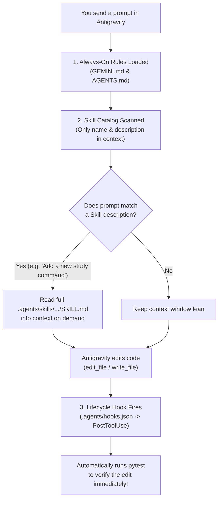

# Chapter 4: Teaching Antigravity How You Like to Work (`GEMINI.md`, Skills, and Hooks)

If you have been coding with AI for more than a week, you have probably noticed two annoying patterns that start happening as your project grows.

First, your single Python file (`app.py` or `script.py`) keeps getting longer and longer. At 80 lines, everything was easy. At 600 lines, your data models, calculation math, terminal `print()` statements, and quick test snippets are all tangled together like headphone cables in a pocket. Whenever you ask the AI to change a calculation at line 420, it accidentally breaks a print format at line 115.

Second, you find yourself typing the exact same reminders into the chat window over and over again:
- *"Remember to use Python 3.12 type hints!"*
- *"Hey, use Pydantic v2 `ConfigDict`, not the old v1 `class Config:`!"*
- *"Don't forget to run the tests after you edit that file!"*

Let's pause here and see why this happens. By default, every new AI chat session starts with a blank slate. The model does not automatically know your personal coding habits, and if all your code lives in one giant file, both you and the AI have to wade through hundreds of unrelated lines just to make a two-line change.

In this chapter, we are going to fix both problems permanently:
1. **Clean Project Structure & `ruff`**: We will learn how to split a tangled script into a clean Python package (`src/` for data models and business logic, `tests/` for automated tests) and keep it tidy with `ruff`.
2. **Teaching Google Antigravity Your Rules (`GEMINI.md`, `AGENTS.md`, Skills, and Hooks)**: We will configure Antigravity so it automatically remembers your rules, loads step-by-step checklists only when it needs them, runs your tests automatically after edits, and uses `/compact`, `/learn`, and **Subagents** (`research`, `self`) to keep its working memory sharp.

---

## 1. What We're Building & Why It Matters

Let's start by looking at the "Before" picture: the 5-line trap that turns into a 500-line headache when we build a **Coding & Study Session Tracker** in a single file.

### The "Everything in One File" Bug

When we ask an AI assistant for a quick script to log our daily study sessions, it often mixes data storage, input prompts, math, and printing inside a single function:

```python
# ❌ THE TANGLED WAY: Input, validation, math, and printing all mixed together
sessions = []

def log_and_print_study():
    topic = input("What did you study? ")          # 1. Hard to test automatically!
    mins = int(input("How many minutes? "))        # 2. Crashes or accepts -50!
    sessions.append({"t": topic, "m": mins})       # 3. Cryptic dictionary keys
    avg = sum(s["m"] for s in sessions) / len(sessions)
    print(f"Logged! Avg time: {avg} mins")         # 4. Returns None—can't reuse in a web API!
```

Why does this become so painful to maintain?
- **You can't write an automated `pytest` test for it** because calling `log_and_print_study()` pauses and waits for a human to type on the keyboard (`input()`), and prints to the screen (`print()`) instead of returning a value you can check with `assert`.
- **You can't reuse the logic** when you want to put a web API (Chapter 5) or a Gemini AI agent in front of it.
- **Every file edit risks breaking everything** because data rules, math, and formatting live in the same function.

### What We're Building Instead

In **`labs/lab04-customizing-antigravity/`**, we build a clean, modular **`study_tracker`** package paired with a complete set of **Google Antigravity customizations**:
- `src/study_tracker/models.py` — Pure **Pydantic v2** data models (`StudySession`, `TopicSummary`, `StudyProgressReport`).
- `src/study_tracker/service.py` — Pure business logic (`StudyTrackerService`) that aggregates study time by topic, handles empty-state edge cases safely, and formats Markdown reports without ever calling `input()` or `print()`.
- `tests/test_study_tracker.py` — Automated `pytest` tests verifying every model and service method.
- `GEMINI.md` and `AGENTS.md` — Always-on project rules and repository guides that Antigravity reads automatically.
- `.agents/skills/add-study-command/SKILL.md` — An on-demand workflow skill that teaches Antigravity our exact 4-step checklist for adding new study metrics.
- `.agents/hooks.json` — A lifecycle hook that automatically runs our test suite whenever Antigravity edits or writes a file.

---

## 2. The Concept from Scratch: Clean Python Projects & `ruff`

If you have only ever written single `.py` files, seeing folders like `src/`, `tests/`, and `pyproject.toml` in open-source Python repositories can look intimidating. Let's demystify them from scratch—they are much simpler than they look!

### Step 1: The Three-Room House (`models.py`, `service.py`, `tests/`)

Think of a clean Python project like a well-organized three-room house instead of a studio apartment where your stove is next to your pillow:

1. **The Front Door (`models.py`)**: This file only contains your **Pydantic `BaseModel` classes**. Its only job is defining what valid data looks like (`StudySession` must have a `topic` between 2 and 80 characters, `duration_minutes` between `1` and `480`, and `difficulty_rating` between `1` and `5`).
2. **The Workshop (`service.py`)**: This file imports your models from `models.py` and does the actual work—adding sessions, filtering by topic, calculating totals, and returning reports. Because `models.py` already checked the data at the front door, `service.py` can stays clean and focused on business logic.
3. **The Inspection Room (`tests/test_study_tracker.py`)**: This folder sits alongside `src/` and imports your models and service to test them automatically with `pytest`.

Wait—what is that `__init__.py` file inside `src/study_tracker/`?
In Python, placing an `__init__.py` file inside a folder tells Python: *"Treat this folder as an importable package"* so you can write clean imports like:

```python
from study_tracker import StudySession, StudyTrackerService
```

### Step 2: Keeping Code Tidy Automatically with `ruff`

When you collaborate with an AI coding assistant (or other developers), small formatting inconsistencies can creep in: unused `import` lines left behind after an edit, lines that stretch 200 characters wide, or old Python 3.8 syntax where modern Python 3.12 syntax is cleaner.

In modern Python, **`ruff`** is the super-fast, all-in-one code linter and formatter (written in Rust, so it checks an entire project in milliseconds). You configure `ruff` right inside `pyproject.toml`:

```toml
[tool.ruff]
line-length = 100
target-version = "py312"

[tool.ruff.lint]
select = ["E", "F", "I", "UP", "B"]
```

What do those short letter codes in `select` mean?
- **`E` & `F` (Pyflakes & pycodestyle)**: Catches syntax errors, undefined variable names, and unused imports.
- **`I` (isort)**: Automatically sorts your `import` statements alphabetically at the top of every file.
- **`UP` (pyupgrade)**: Encourages modern Python 3.12+ syntax (like `list[str]` and `str | None` instead of old `Optional[List[str]]`).
- **`B` (flake8-bugbear)**: Catches common Python gotchas (like using a mutable list `def foo(items=[])` as a default argument).

---

## 3. The Google Tool from Scratch: Customizing Antigravity

Now let's look at how **Google Antigravity** learns how your project works.

A common mistake developers make is trying to paste a 5,000-word instruction manual into every chat prompt. Not only is that exhausting, it also wastes **context window space**—the working memory the AI uses to reason about your code. When the context window gets stuffed with instructions you don't need right now, the AI has less room to focus on the bug right in front of it.

Antigravity solves this with a layered customization system built around **progressive disclosure**: load the core rules always, load specialized workflows only on demand, and run mechanical checks automatically via hooks.

Here is how Antigravity discovers and applies your customizations during a turn:



Let's examine each of these building blocks from scratch.

### 1. Always-On Rules: `GEMINI.md` and `AGENTS.md`

When Antigravity starts working on a file in your repository, it walks up the folder tree from that file's directory to the root of your repository looking for **`GEMINI.md`** and **`AGENTS.md`**.

- **`GEMINI.md`** is where you put your **coding standards and architectural rules**: Python version (`3.12+`), library choices (`Pydantic v2`, `uv`), security rules (never hardcode secrets), and how code should be organized (`models.py` vs `service.py`).
- **`AGENTS.md`** is your **quick repository map and operating guide**: what each folder contains and the exact terminal command to run the tests.

> [!TIP]
> **How Antigravity Manages Rule Budgets**:
> - **Hierarchical Scope**: You can place a root `GEMINI.md` at the top of your repo for global rules, and a more specific `GEMINI.md` inside a subfolder (like `labs/lab04-customizing-antigravity/GEMINI.md`) for rules that only apply to that folder!
> - **Automatic Deduplication**: Even if Antigravity touches ten files in the same folder, each `GEMINI.md` file is deduplicated by its path and injected only once.
> - **Keep Rules Concise**: Each rule file is capped at `24 KB` (`24,000` bytes), and all always-on rules share a `20,000`-token rules budget. Keep `GEMINI.md` short, punchy, and focused on rules the agent needs on *every* turn.

### 2. On-Demand Workflows: The 3 Levels of Agent Skills

What about detailed, multi-step checklists that you only need *sometimes*—like a 4-step checklist for adding a new analytics command, or scaffolding an ADK agent, or running a security audit?

If you put fifty different checklists inside `GEMINI.md`, they would eat up your context window on every single turn, even when you are just fixing a typo in `README.md`.

In the Google AI ecosystem, **Agent Skills** solve this across **three levels**—starting on your laptop while you code, extending into the agents you deploy to production, and scaling across your entire team in Google Cloud:

#### Level 1: Coding-Time Workspace Skills (`.agents/skills/<name>/SKILL.md` + `agents-cli setup`)

We package repeatable workflows as **Skills** inside `.agents/skills/<skill-name>/SKILL.md`. Every `SKILL.md` starts with a tiny YAML frontmatter header between `---` lines:

```markdown
---
name: add-study-command
description: >-
  Step-by-step workflow for adding a new study analytics query, filter, or report
  command to the study_tracker package. Use this skill whenever the user asks to
  add a new metric, summary calculation, or filtering feature to StudyTrackerService.
---
```

Here is the magic of **progressive disclosure**:
1. At the start of a conversation, Antigravity **does not read the body** of your `SKILL.md` files. It only loads the `name` and `description` (just two lines!).
2. When you ask something that matches the description—like *"Add a method to find my longest study session"*—Antigravity sees the match, reads the full `.agents/skills/add-study-command/SKILL.md` file on demand, and follows your checklist step by step.

Better yet, you don't have to write every skill from scratch! You can install official Google skill packs directly into your workspace with one command. For example, running **`uvx google-agents-cli setup`** installs the official **7-skill `agents-cli` suite** (`google-agents-cli-workflow`, `scaffold`, `adk-code`, `eval`, `deploy`, `publish`, `observability`) straight into Antigravity so your coding agent automatically knows the latest Google Cloud & ADK patterns.

#### Level 2: Runtime Agent-Loadable Skills (`/.agent/skills` in Deployed Agents)

Skills aren't just for your coding assistant in the IDE—**the AI agents you build and deploy can also load `SKILL.md` files at runtime!**

Suppose you build a customer support or operations agent in Chapter 8 or Chapter 10 that handles 25 different company procedures (refund policies, hardware troubleshooting, travel reimbursement). Instead of stuffing all 25 policy manuals into the agent's system prompt on every single message, you mount those `SKILL.md` files into the running agent at **`/.agent/skills/<skill-name>`** (either using the ADK `long-horizon-harness` pattern or the **Gemini Enterprise Managed Agents API** `mount` block from Google Cloud Storage or Skill Registry):

```json
{
  "mount": {
    "path": "/.agent/skills/study-coach",
    "source": {
      "skillSource": {
        "skillReference": "projects/my-project/locations/global/skills/study-coach"
      }
    }
  }
}
```

When a user asks your live agent a question, the agent checks its mounted skill descriptions and reads only the specific `SKILL.md` playbook it needs for that conversation!

#### Level 3: Enterprise Discovery & Governance (`Google Cloud Agent Registry`)

What happens when ten different teams at your company want to share vetted, version-controlled skills without copying and pasting `.md` files across fifty Git repositories?

Google Cloud provides **Agent Registry & Skill Registry** (`agentregistry.googleapis.com`), a central catalog where you can discover both **First-Party Google skills** (`origin=FIRST_PARTY`) and **Private enterprise skills** (`origin=PRIVATE`) published by your organization:

```bash
# 1. Discover available First-Party and Private skills in your Google Cloud project
gcloud alpha agent-registry skills list \
  --project="$GOOGLE_CLOUD_PROJECT" \
  --location="global"

# 2. Inspect and download a specific versioned skill revision on demand
gcloud alpha agent-registry skills revisions describe \
  "projects/$GOOGLE_CLOUD_PROJECT/locations/global/skills/study-coach/revisions/1" \
  --format="json"
```

This means a security or platform team can update a company skill in one place, publish a new revision to Skill Registry, and both developers in Antigravity and live agents in production can pull the approved revision immediately.

### 3. Automatic Guardrails: Lifecycle Hooks (`.agents/hooks.json`)

Even with great rules and skills, what if you want a shell command (like your test suite or syntax checker) to run **automatically** at key moments in the agent's execution loop without relying on the AI to remember?

That is what **Lifecycle Hooks** (`.agents/hooks.json`) do. Hooks let you attach shell commands to specific lifecycle events:

| Hook Event | When It Fires | Common Use Case |
| :--- | :--- | :--- |
| **`SessionStart`** | Once when a new conversation starts | Injecting environment status or startup reminders |
| **`PreToolUse`** | Right *before* a tool (like `run_command`) executes | Blocking dangerous commands (`"decision": "deny"`) or asking permission (`"decision": "ask"`) |
| **`PostToolUse`** | Right *after* a tool (like `edit_file` or `write_file`) finishes | Running `py_compile`, `ruff`, or `pytest` automatically |
| **`PreInvocation`** / **`PostInvocation`** | Before or after the model is called | Injecting ephemeral reminders or forcing continuation |
| **`Stop`** | When the agent is about to finish its turn | Checking that all background tasks or required tests passed before stopping (`"decision": "continue"`) |

For example, in our repository's `.agents/` configuration, a `PostToolUse` hook matching `edit_file|write_file` runs immediately after any code edit to verify that nothing was broken.

### 4. Managing Memory & Delegation: `/compact`, `/learn`, and Subagents

To round out your Antigravity toolkit, there are three everyday habits that make long coding sessions feel effortless:

1. **`/compact` (Freeing Up Context Memory)**: When you have been working in the same chat session for an hour—debugging logs, reading files, and building several features—the conversation history gets long. Typing `/compact` summarizes the completed work and frees up the context window so Antigravity stays fast and sharp for the next task.
2. **`/learn` (Turning Corrections into Permanent Knowledge)**: Suppose you correct Antigravity during a session—*"Hey, in this repo we always format durations as `'45 mins'` instead of `'0.75 hours'`."* Instead of repeating that correction tomorrow, use `/learn` to ask Antigravity to save that preference into your project rules or skills permanently!
3. **Subagents (`research` and `self`)**: What if you are working on a feature in `service.py`, and suddenly you need to search through 30 files or read documentation to figure out how an API works? If your main agent reads all 30 files directly, its context window fills up with search noise. Instead, Antigravity can spin up a **Subagent**:
   - **`research` subagent**: A read-only investigator with its own separate context window. It searches the codebase or docs, reads the 30 files in isolation, and sends back a concise 10-line summary to your main agent.
   - **`self` subagent**: A full-capability worker with its own context window that can build or test an independent module in parallel and report back when finished.

---

## 4. Hands-On Python Lab Walkthrough

Let's walk through all the files in **`labs/lab04-customizing-antigravity/`** and see how the modular Python code and the Antigravity customizations fit together.

### Part A: The Validated Models (`src/study_tracker/models.py`)

Open [models.py](../labs/lab04-customizing-antigravity/src/study_tracker/models.py). Notice how clean this file is—it has zero printing or aggregation logic, just three crystal-clear Pydantic v2 models:

```python
class StudySession(BaseModel):
    """A single focused study block logged by a learner."""

    model_config = ConfigDict(str_strip_whitespace=True, frozen=True)

    topic: str = Field(
        ...,
        min_length=2,
        max_length=80,
        description="Subject studied (e.g., 'Pydantic Validation', 'FastAPI Routes').",
    )
    duration_minutes: int = Field(
        ...,
        ge=1,
        le=480,
        description="Length of the study session in minutes (1 to 480).",
    )
    difficulty_rating: int = Field(
        default=3,
        ge=1,
        le=5,
        description="Self-rated difficulty from 1 (easy) to 5 (challenging).",
    )
    notes: str = Field(
        default="",
        max_length=280,
        description="Optional short reflection on what was learned.",
    )

    @field_validator("topic")
    @classmethod
    def normalize_topic_title(cls, value: str) -> str:
        """Ensure topic is not blank and collapse repeated internal spaces."""
        cleaned = " ".join(value.split())
        if len(cleaned) < 2:
            raise ValueError("Topic must contain at least 2 non-whitespace characters.")
        return cleaned
```

Look at `normalize_topic_title`: if a user types `"  Pydantic    Validation  "`, `" ".join(value.split())` collapses the extra spaces in the middle and turns it into `"Pydantic Validation"`. And if someone passes `duration_minutes=0` or `duration_minutes=600` (more than 8 hours in a single sitting!), `Field(..., ge=1, le=480)` catches it immediately.

Below `StudySession`, we also define [`TopicSummary`](../labs/lab04-customizing-antigravity/src/study_tracker/models.py#L45-L53) and [`StudyProgressReport`](../labs/lab04-customizing-antigravity/src/study_tracker/models.py#L56-L64) so that the output of our service is just as strictly typed as its input.

### Part B: Pure Business Logic (`src/study_tracker/service.py`)

Now open [service.py](../labs/lab04-customizing-antigravity/src/study_tracker/service.py). In [`StudyTrackerService`](../labs/lab04-customizing-antigravity/src/study_tracker/service.py#L8-L96), every method has a single, clear responsibility:

1. **`add_session(...) -> StudySession`**: Validates and appends a new study session.
2. **`list_sessions(topic_filter: str | None = None) -> list[StudySession]`**: Returns all sessions, or filters them case-insensitively (`"FASTAPI & SQL"` matches `"FastAPI & SQL"`).
3. **`build_progress_report() -> StudyProgressReport`**: Look at lines 36–43 of [`build_progress_report`](../labs/lab04-customizing-antigravity/src/study_tracker/service.py#L34-L81):
   ```python
   if not self._sessions:
       return StudyProgressReport(
           total_sessions=0,
           total_minutes=0,
           top_topic=None,
           topic_summaries=[],
       )
   ```
   Remember our rule in `GEMINI.md` and our `add-study-command` skill? **Always handle the empty-tracker edge case gracefully!** A classic AI bug is dividing by `len(self._sessions)` when zero sessions have been logged, crashing the app with a `ZeroDivisionError`. By checking `if not self._sessions:` first, our service is rock-solid even on a brand-new account.
4. **`format_markdown_report() -> str`**: Takes the structured `StudyProgressReport` and turns it into a clean Markdown string. Because it returns a `str` instead of calling `print()`, our tests can inspect the exact Markdown output with `assert`.

### Part C: Inspecting `GEMINI.md`, `SKILL.md`, and `hooks.json`

Now let's look closely at the three customization files in `labs/lab04-customizing-antigravity/` that teach Antigravity how to work inside this package.

First, open [GEMINI.md](../labs/lab04-customizing-antigravity/GEMINI.md):

```markdown
# Project Coding Rules (`GEMINI.md`)

Whenever you generate or modify code inside `lab04-customizing-antigravity`, follow these non-negotiable standards:

## 1. Architecture & Separation of Concerns
- **Data Models (`src/study_tracker/models.py`)**: All data structures must be **Pydantic v2** `BaseModel` classes with `ConfigDict(str_strip_whitespace=True, frozen=True)` and explicit `Field(...)` bounds.
- **Business Logic (`src/study_tracker/service.py`)**: Keep all calculation, filtering, and formatting functions pure and deterministic. Never call `input()` or `print()` inside `service.py`—return structured models or formatted strings instead.
- **Tests (`tests/test_study_tracker.py`)**: Every new method in `StudyTrackerService` must have at least one happy-path test and one edge-case/validation test.
```

Second, open [.agents/skills/add-study-command/SKILL.md](../labs/lab04-customizing-antigravity/.agents/skills/add-study-command/SKILL.md). Notice how the YAML frontmatter tells Antigravity *when* to activate the skill, and the body gives a concrete 4-step recipe:
- **Step 1**: Check or add Pydantic output models in `src/study_tracker/models.py` and export them in `__init__.py`.
- **Step 2**: Implement pure business logic in `src/study_tracker/service.py` (including the empty-tracker check so `len(self._sessions) == 0` never raises a `ZeroDivisionError`).
- **Step 3**: Write both a `test_<feature>_happy_path()` and a `test_<feature>_edge_cases()` function in `tests/test_study_tracker.py`.
- **Step 4**: Run the test suite to verify 100% pass rate before finishing the turn.

Third, open [.agents/hooks.json](../labs/lab04-customizing-antigravity/.agents/hooks.json):

```json
{
  "verify-study-tracker-after-edit": {
    "PostToolUse": [
      {
        "matcher": "edit_file|write_file",
        "hooks": [
          {
            "type": "command",
            "command": "uv run python tests/test_study_tracker.py >/dev/null 2>&1 && echo '{}'",
            "timeout": 15
          }
        ]
      }
    ]
  }
}
```

Notice how `PostToolUse` uses `"matcher": "edit_file|write_file"` and returns an empty JSON object `{}` on standard output (`stdout`) as required by the Antigravity hook contract. Whenever Antigravity edits or writes a file in this lab, the hook runs `tests/test_study_tracker.py` in the background automatically!

### Quick Decision Guide: Which Customization Should I Use?

When you are building your own projects, use this simple cheat sheet to decide where a rule or workflow belongs:

| Question You Are Asking | Where It Belongs | Why |
| :--- | :--- | :--- |
| *"Should the AI follow this rule on every single turn?"* | **`GEMINI.md`** | Always active for its directory and subdirectories. |
| *"How is this repository laid out and how do I run tests?"* | **`AGENTS.md`** | Gives coding agents an instant map of folders and test commands. |
| *"What is the step-by-step checklist for a specific task?"* | **`.agents/skills/<name>/SKILL.md`** | Loaded on demand (progressive disclosure) so it doesn't clutter context. |
| *"Should a script run automatically before or after a tool call?"* | **`.agents/hooks.json`** | Deterministic shell execution (`PreToolUse`, `PostToolUse`, `Stop`). |
| *"Is my chat session getting long and full of old logs?"* | **`/compact` or Subagents** | Summarizes history or isolates heavy file searches in a `research` subagent. |

### Part D: Running the Lab 04 Test Suite

Open [test_study_tracker.py](../labs/lab04-customizing-antigravity/tests/test_study_tracker.py) and run it from your terminal:

```bash
uv run python labs/lab04-customizing-antigravity/tests/test_study_tracker.py
```

You will see all 5 test suites pass immediately:

```text
[PASS] test_add_and_validate_study_session
[PASS] test_rejects_invalid_duration_and_difficulty_and_blank_topic
[PASS] test_progress_report_aggregates_and_sorts_topics_correctly
[PASS] test_empty_tracker_returns_safe_report_and_markdown
[PASS] test_list_sessions_with_case_insensitive_filter

All 5/5 Lab 04 tests passed!
```

> [!TIP]
> **Try It Yourself in Antigravity!**
> Open the Antigravity chat inside `labs/lab04-customizing-antigravity` and prompt:
> *"Add a new method `get_hardest_sessions(min_difficulty: int = 4)` to `StudyTrackerService` that returns sessions at or above the given difficulty rating."*
> Watch how Antigravity automatically spots the `add-study-command` skill, follows the rules in `GEMINI.md`, updates `service.py` and `tests/test_study_tracker.py`, and verifies the tests!

---

## 5. Wrapping Up & What's Next

Let's look at how far we have come in just two chapters:
- In **Chapter 3**, we learned how to stop bad data at the front door with **Pydantic v2** and catch bugs automatically with **`pytest`**.
- In **Chapter 4**, we learned how to organize our code into a clean **`src/` and `tests/` package**, enforce code style with **`ruff`**, and teach **Google Antigravity** our engineering habits using **`GEMINI.md`**, **`AGENTS.md`**, on-demand **Skills**, **`hooks.json`**, **`/compact`**, **`/learn`**, and **Subagents**.

Right now, though, our Python programs still live only inside our own terminal, and any data we log disappears as soon as the program exits.

How do we turn our clean Python models and services into a **real web backend** that mobile apps, browsers, or AI agents can call over the network—and save our data permanently in a **SQL database** that never loses a record or double-books a seat?

Turn the page to **Chapter 5**, where we build our first production-style web API with **`FastAPI`** and **SQL databases** from scratch!

---

**Navigation**: [← Previous: Chapter 3 — Stopping Bad Data and Catching Bugs](./ch03-stopping-bad-data-and-testing.md) | [🏠 Book Index](../README.md) | [Next: Chapter 5 — Building a Real Web Backend with a Database →](./ch05-building-web-apis-and-databases.md)
