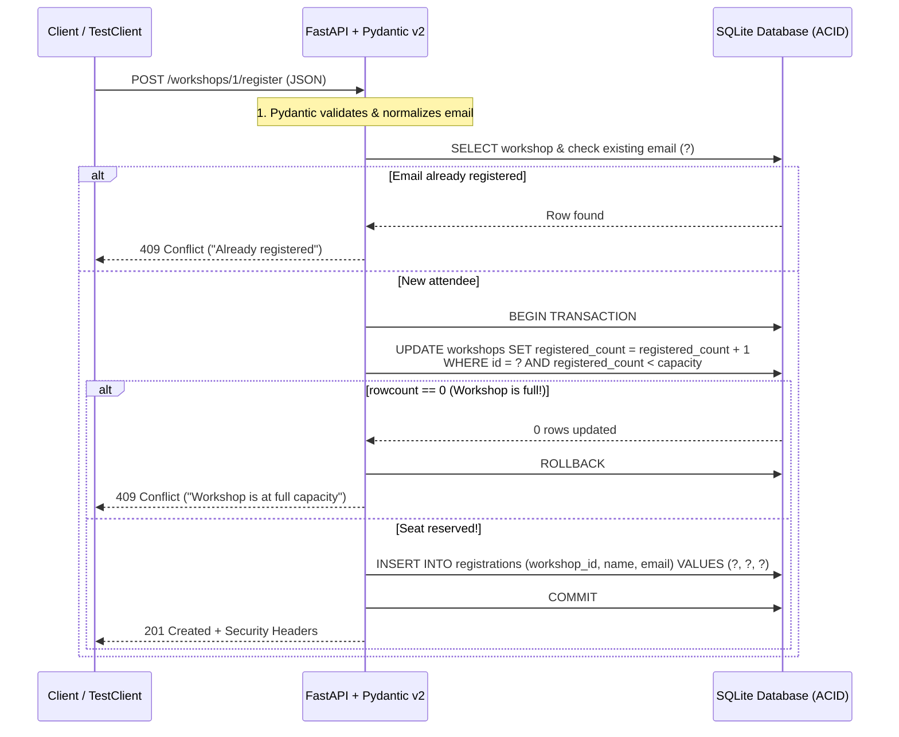

# Chapter 5: Building a Real Web Backend with a Database (`FastAPI` & SQL 101)

Up to this point in the book, our Python programs have lived inside our own terminal. When we ran our expense splitter in Chapter 3 or our study tracker in Chapter 4, the program started up, ran our functions in computer memory (RAM), printed the output, and exited. The moment the program finished, every piece of data vanished.

If you want to build a real product—whether it is a web app for your customers, a mobile backend, or a tool that a Gemini AI agent can call over the internet—your code needs to do two new things:
1. **Speak HTTP (Web APIs)**: It needs to listen for requests over a network, validate incoming JSON data, and send back structured JSON responses with clear status codes.
2. **Remember Data Permanently and Safely (SQL Databases)**: It needs to store data on disk (or in a cloud database) so that even if your server restarts—or fifty people click the "Register" button at the exact same millisecond—no data is lost and no seat is double-booked.

If you have never built a web API or written a SQL database query before, you are in the right place. We are going to explain every single concept from scratch in plain English, look at the classic database bugs that trip up new AI builders, and build a complete **Workshop & Event Registration API** using **`FastAPI`**, **`Pydantic v2`**, and **`SQLite`** (and see how it maps directly to **Google Cloud SQL** and **AlloyDB for PostgreSQL** when you deploy to Google Cloud).

---

## 1. What We're Building & Why It Matters

Let's start by looking at what happens when someone prompts an AI to *"write a quick API to register people for a workshop"* without thinking about database safety.

### The Five-Line SQL Injection & Overbooking Disaster

Here is the kind of code a naive prompt often produces when you ask for a quick registration endpoint:

```python
# ❌ DO NOT DO THIS: SQL Injection + Race Condition + Zero Validation
@app.post("/register")
def register_unsafe(workshop_id: int, name: str, email: str):
    # Bug 1: f-string SQL query allows anyone to delete your database!
    conn.execute(
        f"INSERT INTO registrations VALUES ({workshop_id}, '{name}', '{email}')"
    )
    # Bug 2: Never checks if the workshop is already full or if the email registered twice!
    return {"status": "ok"}
```

Let's pause here and look at the two massive holes in those five lines:

1. **The SQL Injection Hole**: Because the code builds a SQL command using a Python f-string (`f"INSERT ... '{name}'"`), what happens if a mischievous user enters their name as `Robert'); DROP TABLE workshops;--`? The single quote `'` closes the string early, and the database obediently executes `DROP TABLE workshops;`—wiping out your entire table! (If you have ever seen the famous *xkcd* comic about "Little Bobby Tables," this is that exact bug.)
2. **The Overbooking & Duplicate Registration Bug**: Suppose a hands-on AI workshop only has **20 seats**, and 25 people try to sign up—or one impatient person clicks the "Register" button five times in a row. Without database constraints and an atomic capacity check, your database happily records 25 registrations for a 20-seat room, and lists the same person five times.

### What We're Building Instead

In **`labs/lab05-fastapi-database/`**, we build a **Workshop & Event Registration API** (`app.py` and `test_app.py`) that:
- Exposes clean **`FastAPI`** endpoints (`POST /workshops`, `GET /workshops`, `GET /workshops/{id}`, `POST /workshops/{id}/register`, `GET /workshops/{id}/registrations`).
- Validates every request and response with **Pydantic v2** models (`WorkshopCreate`, `RegistrationCreate`).
- Uses **parameterized SQL queries (`?` placeholders)** on every single database call so SQL injection is 100% impossible.
- Uses **relational database constraints (`FOREIGN KEY`, `UNIQUE`, `CHECK`)** and **atomic SQL transactions** so a workshop can *never* be overbooked and an email can *never* register twice for the same workshop.
- Attaches standard **HTTP security headers** (`X-Content-Type-Options: nosniff`, `X-Frame-Options: DENY`, `Content-Security-Policy`) to every response.

---

## 2. The Concept from Scratch: Web APIs & SQL Databases 101

Let's break down how web APIs and relational databases work from first principles.

### Step 1: Web APIs 101 (`GET`, `POST`, JSON, and Status Codes)

When your web browser, a mobile app, or an AI agent talks to a backend server over the internet, they communicate using **HTTP** (Hypertext Transfer Protocol). Think of an HTTP API like ordering at a coffee shop counter:

1. **The HTTP Method (The Verb)**: Tells the server what kind of action you want to take:
   - **`GET`**: *"Read data without changing anything"* (e.g., `GET /workshops` to see the list of upcoming workshops).
   - **`POST`**: *"Create something new or trigger an action"* (e.g., `POST /workshops/1/register` to sign up an attendee).
2. **The URL Path (The Noun)**: Identifies which resource you are talking about, like `/workshops` or `/workshops/1`.
3. **The JSON Payload (The Order Slip)**: When you send a `POST` request, you attach a neat text package formatted as **JSON** (JavaScript Object Notation)—which looks almost identical to a Python dictionary:
   ```json
   {
     "attendee_name": "Liam Chen",
     "attendee_email": "liam@example.com"
   }
   ```
4. **The HTTP Status Code (The Quick Summary Number)**: Every response from the server starts with a 3-digit number so the caller immediately knows if the request succeeded or failed without having to guess:

| Status Code | Name | Plain-English Meaning |
| :--- | :--- | :--- |
| **`200 OK`** | Success | *"Here is the data you asked for."* |
| **`201 Created`** | Created | *"We created your new workshop or registration successfully!"* |
| **`400 Bad Request`** | Bad Request | *"The request couldn't be understood."* |
| **`404 Not Found`** | Not Found | *"Workshop ID 999 does not exist."* |
| **`409 Conflict`** | Conflict | *"Your data is valid, but it conflicts with current state (the workshop is full, or you already registered)."* |
| **`422 Unprocessable Entity`** | Validation Error | *"Pydantic stopped your request because a field is invalid (e.g., capacity is 0 or email is missing an `@`)."* |

### Step 2: `FastAPI` from Scratch

In Python, **`FastAPI`** is the gold standard for building modern web APIs. Why do Python developers love FastAPI so much? Because it connects **Python type hints** and **Pydantic v2** (which you learned in Chapter 3!) directly to your web endpoints:

```python
@app.post("/workshops", response_model=WorkshopResponse, status_code=201)
def create_workshop(payload: WorkshopCreate, conn: DbConnection) -> WorkshopResponse:
    ...
```

When a request arrives at `POST /workshops`:
1. FastAPI automatically reads the JSON body and feeds it into your Pydantic `WorkshopCreate` model.
2. If the JSON is invalid (say, `capacity: -5`), FastAPI stops right there and returns a `422 Unprocessable Entity` error with a clear JSON explanation—your function doesn't even have to run!
3. Even better, FastAPI uses your Pydantic models to automatically generate an interactive web page at **`/docs`** (Swagger UI), where you can test your API endpoints right in your browser with a single click.

What is that `conn: DbConnection` argument in `create_workshop`? That is FastAPI's **Dependency Injection** (`Depends(get_db)`). Instead of every function opening and closing the database file manually (and risking forgetting to close it if an error happens), `get_db()` opens a fresh database connection before the route runs and guarantees `conn.close()` runs in a `finally:` block as soon as the request finishes.

### Step 3: Relational Databases (SQL) 101

Where should our API store workshops and registrations?
If you store them in a Python list (`workshops = []`), everything is wiped out the moment you restart your server. If you store them in a plain JSON file on disk, and two users register at the same instant, one user's write will overwrite the other's!

That is why production backends use a **Relational Database (SQL)**. A relational database organizes data into structured **tables** (like spreadsheets with strict rules):

- **Primary Key (`id INTEGER PRIMARY KEY AUTOINCREMENT`)**: A unique ID number (`1`, `2`, `3`, ...) that the database assigns automatically to every row so you can always refer to a specific workshop or registration unambiguously.
- **Foreign Key (`FOREIGN KEY (workshop_id) REFERENCES workshops(id)`)**: A link from a row in `registrations` back to the parent row in `workshops`. The database guarantees you can never create a registration for a `workshop_id` that doesn't exist!
- **Constraints (`CHECK` and `UNIQUE`)**: Rules enforced by the database engine itself:
  - `CHECK (registered_count <= capacity)` makes it physically impossible for `registered_count` to exceed `capacity`.
  - `UNIQUE (workshop_id, attendee_email)` makes it impossible for the same email to be inserted twice for the same workshop.
- **ACID Transactions (`with conn:`)**: A transaction groups multiple SQL steps into an **all-or-nothing** bundle. When someone registers for a workshop, we need to do two things together:
  1. Increment `registered_count` by `1` on the `workshops` table (only if `registered_count < capacity`).
  2. Insert the attendee's row into the `registrations` table.
  By wrapping both steps in a single transaction (`with conn:`), either **both** succeed together or **both** are rolled back automatically if anything goes wrong!

Here is the complete request flow from the client through FastAPI, Pydantic, and our atomic SQLite transaction:



### Step 4: Stopping SQL Injection with Parameterized Queries (`?`)

How do we make sure user input like `"Robert'); DROP TABLE workshops;--"` can never trick our database into running malicious commands?

The rule is simple and absolute: **Never use Python f-strings, `+`, or `.format()` to put variables into a SQL string. Always use `?` placeholders and pass values as a separate tuple.**

```python
# ❌ VULNERABLE: String interpolation mixes SQL code and user data together
conn.execute(f"SELECT * FROM workshops WHERE title LIKE '%{search}%'")

# ✅ SECURE: Parameterized query separates the SQL command from the data tuple
conn.execute(
    "SELECT id, title, instructor, capacity, registered_count FROM workshops WHERE title LIKE ?",
    (f"%{search.strip()}%",),
)
```

When you use a `?` placeholder, the database engine compiles the SQL command (`SELECT ... WHERE title LIKE ?`) *first*, and then plugs the parameter tuple in purely as literal text data. Even if the user types `; DROP TABLE workshops;--`, the database just searches for a workshop whose title literally contains the characters `; DROP TABLE workshops;--`. It can never execute as code!

---

## 3. The Google Tool from Scratch: From Local SQLite to Google Cloud SQL & AlloyDB

You might be wondering: *"Why are we using `sqlite3` on our laptop today, and how does this connect to Google Cloud in production?"*

### Why Start with SQLite Locally, Then Move to Cloud SQL / AlloyDB?

Python comes with **`sqlite3` built right into the standard library**. It stores a full relational SQL database inside a single file (like `workshops.db`) with zero servers to install or configure. That makes it perfect for learning SQL and running ultra-fast automated tests on your laptop.

When you deploy your FastAPI app to production on **Google Cloud Run** (which we will do in Chapter 8!), multiple cloud containers may be running your API at the same time, so they need a shared, cloud-managed database server:
- **Google Cloud SQL for PostgreSQL**: Google Cloud's fully managed relational database service that handles backups, patches, high availability, and encrypted connections automatically.
- **Google Cloud AlloyDB for PostgreSQL**: Google-built, high-performance PostgreSQL designed for demanding transactional workloads and built-in vector/AI search (`pgvector`).

Because SQLite and PostgreSQL both speak standard relational SQL (tables, primary keys, foreign keys, `UNIQUE` constraints, ACID transactions, and parameterized queries), the exact database design you learn in Lab 05 transfers directly to **Cloud SQL** and **AlloyDB**!

### Using Antigravity's `new-endpoint` Skill & Database MCP Servers

Inside **Google Antigravity**, you also have two superpowers when building FastAPI and database backends:

1. **The Workspace `new-endpoint` Skill (`.agents/skills/new-endpoint/SKILL.md`)**: Remember how we learned about Skills in Chapter 4? This repository includes a built-in skill at [`.agents/skills/new-endpoint/SKILL.md`](../.agents/skills/new-endpoint/SKILL.md) that enforces our 4-step checklist whenever you ask Antigravity to add a new FastAPI endpoint:
   - Step 1: Define Pydantic v2 request & response models with `Field(...)` constraints.
   - Step 2: Use parameterized SQL queries (`?` placeholders, never f-strings).
   - Step 3: Return clear HTTP status codes (`201`, `404`, `409`, `422`) and security headers.
   - Step 4: Write both a happy-path and a failure-path test.
2. **Google Cloud Database MCP Servers (`datacloud_cloud-sql_remote`, `datacloud_alloydb_remote`)**: When you connect Antigravity to your Google Cloud project via MCP (Model Context Protocol, which we will explore in depth in Chapter 6), Antigravity can inspect your live Cloud SQL or AlloyDB schemas, verify table definitions, and run read-only queries right from your chat window!

---

## 4. Hands-On Python Lab Walkthrough

Let's open the code in **`labs/lab05-fastapi-database/`** and walk through how our Workshop & Event Registration API works:
- [app.py](../labs/lab05-fastapi-database/app.py)
- [test_app.py](../labs/lab05-fastapi-database/test_app.py)

### Part A: Pydantic Request & Response Models

Open [app.py](../labs/lab05-fastapi-database/app.py#L24-L97) and look at `WorkshopCreate` and `RegistrationCreate`:

```python
class WorkshopCreate(BaseModel):
    """Payload for creating a new workshop event."""

    model_config = ConfigDict(str_strip_whitespace=True, frozen=True)

    title: str = Field(..., min_length=3, max_length=120)
    instructor: str = Field(..., min_length=2, max_length=80)
    capacity: int = Field(..., ge=1, le=500)
```

And in `RegistrationCreate`, look at how we normalize and validate every attendee's email address before it ever reaches the database:

```python
    @field_validator("attendee_email")
    @classmethod
    def validate_and_normalize_email(cls, value: str) -> str:
        """Normalize email to lowercase and verify basic email structure."""
        normalized = value.strip().lower()
        if not EMAIL_PATTERN.match(normalized):
            raise ValueError("Invalid email address format.")
        return normalized
```

Why is `.lower()` so important here? Because in SQL, `'Priya@Example.com'` and `'priya@example.com'` are different strings! By normalizing every email to lowercase at the Pydantic boundary, someone can never bypass our duplicate-registration check just by capitalizing a letter in their email address.

### Part B: Database Tables & Security Headers Middleware

Next, look at [`init_db`](../labs/lab05-fastapi-database/app.py#L109-L137) in `app.py`:

```python
        conn.execute("PRAGMA foreign_keys = ON;")
        conn.execute(
            """
            CREATE TABLE IF NOT EXISTS workshops (
                id INTEGER PRIMARY KEY AUTOINCREMENT,
                title TEXT NOT NULL,
                instructor TEXT NOT NULL,
                capacity INTEGER NOT NULL CHECK (capacity >= 1),
                registered_count INTEGER NOT NULL DEFAULT 0
                    CHECK (registered_count >= 0 AND registered_count <= capacity)
            );
            """
        )
```

Notice the two database-level safety nets:
1. `CHECK (registered_count >= 0 AND registered_count <= capacity)` on `workshops`.
2. `UNIQUE (workshop_id, attendee_email)` on `registrations`.

Even if a future developer wrote a buggy query, SQLite itself will refuse to let `registered_count` exceed `capacity` or let the same email be inserted twice for the same workshop.

Right below `get_db()`, look at [`add_security_headers`](../labs/lab05-fastapi-database/app.py#L166-L176):

```python
@app.middleware("http")
async def add_security_headers(request: Request, call_next) -> Response:
    """Attach standard security headers to every HTTP response."""
    response: Response = await call_next(request)
    response.headers["X-Content-Type-Options"] = "nosniff"
    response.headers["X-Frame-Options"] = "DENY"
    response.headers["Content-Security-Policy"] = (
        "default-src 'self'; frame-ancestors 'none'"
    )
    response.headers["Permissions-Policy"] = "camera=(), microphone=(), geolocation=()"
    response.headers["Cache-Control"] = "no-store"
    return response
```

A FastAPI **middleware** wraps every single HTTP request and response. By setting `X-Content-Type-Options: nosniff`, `X-Frame-Options: DENY`, and a strict `Content-Security-Policy` here once, every endpoint in our app is automatically protected against MIME-sniffing and clickjacking.

### Part C: Atomic Seat Reservation in `POST /workshops/{workshop_id}/register`

Now look at the heart of Lab 05—[`register_attendee`](../labs/lab05-fastapi-database/app.py#L248-L315) in `app.py`:

```python
    try:
        with conn:
            update_cursor = conn.execute(
                """
                UPDATE workshops
                SET registered_count = registered_count + 1
                WHERE id = ? AND registered_count < capacity
                """,
                (workshop_id,),
            )
            if update_cursor.rowcount == 0:
                raise HTTPException(
                    status_code=status.HTTP_409_CONFLICT,
                    detail="Workshop is already at full capacity.",
                )

            insert_cursor = conn.execute(
                """
                INSERT INTO registrations (workshop_id, attendee_name, attendee_email)
                VALUES (?, ?, ?)
                """,
                (workshop_id, payload.attendee_name, payload.attendee_email),
            )
            registration_id = int(insert_cursor.lastrowid or 0)
```

Look closely at that `UPDATE` statement:
```sql
UPDATE workshops
SET registered_count = registered_count + 1
WHERE id = ? AND registered_count < capacity
```
Why is this pattern so powerful? Instead of reading `registered_count` into Python, checking `if count < capacity:` in Python, and then writing `count + 1` back (where two simultaneous requests could both read `count = 19` and both write `20`!), we tell the database to check `AND registered_count < capacity` and increment `registered_count` in a **single atomic SQL statement**.
- If a seat is available, `update_cursor.rowcount` is `1`, and we immediately insert the registration inside the same `with conn:` transaction.
- If the workshop is already full, the `WHERE` clause matches zero rows (`update_cursor.rowcount == 0`), we raise `409 Conflict`, and the transaction rolls back cleanly!

### Part D: Testing Every Status Code & SQL Injection Defense with `TestClient`

How do we test a FastAPI web server without manually starting `uvicorn` in one terminal and running `curl` commands in another?

FastAPI includes **`TestClient`** (powered by `httpx`), which lets your `pytest` functions send simulated HTTP requests (`client.get(...)`, `client.post(...)`) directly to your FastAPI `app` in memory!

Open [test_app.py](../labs/lab05-fastapi-database/test_app.py) and look at how each test creates a fresh, isolated temporary database file (`_create_isolated_client()`) and verifies a specific behavior:
1. **`test_create_and_fetch_workshop_with_security_headers`**: Verifies `201 Created`, initial `seats_remaining`, and the presence of `X-Content-Type-Options: nosniff`, `X-Frame-Options: DENY`, and `Content-Security-Policy`.
2. **`test_register_attendees_and_block_overbooking_with_409`**: Creates a 2-seat workshop, registers 2 attendees (`201 Created`), and proves the 3rd attendee is blocked with **`409 Conflict`** (`"Workshop is already at full capacity."`).
3. **`test_duplicate_email_registration_returns_409_conflict`**: Registers `priya@example.com`, then tries registering `"  PRIYA@example.com "` and verifies it is blocked with **`409 Conflict`** without consuming a second seat.
4. **`test_invalid_email_or_capacity_returns_422_unprocessable_entity`**: Verifies that `capacity: 0` or `"not-an-email-address"` is rejected with **`422 Unprocessable Entity`**.
5. **`test_sql_injection_payloads_are_neutralized_by_parameterized_queries`**: Sends classic SQL injection attacks (`"' OR '1'='1'; DROP TABLE workshops; --"` and `"Robert'); DROP TABLE workshops;--"`) and proves our parameterized queries treat them as harmless literal strings while keeping the `workshops` table 100% intact.

Run the Lab 05 test suite from your terminal right now:

```bash
uv run python labs/lab05-fastapi-database/test_app.py
```

You will see all 6 integration tests pass:

```text
[PASS] test_create_and_fetch_workshop_with_security_headers
[PASS] test_register_attendees_and_block_overbooking_with_409
[PASS] test_duplicate_email_registration_returns_409_conflict
[PASS] test_invalid_email_or_capacity_returns_422_unprocessable_entity
[PASS] test_missing_workshop_returns_404_not_found
[PASS] test_sql_injection_payloads_are_neutralized_by_parameterized_queries

All 6/6 Lab 05 API tests passed!
```

---

## 5. Wrapping Up & What's Next

Congratulations—you have just completed **Part 2** of the book! Let's step back and admire the foundation you now have under your belt:
- **Chapter 3 (`Pydantic v2` & `pytest`)**: You learned how to validate every piece of data entering your code, avoid floating-point money bugs with `Decimal`, and write automated unit and property tests.
- **Chapter 4 (`GEMINI.md`, Skills, and Hooks)**: You learned how to structure a clean multi-file Python package (`src/` and `tests/`) and customize Google Antigravity so it enforces your rules and runs your tests automatically on every edit.
- **Chapter 5 (`FastAPI` & SQL)**: You built a real web API backed by a relational SQL database with atomic capacity checks, parameterized queries that stop SQL injection cold, HTTP security headers, and `TestClient` integration tests.

In **Part 3 (Chapters 6 and 7)**, we are going to connect our backend to live tools and a full-stack web interface:
- In **Chapter 6**, we will connect Google Antigravity to live official Google documentation and our event database using the **Model Context Protocol (MCP)**—and build our own custom Python `FastMCP` server from scratch.
- In **Chapter 7**, we will turn a hand-drawn sketch into a full-stack **Smart Pantry & Recipe Tracker** web app (`FastAPI` + `HTMX`) and test it in a real browser using Antigravity's `/browser` command!

---

**Navigation**: [← Previous: Chapter 4 — Teaching Antigravity How You Like to Work](./ch04-teaching-antigravity-your-rules.md) | [🏠 Book Index](../README.md) | [Next: Chapter 6 — Connecting Antigravity to Live Docs and Tools with MCP →](./ch06-connecting-live-data-with-mcp.md)
