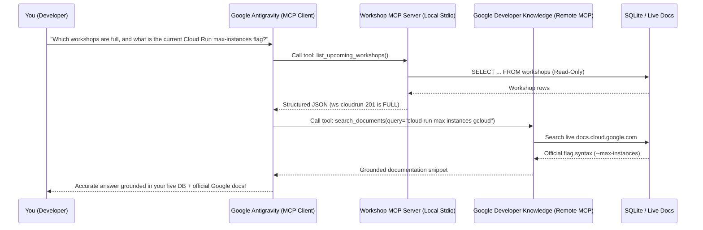

# Chapter 6: Connecting Antigravity to Live Docs and Tools with MCP

## 1. What We're Building & Why It Matters

If you've been building apps with AI recently, you've probably run into a frustrating moment that goes something like this:

You ask your coding agent to write a Python script using a library that released a major update last month, or you ask it to write a SQL query against your team's event database. The agent responds immediately, with total confidence. The code looks clean. The variable names make sense.

And then you run it—and it crashes on line 3.

Why did that happen? Two simple reasons:

1. **Public libraries move faster than model training cutoffs.** Even the smartest Gemini model only knows what existed in its training data unless you give it a way to look up live documentation. For instance, when Google released the unified `google-genai` SDK to replace the older `google-generativeai` package—or when the Python Model Context Protocol SDK (`mcp` 2.x) renamed `FastMCP` to `MCPServer`—any model relying purely on memory risked mixing up old and new imports.
2. **Your private databases and internal services were never in the training data at all.** When you ask an AI agent, *"How many seats are left in our Friday Cloud Run workshop?"* or *"Write a query for our registrations table,"* the model has zero idea whether your column is named `seats_left`, `remaining_capacity`, or `open_spots`. Left on its own, it has to guess.

For a while, developers tried to work around this by pasting giant walls of documentation and database schemas into every chat prompt. That works for five minutes, until your prompt becomes 15,000 lines long, your context window fills up, and you forget to update the pasted text when a table changes.

We need a better way. Instead of copy-pasting documentation and database rows into the chat by hand, we want our coding agent to **look up the exact piece of live documentation or database metadata it needs, right when it needs it, through a safe, read-only connection.**

That is what the **Model Context Protocol (MCP)** gives us.

In this chapter, we are going to unpack MCP from the ground up, see how Google Antigravity connects to official Google MCP servers (like **Google Developer Knowledge** and **BigQuery**), learn how Antigravity keeps your context window fast and lean using **Lazy Loading**, and build our own custom Python MCP server in `labs/lab06-mcp-tools/` that lets Antigravity safely inspect a live SQLite workshop database.

---

## 2. The Concept from Scratch

### What Is MCP in Plain English?

Before USB-C came along, your desk drawer was probably full of incompatible cables: one for your phone, another for your camera, a chunky connector for your printer, and a proprietary brick for your laptop. Every time a hardware company made a new device, they invented a new plug.

Early AI tools had the exact same problem. If you wanted an AI assistant to read a local SQLite database, search Google Cloud documentation, and check a ticketing system, you had to write custom glue code for every single AI app and every single data source.

**Model Context Protocol (MCP)** is the **USB-C adapter for AI agents**.

It is an open standard that defines one simple agreement between two sides:

- **The MCP Client (the AI host)**: This is Google Antigravity (or your own ADK agent). When the agent realizes it needs outside information, it sends a structured JSON request asking, *"What tools do you have?"* or *"Please run the `check_workshop_seat_status` tool with `workshop_id='ws-genai-101'`."*
- **The MCP Server (the tool provider)**: This is a small program—running either right on your laptop or out on a cloud URL—that knows how to talk to a specific data source (like official Google docs, BigQuery, or your local SQLite database) and return a clean, structured answer.

Let's pause here and look at how a single question flows from you, through Antigravity, out to an MCP server, and back again:



### The Three Things an MCP Server Can Expose

When you connect an MCP server to Antigravity, it can offer three kinds of building blocks:

1. **Tools (Functions the agent can call)**: This is what you will use 90% of the time. A tool is simply a function with typed inputs and outputs—like `search_documents(query="...")` or `check_workshop_seat_status(workshop_id="ws-genai-101")`.
2. **Resources (Read-only files or data streams)**: Static or dynamic reference data identified by a URI (like `schema://workshops/tables`), which the agent can read like a file.
3. **Prompts (Reusable prompt templates)**: Pre-packaged starter prompts that users or agents can invoke for common workflows.

### How Do Antigravity and the MCP Server Talk? (Transports)

An MCP client and server can talk over two standard communication channels (called **transports**):

1. **Stdio Transport (Local Subprocess)**:
   - **How it works**: Antigravity starts your Python or Node script right on your machine as a background process and talks to it over standard input (`stdin`) and standard output (`stdout`).
   - **When to use it**: Perfect for local development tools, inspecting a local SQLite database, or wrapping a script in your repository. No network ports to open!
2. **Streamable HTTP Transport (Remote URL)**:
   - **How it works**: The MCP server runs as a web service (for example, `https://developerknowledge.googleapis.com/mcp` or a Cloud Run service at `https://mcp.mycompany.com/mcp`), and Antigravity sends HTTPS requests to it.
   - **When to use it**: Ideal for shared team servers or official cloud-hosted MCP endpoints maintained by Google.

> [!IMPORTANT]
> **Watch out for print statements in Stdio MCP servers!**
> Because a local `Stdio` MCP server sends its JSON protocol messages over `stdout` (standard output), putting a casual `print("Debugging query...")` inside your tool function will corrupt the JSON stream! If you need to log diagnostic messages inside a local MCP server, always write them to `sys.stderr` or use Python's `logging` module configured for `stderr`.

### Keeping Your Context Window Lean: Eager vs. Lazy Loading vs. CLI

Here is a trap that trips up almost every developer the first time they discover MCP:

Because MCP servers are so easy to add, it is tempting to hook up ten different servers right away—BigQuery, Cloud SQL, AlloyDB, Spanner, GitHub, Slack, Cloud Storage, Dataproc, and three custom servers. Suddenly, your agent has **150 tools** connected.

Now think about how an AI model knows what tools it can call. If a tool is loaded **eagerly**, the entire JSON schema for that tool—its name, its description, every parameter name, every parameter type, and every parameter description—gets pasted into the model's system prompt on **every single turn of your conversation**.

If you eagerly load 150 tool schemas, you can burn **30,000 to 50,000 tokens** of your context window before you even type `"Hello"`. That makes responses slower, costs more tokens, and can actually confuse the model when dozens of tools have similar names (like ten different `execute_sql` tools across different databases).

How does Google Antigravity solve this? With **Lazy Loading** (progressive disclosure for tools):

| Approach | How It Works in Antigravity | Context Cost | Best For |
| :--- | :--- | :--- | :--- |
| **Eager MCP Tools** | Full JSON schema is injected into the system prompt on every turn (`mcp_<server>_<tool>`). | High (paid on every turn) | 2–5 core tools you use constantly in almost every task. |
| **Lazy MCP Tools** | Only the **server name** and **tool name** are listed in the system prompt. Full schemas live on disk under `<appDataDir>/mcp/<serverName>/<toolName>.json`. | Tiny (a few words per tool) | Rich cloud toolboxes (BigQuery, Cloud SQL, Spanner, Developer Knowledge) with dozens of tools. |
| **Direct CLI (`gcloud` / `uv`)** | No MCP server needed; the agent runs a terminal command when required. | Zero until used | Simple one-off shell tasks or commands you already run in your terminal. |

Let's trace what happens when Antigravity uses a **Lazy-Loaded MCP tool**:

1. In its system prompt, Antigravity sees a tiny list:
   ```text
   # google-cloud-developer_developer-knowledge
   Lazy:
   search_documents
   answer_query
   get_documents
   ```
   Notice that no giant JSON parameter schemas are cluttering the prompt!
2. When you ask a Google Cloud question, Antigravity reads the tiny schema file `<appDataDir>/mcp/google-cloud-developer_developer-knowledge/search_documents.json` on demand to check the exact arguments.
3. Then it calls `call_mcp_tool(ServerName="google-cloud-developer_developer-knowledge", ToolName="search_documents", Arguments={"query": "cloud run filestore mount gcloud"})`.

That means you can keep dozens of Google Cloud MCP servers connected in Antigravity without bogging down your daily coding chats.

> [!TIP]
> **When should you use MCP vs. a simple CLI command?**
> You don't need an MCP server for everything! If you just need to run `uv run pytest` or check `git status`, a normal terminal command is simpler and faster. Reach for an **MCP server** when you want to give the agent **structured, guardrail-enforced access** to a data source—for example, exposing *only* three safe, read-only, PII-masked queries against a database rather than handing the agent raw shell access to the database file.

---

## 3. The Google Tool from Scratch

Now let's look at how MCP works inside **Google Antigravity** and how to use Google's official MCP servers right away.

### Configuring `mcp_config.json` in Antigravity

Antigravity reads your MCP server definitions from a JSON file named `mcp_config.json`. You can place this file in two places depending on whether you want the server available everywhere or bundled with a specific plugin:

1. **Global Configuration (`~/.gemini/config/mcp_config.json`)**: Active across all projects and workspaces on your machine.
2. **Plugin Configuration (`plugins/<plugin_name>/mcp_config.json`)**: Active whenever that plugin is enabled in Antigravity.

You can also inspect your active MCP servers and browse their discovered tools visually in the Antigravity UI by opening **Skills & Customizations** in the left-hand sidebar (or clicking **Additional Options (`...`) > MCP Servers**). Inside the chat canvas, you can even type `@` to mention a specific MCP server or tool directly in your prompt!

Let's look at what `mcp_config.json` looks like with both a **local Stdio server** and a **remote Streamable HTTP server**:

```json
{
  "mcpServers": {
    "workshop-event-inspector": {
      "command": "uv",
      "args": [
        "run",
        "python",
        "labs/lab06-mcp-tools/event_mcp_server.py"
      ],
      "env": {
        "WORKSHOP_DB_PATH": "labs/lab06-mcp-tools/workshops.db"
      }
    },
    "google-developer-knowledge-remote": {
      "url": "https://developerknowledge.googleapis.com/mcp"
    }
  }
}
```

Look how clean that is:
- For `workshop-event-inspector`, we specify `"command": "uv"` and `"args": ["run", "python", "labs/lab06-mcp-tools/event_mcp_server.py"]`. Antigravity spawns that Python script automatically via `Stdio` and injects the `WORKSHOP_DB_PATH` environment variable.
- For `google-developer-knowledge-remote`, we specify `"url"` pointing at the remote **Streamable HTTP** endpoint. (Note: Antigravity uses the modern MCP Streamable HTTP specification rather than the deprecated 2024 HTTP+SSE `/sse` transport.)

### Using Official Google MCP Servers

Google provides official MCP servers that connect Antigravity directly to live Google documentation and Google Cloud data services. Let's look at the two you will use most often.

#### 1. Google Developer Knowledge MCP (`google-cloud-developer_developer-knowledge`)

Whenever you ask Antigravity about Google Cloud (`gcloud`, Cloud Run, GKE, BigQuery, Vertex AI), the `google-genai` Gemini SDK, Agent Development Kit (ADK), Firebase, Flutter, or Android, the **Google Developer Knowledge MCP server** lets the agent pull answers straight from official, up-to-date Google documentation instead of relying on memory.

It exposes three focused tools:

- **`answer_query(query="...")`**: Best for conceptual questions, architecture comparisons, and multi-step workflows (for example, *"When should I choose Cloud Run Jobs versus Cloud Run Services for batch PDF parsing?"*).
- **`search_documents(query="...")`**: Best when you need exact CLI flags, IAM permission names (`service.resource.verb`), or API parameter syntax. Pass 2 to 5 focused keywords rather than a long sentence (for example, `"cloud run concurrency max instances gcloud"`).
- **`get_documents(names=["documents/..."])`**: Fetches the full text of specific official documentation pages by their resource path (for example, `names=["documents/docs.cloud.google.com/run/docs/overview/what-is-cloud-run"]`).

What if you are running in a restricted environment where the MCP handshake isn't available? The Developer Knowledge service also provides a direct REST API fallback at `https://developerknowledge.googleapis.com/v1` that works with your existing `gcloud` credentials or a `DEVELOPERKNOWLEDGE_API_KEY`:

```bash
curl -s -X POST "https://developerknowledge.googleapis.com/v1:answerQuery" \
  -H "Authorization: Bearer $(gcloud auth print-access-token)" \
  -H "X-Goog-User-Project: $(gcloud config get-value project 2>/dev/null)" \
  -H "Content-Type: application/json" \
  -d '{"query": "How do I configure minimum instances on Cloud Run?"}'
```

#### 2. Google Cloud Data MCP Servers (BigQuery, Cloud SQL, AlloyDB, Spanner)

When you are building data-backed applications on Google Cloud, Antigravity can also connect to Google Cloud's remote data MCP servers—such as `datacloud_bigquery_remote`, `datacloud_cloud-sql_remote`, and `datacloud_spanner_remote`.

For example, with the **BigQuery MCP server** (`datacloud_bigquery_remote`), Antigravity can lazily invoke:
- `list_dataset_ids` and `list_table_ids` to discover what datasets and tables actually exist in your Google Cloud project.
- `get_table_info` to read the exact column names, data types, and partitioning keys before writing a single line of SQL.
- `execute_sql_readonly` to run safe, read-only analytical queries and verify results without risking accidental table modifications.

---

## 4. Hands-On Python Lab Walkthrough

Now let's build our own custom MCP server in Python!

### How to Build This Lab with Antigravity (Prompts + Active Skills)

When you build an MCP server in **Google Antigravity**, you can combine your workspace rules with official Google documentation skills so the agent writes clean, read-only MCP tools on the first try:

1. **Active Customizations in Your Workspace**:
   - [`GEMINI.md`](../GEMINI.md): Enforces Pydantic v2 validation and parameterized SQL (`?` placeholders).
   - **Developer Knowledge Skill (`retrieving-developer-knowledge`)**: Lets Antigravity look up current MCP Streamable HTTP and `Stdio` patterns.
2. **The Prompt to Run in Antigravity**:
   > `/plan Create a read-only Python MCP server in labs/lab06-mcp-tools/event_mcp_server.py and tests in test_event_mcp_server.py. Open SQLite in read-only URI mode (?mode=ro), validate all tool inputs with Pydantic v2, use ? parameterized SQL queries, and mask attendee email addresses (e.g. aa***@example.org) before returning registration lists.`
3. **What to Check in `git diff`**:
   - Verify the SQLite connection uses `uri=True` with `?mode=ro` so a buggy tool can never modify or delete rows.
   - Verify `mask_email()` runs on every attendee record before the dictionary is returned to the model.

Open up `labs/lab06-mcp-tools/`. Here is the scenario we are solving:

Our developer relations team runs hands-on technical workshops (on the Gemini SDK, Cloud Run, and MCP). The schedule and attendee registrations live in a SQLite database (`workshops` and `registrations` tables). We want Antigravity to be able to answer questions like:
- *"Which upcoming workshops still have open seats?"*
- *"Is `ws-cloudrun-201` full, and how many people are on the waitlist?"*
- *"Who is confirmed for `ws-genai-101`?"*

**Wait—what about security?**
If we just handed an AI agent raw write access to our database or returned raw rows from `SELECT * FROM registrations`, two bad things could happen:
1. An accidental `DELETE` or `DROP TABLE` query could wipe out our event registrations.
2. Attendee email addresses (`priya.sharma@example.com`) would be dumped in plaintext into the model's context window.

So in [`event_mcp_server.py`](../labs/lab06-mcp-tools/event_mcp_server.py), we enforce four strict safety rules:
1. **Read-Only Database Connection**: We open SQLite using a URI with `?mode=ro` (`file:/path/to/db?mode=ro`) so SQLite itself rejects any write operation at the engine level.
2. **Parameterized SQL Queries Only**: Every query uses `?` placeholders—never Python f-strings or `+` concatenation.
3. **Pydantic v2 Input Validation**: Every tool validates its arguments with a `Pydantic` model before touching the database.
4. **Automatic PII Masking**: Before returning registration records, our `mask_email()` helper converts `aarav.mehta@example.org` into `aa***@example.org`.

### Step 1: Handling `mcp` SDK Imports Cleanly

Let's look at the top of [`event_mcp_server.py`](../labs/lab06-mcp-tools/event_mcp_server.py#L19-L23):

```python
# Support both mcp 2.x (MCPServer) and mcp 1.x (FastMCP) seamlessly
try:
    from mcp.server.mcpserver import MCPServer as FastMCP
except ImportError:  # pragma: no cover
    from mcp.server.fastmcp import FastMCP  # type: ignore[no-redef]
```

Remember earlier when we talked about libraries evolving rapidly? In `mcp` 1.x, the high-level server class lived at `from mcp.server.fastmcp import FastMCP`. In `mcp` 2.x, the SDK renamed that class to `MCPServer` in `mcp.server.mcpserver`. By writing a tiny `try / except ImportError` import alias, our server runs cleanly on both `mcp` 1.x and `mcp` 2.x!

### Step 2: Validating Inputs with Pydantic v2 and Masking PII

Next, let's inspect [`mask_email`](../labs/lab06-mcp-tools/event_mcp_server.py#L29-L39) and our `Pydantic` validation models in [`event_mcp_server.py`](../labs/lab06-mcp-tools/event_mcp_server.py#L58-L93):

```python
WORKSHOP_ID_PATTERN = re.compile(r"^ws-[a-z0-9-]{2,32}$")
ALLOWED_STATUSES = {"CONFIRMED", "WAITLISTED", "CANCELLED"}


def mask_email(email: str) -> str:
    """Mask an email address so raw attendee PII is never exposed to the model."""
    cleaned = email.strip()
    if "@" not in cleaned:
        return "***"
    local_part, domain_part = cleaned.split("@", 1)
    if len(local_part) <= 2:
        masked_local = f"{local_part[:1]}***"
    else:
        masked_local = f"{local_part[:2]}***"
    return f"{masked_local}@{domain_part}"


class WorkshopIdInput(BaseModel):
    """Validated workshop identifier."""

    model_config = ConfigDict(extra="forbid", str_strip_whitespace=True)

    workshop_id: str = Field(
        ...,
        min_length=5,
        max_length=35,
        description="Unique workshop ID such as 'ws-genai-101'.",
    )

    @field_validator("workshop_id")
    @classmethod
    def validate_workshop_id(cls, value: str) -> str:
        normalized = value.lower()
        if not WORKSHOP_ID_PATTERN.match(normalized):
            raise ValueError(
                "workshop_id must match pattern 'ws-<slug>' using lowercase letters, digits, or hyphens."
            )
        return normalized
```

Notice what `WorkshopIdInput` does: if someone (or a confused prompt) passes `"ws-genai-101' OR '1'='1"`, Pydantic immediately rejects it with a `ValidationError` because it does not match `^ws-[a-z0-9-]{2,32}$`.

### Step 3: Registering Read-Only MCP Tools with `@mcp.tool()`

Now let's see how we create the server instance and register our tools in [`event_mcp_server.py`](../labs/lab06-mcp-tools/event_mcp_server.py#L238-L390):

```python
def _connect_readonly(db_path: Path) -> sqlite3.Connection:
    """Open a SQLite connection in strict read-only URI mode."""
    uri = f"file:{db_path.as_posix()}?mode=ro"
    conn = sqlite3.connect(uri, uri=True)
    conn.row_factory = sqlite3.Row
    return conn


# Instantiate the MCP server
mcp = FastMCP("workshop-event-inspector")


@mcp.tool()
def check_workshop_seat_status(workshop_id: str) -> dict[str, Any]:
    """Return capacity, remaining seats, and waitlist count for a workshop ID."""
    validated = WorkshopIdInput(workshop_id=workshop_id)
    db_path = _resolve_db_path()

    with _connect_readonly(db_path) as conn:
        workshop_row = conn.execute(
            """
            SELECT workshop_id, title, capacity, seats_taken
            FROM workshops
            WHERE workshop_id = ?
            """,
            (validated.workshop_id,),
        ).fetchone()
```

Let's pause here and appreciate what `@mcp.tool()` does for us:
1. It inspects our Python function's **name** (`check_workshop_seat_status`), **type hints** (`workshop_id: str -> dict[str, Any]`), and **docstring** (`"Return capacity, remaining seats, and waitlist count for a workshop ID."`).
2. It automatically generates the JSON Schema that Antigravity needs to understand the tool.
3. Inside the function, we validate the input with `WorkshopIdInput`, open our SQLite database in strict read-only mode (`?mode=ro`), execute a parameterized `SELECT` query with `?`, and return a clean Python dictionary containing the computed `seats_remaining`, `waitlisted_count`, and `availability_badge`.

We also include [`build_developer_knowledge_lookup`](../labs/lab06-mcp-tools/event_mcp_server.py#L393-L433), which validates a query and formats both the exact MCP payload for `google-cloud-developer_developer-knowledge` (`search_documents`, `answer_query`, or `get_documents`) and its matching REST API fallback URL.

### Step 4: Running the Automated Test Suite

Every time we build an MCP server, we should test its tool functions directly in Python before wiring it into `mcp_config.json`. Open [`test_event_mcp_server.py`](../labs/lab06-mcp-tools/test_event_mcp_server.py) and run the test suite from the repository root:

```bash
uv run python labs/lab06-mcp-tools/test_event_mcp_server.py
```

You will see all 7 automated checks pass:

```text
[PASS] test_mcp_server_registers_expected_tools
[PASS] test_list_upcoming_workshops_and_filtering
[PASS] test_check_workshop_seat_status_open_and_full
[PASS] test_search_registrations_masks_attendee_emails
[PASS] test_input_validation_blocks_malformed_ids_and_sql_injection
[PASS] test_readonly_sqlite_connection_blocks_writes
[PASS] test_build_developer_knowledge_lookup_modes

All 7/7 Lab 06 MCP tests passed!
```

Look at what we verified in less than a second:
- All four tools are properly registered on the `mcp` server instance and callable via `mcp.call_tool(...)`.
- Topic filtering and `only_open_seats=True` accurately filter out full workshops (`ws-cloudrun-201`).
- Attendee email addresses are masked (`pr***@example.com`) and raw `attendee_email` keys never appear in the output.
- SQL injection strings (`"ws-genai-101' OR '1'='1"`) are blocked by Pydantic validation and parameterized SQL queries.
- Attempting to run `DELETE FROM workshops` on the read-only SQLite URI raises `sqlite3.OperationalError`.

---

## 5. Wrapping Up & What's Next

Let's recap what we accomplished in this chapter:

- **Why MCP Matters**: AI models can't know about library changes released after their training cutoff or private tables inside your database unless we give them a live lookup tool.
- **Model Context Protocol (MCP)**: Acts as a universal USB-C adapter between an MCP Client (Google Antigravity) and MCP Servers over local `Stdio` processes or remote `Streamable HTTP` endpoints.
- **Official Google MCP Servers**: You can ground Antigravity in live Google documentation using **Google Developer Knowledge MCP** (`search_documents`, `answer_query`, `get_documents`) and inspect cloud datasets safely with **BigQuery MCP**.
- **Lazy Loading Keeps Context Lean**: Instead of stuffing 100 tool schemas into every prompt, Antigravity's Lazy Loading keeps tool schemas on disk and loads them only when needed.
- **Safe Custom MCP Servers**: Using Python's `mcp` SDK, `Pydantic` v2, read-only database connections (`?mode=ro`), parameterized SQL (`?`), and PII masking, you can give Antigravity live visibility into your application's data without risking data loss or privacy leaks.

In **Chapter 7**, we'll move from backend tools to the user interface. We'll see how to sketch a web app on a napkin or whiteboard, turn it into a clean, fast Python web interface using **FastAPI + HTMX** (with rock-solid protection against Cross-Site Scripting), and use Antigravity's `/browser` command to launch Chrome and test our web app automatically!

---

**Navigation**: [← Previous: Chapter 5 — Building a Real Web Backend with a Database](./ch05-building-web-apis-and-databases.md) | [🏠 Book Index](../README.md) | [Next: Chapter 7 — From Sketch to Full-Stack Web App →](./ch07-sketch-to-fullstack-web-app.md)
