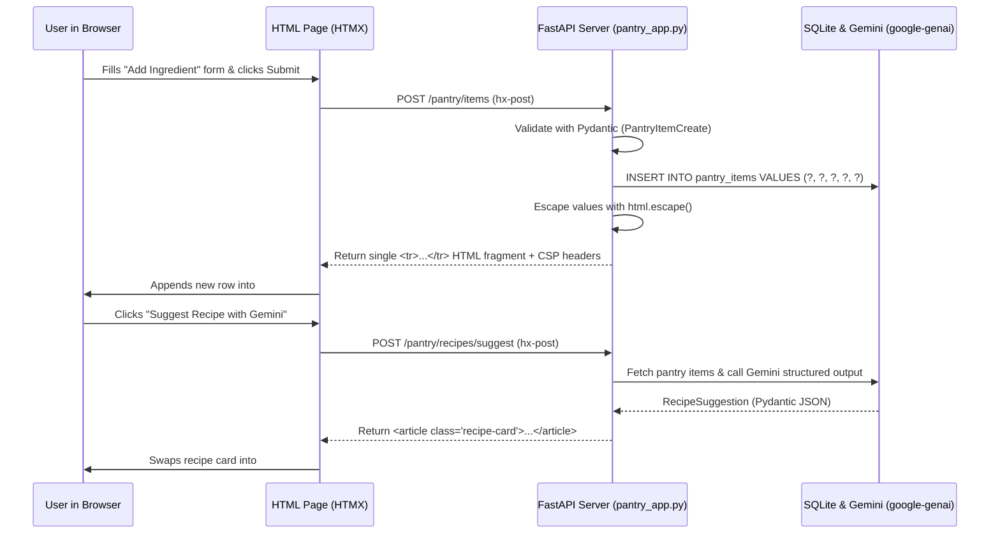

# Chapter 7: From Sketch to Full-Stack Web App (and Testing It with Antigravity `/browser`)

## 1. What We're Building & Why It Matters

If you've built a cool Python script or AI backend, the very next thing you usually want to do is **put a web page in front of it** so you (or your friends, teammates, or customers) can actually click buttons, fill out a form, and see results on screen instead of staring at terminal output.

And if you've ever asked an AI coding assistant, *"Build me a web frontend for my Python app,"* you know what often happens next:

Suddenly, your simple 150-line Python project explodes into two separate repositories, a `node_modules` folder with 40,000 files, three bundler configuration files, a state management library, and a build step that breaks every time a JavaScript package updates. You just wanted a table, a form to add items, and a button to ask Gemini for a recommendation—and now you're debugging webpack errors at midnight.

Even worse, if you ask an AI to quickly stitch together HTML strings in Python or JavaScript without clear security rules, it is dangerously easy to introduce **Cross-Site Scripting (XSS)** bugs where a stray `<` or `"` in user input breaks your page—or executes unauthorized JavaScript in another user's browser.

There is a much simpler, cleaner, and safer way to build interactive web apps in Python:

1. **Draw what you want on a piece of paper** (or a whiteboard) and drop a photo of that sketch into **Google AI Studio** or **Google Antigravity** to generate clean HTML and CSS.
2. **Keep your UI logic in Python with `FastAPI` + `HTMX`**: Instead of maintaining a separate JavaScript single-page application, your FastAPI routes return small, safe HTML fragments (`<tr>...</tr>` or `<article>...</article>`) that snap straight into the page without a full browser reload.
3. **Bake in web security from day one**: Escape every untrusted value with `html.escape()`, quote every HTML attribute, and send strict browser security headers (`Content-Security-Policy`, `X-Frame-Options: DENY`, `X-Content-Type-Options: nosniff`).
4. **Test the real UI automatically**: Combine fast `FastAPI` `TestClient` checks with Antigravity's **`/browser`** slash command (and `Playwright`) so your agent actually opens Chrome, fills out your form, clicks your buttons, and verifies that everything renders cleanly.

In this chapter, we'll learn all four steps from scratch and build **Lab 07 (`labs/lab07-web-ui-and-browser/`)**: a full-stack **Smart Pantry & Recipe Tracker** web app powered by FastAPI, HTMX, SQLite, and Gemini (`google-genai`).

---

## 2. The Concept from Scratch

### How Server-Rendered HTML + `HTMX` Works

Let's start with first principles. How does a normal web page work?

When you visit `http://127.0.0.1:8007/` in your browser, the browser sends an HTTP `GET /` request to your Python server. Your Python server returns an HTML document—a text string made of tags like `<table>`, `<form>`, and `<button>`—and the browser paints it on your screen.

In traditional 1990s web apps, every time you submitted a form (`POST /pantry/items`), the browser threw away the entire page, waited for the server to send back a brand-new full HTML page, and flashed white while redrawing everything from top to bottom.

To avoid that full-page flash, developers spent the last decade building heavy JavaScript frontends that fetch JSON and rebuild the page in the browser.

**`HTMX`** gives you that smooth, instant update experience **without leaving Python**. It works by adding three tiny, readable attributes directly onto any normal HTML `<form>` or `<button>`:

- **`hx-post="/pantry/items"`**: *"When the user submits this form or clicks this button, send an HTTP `POST` request to `/pantry/items` in the background."*
- **`hx-target="#pantry-table-body"`**: *"When the server sends back a snippet of HTML, find the element on the page with `id="pantry-table-body"`."*
- **`hx-swap="beforeend"`** (or `"innerHTML"`): *"Insert that new HTML snippet right at the bottom of the target element (`beforeend`) or replace what's inside it (`innerHTML`)."*

Let's trace that flow visually:



Look how little moving parts that requires:
- Your Python backend validates the data with `Pydantic`, saves it to SQLite using parameterized `?` queries, formats a 7-line `<tr>...</tr>` string with `html.escape()`, and returns it.
- You don't have to write client-side state synchronization, JSON parsers, or unsafe DOM manipulation code.

### Web Security from Scratch: Stopping Cross-Site Scripting (XSS)

Whenever your web app takes text that came from the outside world—whether typed into a form by a user, loaded from a database row, or generated by an AI model—and puts that text into an HTML page, you have to guard against **Cross-Site Scripting (XSS)**.

What is XSS in plain English?

Imagine our Smart Pantry app renders a table cell using a naive Python f-string without escaping:

```python
# VULNERABLE CODE — NEVER DO THIS!
row_html = f"<td>{item.name}</td>"
```

If an ordinary user types `Chickpeas`, the browser sees:

```html
<td>Chickpeas</td>
```

Everything looks fine. Now imagine a mischievous user (or an attacker) types this as the ingredient name:

```text
<script>stealSession()</script>
```

If we don't escape `item.name`, the HTML sent to the browser becomes:

```html
<td><script>stealSession()</script></td>
```

When the browser reads `<script>`, it doesn't know that text came from an ingredient input box! It thinks **your server** wrote that `<script>` tag, and it immediately executes the JavaScript inside the browser of everyone who views the page.

#### How We Stop XSS Cold (Four Simple Habits)

1. **Escape every untrusted string before putting it into HTML (`html.escape`)**:
   Python's built-in `html.escape(value, quote=True)` converts the five characters that have special meaning in HTML into harmless text entities:
   - `<` becomes `&lt;`
   - `>` becomes `&gt;`
   - `&` becomes `&amp;`
   - `"` becomes `&quot;`
   - `'` becomes `&#x27;`

   When the browser receives `<td>&lt;script&gt;stealSession()&lt;/script&gt;</td>`, it displays the literal characters `<script>stealSession()</script>` harmlessly on screen as plain text and **never executes them as code**.
   Notice that you must escape strings **even when reading them back from your own database**—because database rows originally came from external inputs!

2. **Always quote every HTML attribute**:
   Suppose you put a variable inside an HTML attribute without quotes:
   - **Vulnerable**: `<div class={{ category }}>` — If `category` contains `Produce onclick=evil()`, an attacker can break out of the attribute without even needing a quote character!
   - **Secure**: `<div class="cell-category">` — Always wrap attribute values in double quotes (`"..."`) and escape any dynamic values with `html.escape(val, quote=True)`.

3. **Avoid unsafe JavaScript DOM APIs and browser storage**:
   - If you ever write client-side JavaScript, never assign strings to `element.innerHTML`, `outerHTML`, or `document.write()`. Use `element.textContent = value` and `document.createElement()` instead.
   - Never use `localStorage` or `sessionStorage` to store authentication tokens or session IDs (because any XSS bug can read `localStorage`). Use `HttpOnly`, `Secure`, `SameSite` cookies set by the backend.
   - Never use blocking browser dialogs like `alert()`, `confirm()`, or `prompt()` in production UI code.

4. **Send a strict `Content-Security-Policy` (CSP) and security headers**:
   Even after escaping every string, we add a second layer of armor called **HTTP Security Headers** on every response from FastAPI:
   - `Content-Security-Policy: default-src 'self'; script-src 'self'; style-src 'self'; object-src 'none'; frame-ancestors 'none'; base-uri 'self'` — This tells the browser: *"Only load scripts and stylesheets from our own server (`'self'`). Even if someone ever managed to sneak an inline `<script>` tag onto the page, refuse to run it!"*
   - `X-Content-Type-Options: nosniff` — Prevents the browser from guessing ("sniffing") a file's type and treating a plain text response as executable HTML or script.
   - `X-Frame-Options: DENY` — Prevents malicious websites from embedding your app inside an invisible `<iframe>` to trick users into clicking buttons (**clickjacking**).

---

## 3. The Google Tool from Scratch

Now let's look at three Google tools that make building, visualizing, and testing web interfaces dramatically faster: **Multimodal Sketch-to-Code with Gemini**, **Antigravity Generative UI**, and **Antigravity `/browser`**.

### 1. Sketch-to-Code with Gemini in Google AI Studio & Antigravity

You don't need to be a graphic designer to create a clean web layout. Because Gemini is natively multimodal, one of the fastest ways to start a web app is to grab a pen and a piece of paper (or a whiteboard) and draw three boxes:

- Box 1: *"Pantry Inventory Table (Ingredient, Category, On Hand, Reorder At, Status Badge)"*
- Box 2: *"Add Ingredient Form (Name, Category dropdown, Quantity, Unit, Threshold, Add Button)"*
- Box 3: *"AI Chef Suggestion Card ('Suggest Recipe with Gemini' button + steps list)"*

Snap a photo of your sketch and drag-and-drop it straight into the **Antigravity Chat Canvas** (or **Google AI Studio**). Then pair the image with a clear, security-aware prompt:

> *"Turn this sketch into a single-page FastAPI + HTMX HTML dashboard. Serve the CSS from `/styles.css` so it works with a strict `Content-Security-Policy: default-src 'self'`, quote all HTML attributes, and escape all dynamic values with `html.escape()`."*

In seconds, Gemini translates your hand-drawn boxes into semantic HTML (`<header>`, `<main>`, `<section>`, `<table>`, `<form>`) and a responsive CSS Grid layout.

### 2. Interactive Previews Inside Your Chat: Antigravity Generative UI

What if you are exploring an idea with Antigravity—like comparing how different low-stock thresholds affect your pantry alerts, or visualizing a component layout—and you want to see and interact with a widget *right inside your chat conversation* before wiring up a full FastAPI server?

Antigravity includes a built-in **Generative UI** capability (`generative_ui` skill):
- Antigravity can write a self-contained HTML artifact to your conversation's artifact directory using the allowlisted Tailwind CSS stylesheet (`https://www.gstatic.com/antigravity/web/dev/tailwindcss.min.js`) and your workspace's automatic light/dark theme variables (`var(--card)`, `var(--foreground)`, `var(--border)`).
- For compact widgets (under 500px tall), Antigravity can embed the live interactive card directly inline in your chat stream using `<agent-embed src="file:///.../widget.html"></agent-embed>`, or let you open larger dashboards in the side pane!

### 3. Testing Your Web App for Real with Antigravity `/browser` and `Playwright`

Once your FastAPI app is running on `http://127.0.0.1:8007`, how do you know the page actually looks right, the form submits properly, and there are no broken stylesheets or console errors?

You have two complementary tools:

1. **FastAPI `TestClient` (Fast HTTP & HTML Verification)**:
   Runs in milliseconds inside Python (`uv run pytest`) without opening a browser window. It sends real HTTP `GET` and `POST` requests to your FastAPI app and verifies status codes, HTML fragments, security headers, and XSS escaping.
2. **Antigravity `/browser` Slash Command (Real Chrome Inspection)**:
   When you type `/browser` in the Antigravity chat canvas (for example, *"/browser Start `labs/lab07-web-ui-and-browser/pantry_app.py` on `127.0.0.1:8007`, add 'Turmeric Powder' with quantity 0.5, and verify the LOW STOCK badge appears"*), Antigravity launches a real browser session. It can:
   - Navigate to `http://127.0.0.1:8007` (restricted by your **Browser Allowlist** in Antigravity Settings for safety).
   - Fill out form inputs (`#name-input`, `#quantity-input`), click `#add-ingredient-btn` and `#suggest-recipe-btn`, and inspect the rendered DOM.
   - Check the browser console and network tab to confirm our strict `Content-Security-Policy` didn't block any legitimate assets.
   - Help you capture repeatable end-to-end browser tests using `Playwright`.

> [!IMPORTANT]
> **Always bind local test servers to `127.0.0.1`, never `0.0.0.0`!**
> When you run `uvicorn.run(app, host="127.0.0.1", port=8007)`, only processes on your own machine (like your browser and Antigravity's `/browser` agent) can connect to your test server. Binding to `0.0.0.0` exposes your local development server to everyone on your Wi-Fi network!

---

## 4. Hands-On Python Lab Walkthrough

Let's walk through the code in `labs/lab07-web-ui-and-browser/` and see how all of these pieces come together in roughly 370 lines of clean Python.

### Step 1: Validating Form Inputs and Gemini Outputs with Pydantic v2

Open [`pantry_app.py`](../labs/lab07-web-ui-and-browser/pantry_app.py#L36-L119). First, we define three `Pydantic` v2 models:

- [`PantryItemCreate`](../labs/lab07-web-ui-and-browser/pantry_app.py#L36-L81): Validates user form submissions. It strips whitespace, enforces `min_length=1, max_length=80` on the ingredient name, checks that `quantity` and `reorder_threshold` are between `0.0` and `10000.0`, and validates `category` and `unit` against strict allow-lists (`ALLOWED_CATEGORIES` and `ALLOWED_UNITS`).
- [`PantryItemRecord`](../labs/lab07-web-ui-and-browser/pantry_app.py#L84-L98): Represents a row stored in SQLite and exposes a clean `@property def is_low_stock(self) -> bool` that returns `True` whenever `self.quantity <= self.reorder_threshold`.
- [`RecipeSuggestion`](../labs/lab07-web-ui-and-browser/pantry_app.py#L101-L119): Defines the exact schema we ask Gemini (`google-genai`) to return when suggesting a recipe from our available pantry items:

```python
class RecipeSuggestion(BaseModel):
    """Structured recipe output from Gemini or the offline recipe matcher."""

    model_config = ConfigDict(extra="forbid")

    title: str = Field(..., description="Short, appetizing recipe title.")
    prep_time_minutes: int = Field(..., ge=1, le=240)
    matched_ingredients: list[str] = Field(
        default_factory=list,
        description="Ingredients from the user's pantry used in this recipe.",
    )
    missing_low_stock_items: list[str] = Field(
        default_factory=list,
        description="Low-stock pantry items that should be restocked soon.",
    )
    steps: list[str] = Field(
        ...,
        min_length=1,
        description="Clear step-by-step cooking instructions.",
    )
```

### Step 2: Parameterized SQLite Storage & Structured Gemini Recipes

Next, inspect [`insert_pantry_item`](../labs/lab07-web-ui-and-browser/pantry_app.py#L188-L218) and [`generate_recipe_suggestion`](../labs/lab07-web-ui-and-browser/pantry_app.py#L221-L271) in [`pantry_app.py`](../labs/lab07-web-ui-and-browser/pantry_app.py):

```python
    api_key = os.environ.get("GEMINI_API_KEY")
    if api_key:
        try:
            client = genai.Client(api_key=api_key)
            prompt = (
                "Create a practical home-cooked recipe using these pantry ingredients: "
                f"{', '.join(ingredient_names)}. "
                f"Low-stock items to note: {', '.join(low_stock_names) or 'None'}."
            )
            response = client.models.generate_content(
                model="gemini-3-flash-preview",
                contents=prompt,
                config=types.GenerateContentConfig(
                    response_mime_type="application/json",
                    response_schema=RecipeSuggestion,
                    temperature=0.2,
                ),
            )
            if response.text:
                return RecipeSuggestion.model_validate_json(response.text)
        except Exception:
            # Fail safe to deterministic offline recipe matcher if network/API is unavailable
            pass
```

Notice two important habits here:
1. We **never** hardcode an API key or a dummy fallback key. We read `os.environ.get("GEMINI_API_KEY")`.
2. When `GEMINI_API_KEY` is set, we pass `response_mime_type="application/json"` and `response_schema=RecipeSuggestion` to `gemini-3-flash-preview`, then validate the JSON with `RecipeSuggestion.model_validate_json(response.text)`. When running offline in CI or local tests without an API key, our deterministic fallback returns a valid `RecipeSuggestion` object using the exact same Pydantic schema!

### Step 3: Escaping All HTML Fragments and Enforcing Security Headers

Now look at [`render_pantry_row_html`](../labs/lab07-web-ui-and-browser/pantry_app.py#L274-L296) and [`enforce_security_headers`](../labs/lab07-web-ui-and-browser/pantry_app.py#L430-L444) in [`pantry_app.py`](../labs/lab07-web-ui-and-browser/pantry_app.py):

```python
def render_pantry_row_html(item: PantryItemRecord) -> str:
    """Render a single HTML table row with all untrusted strings strictly escaped."""
    safe_name = html.escape(item.name, quote=True)
    safe_category = html.escape(item.category, quote=True)
    safe_unit = html.escape(item.unit, quote=True)
    safe_qty = html.escape(f"{item.quantity:g}", quote=True)
    safe_threshold = html.escape(f"{item.reorder_threshold:g}", quote=True)

    if item.is_low_stock:
        badge_html = '<span class="badge badge-low">LOW STOCK</span>'
    else:
        badge_html = '<span class="badge badge-ok">IN STOCK</span>'

    return (
        f'<tr id="pantry-item-{item.item_id}" class="pantry-row">'
        f'<td class="cell-name">{safe_name}</td>'
        f'<td class="cell-category">{safe_category}</td>'
        f'<td class="cell-qty">{safe_qty} {safe_unit}</td>'
        f'<td class="cell-threshold">{safe_threshold} {safe_unit}</td>'
        f'<td class="cell-status">{badge_html}</td>'
        "</tr>"
    )
```

Every single field coming out of `PantryItemRecord`—and every field inside `render_recipe_card_html()`—is passed through `html.escape(..., quote=True)` before being placed inside an HTML tag, and every HTML attribute is wrapped in double quotes (`class="pantry-row"`).

And in our FastAPI HTTP middleware:

```python
@app.middleware("http")
async def enforce_security_headers(
    request: Request,
    call_next: Callable[[Request], Awaitable[Response]],
) -> Response:
    """Attach strict CSP, anti-clickjacking, and nosniff headers to every response."""
    if request.method not in {"GET", "POST", "HEAD"}:
        return Response(status_code=405, content="Method Not Allowed")

    response = await call_next(request)
    response.headers["Content-Security-Policy"] = STRICT_CSP_HEADER
    response.headers["X-Content-Type-Options"] = "nosniff"
    response.headers["X-Frame-Options"] = "DENY"
    response.headers["Permissions-Policy"] = "camera=(), microphone=(), geolocation=()"
    response.headers["Cache-Control"] = "no-store"
    return response
```

Because we serve our stylesheet from `@app.get("/styles.css")`, our `Content-Security-Policy` can enforce `style-src 'self'` and `script-src 'self'` without needing `'unsafe-inline'`.

### Step 4: Running the End-to-End & Security Tests

Let's run [`test_pantry_app.py`](../labs/lab07-web-ui-and-browser/test_pantry_app.py) to verify our dashboard, HTMX fragment endpoints, low-stock badges, recipe suggestions, security headers, and XSS escaping!

From the repository root, run:

```bash
uv run python labs/lab07-web-ui-and-browser/test_pantry_app.py
```

You will see all 6 end-to-end tests pass:

```text
[PASS] test_dashboard_renders_seeded_pantry_and_htmx_attributes
[PASS] test_security_headers_enforced_on_all_responses
[PASS] test_add_pantry_item_htmx_fragment_and_low_stock_flag
[PASS] test_xss_payload_is_strictly_escaped_in_fragment_and_dashboard
[PASS] test_invalid_category_or_negative_quantity_rejected
[PASS] test_suggest_recipe_endpoint_returns_escaped_card

All 6/6 Lab 07 Web UI & Security tests passed!
```

Take a close look at [`test_xss_payload_is_strictly_escaped_in_fragment_and_dashboard`](../labs/lab07-web-ui-and-browser/test_pantry_app.py#L84-L108):

```python
    xss_payload = '<script>alert(1)</script>'
    response = client.post(
        "/pantry/items",
        json={
            "name": xss_payload,
            "category": "Produce",
            "quantity": 3.0,
            "unit": "pcs",
            "reorder_threshold": 1.0,
        },
    )
    assert response.status_code == 201

    # Raw <script> tag must NEVER appear in the rendered fragment
    assert "<script>alert(1)</script>" not in response.text
    assert "&lt;script&gt;alert(1)&lt;/script&gt;" in response.text
```

We don't just *hope* our app is safe against XSS—we have an automated test that fires a real `<script>` and `onerror=` payload at `/pantry/items` and proves that both the HTMX fragment response and the full `GET /` dashboard escape it into harmless `&lt;script&gt;` text!

---

## 5. Wrapping Up & What's Next

Let's review what we built and learned in Chapter 7:

- **Sketch-to-Code with Gemini**: A quick hand-drawn sketch on paper or a whiteboard can be dropped into Google AI Studio or Antigravity to generate semantic HTML and CSS in seconds.
- **FastAPI + HTMX**: By returning small, server-rendered HTML fragments (`<tr>...</tr>`, `<article>...</article>`) wired with `hx-post`, `hx-target`, and `hx-swap`, you can build snappy, interactive web apps entirely in Python without complex JavaScript build pipelines.
- **Defense-in-Depth Web Security**:
  - Validate all inputs with `Pydantic` v2 and store data with parameterized SQL (`?` placeholders).
  - Escape all untrusted text with `html.escape(..., quote=True)` and quote every HTML attribute.
  - Attach strict `Content-Security-Policy`, `X-Content-Type-Options: nosniff`, `X-Frame-Options: DENY`, and `Permissions-Policy` headers on every response.
  - Always bind local test servers to `127.0.0.1`.
- **Visual & Automated UI Verification**: Combine fast `TestClient` tests with Antigravity's `/browser` slash command and Generative UI (`<agent-embed>`) to inspect, interact with, and verify your web pages automatically.

In **Part 4 (Chapters 8, 9, and 10)**, we will take everything we've built so far into the world of **in-app AI agents, cloud deployment, and automation**:
- In **Chapter 8**, we will build multi-agent workflows inside our own Python app using **Google ADK (`google-adk`)** and score their accuracy with automated trajectory evaluations.
- In **Chapter 9**, we will harden our app, package it with **Docker**, load-test it with **Locust**, and deploy it live to **Google Cloud Run**.
- In **Chapter 10**, we will automate our CI/CD pipeline with **Google Cloud Build**, optimize our Gemini costs, and control our coding agent from Python using the **`google-antigravity` SDK**!

---

**Navigation**: [← Previous: Chapter 6 — Connecting Antigravity to Live Docs and Tools with MCP](./ch06-connecting-live-data-with-mcp.md) | [🏠 Book Index](../README.md) | [Next: Chapter 8 — Building Apps with Their Own AI Agents Using Google ADK →](./ch08-building-agents-with-google-adk.md)
