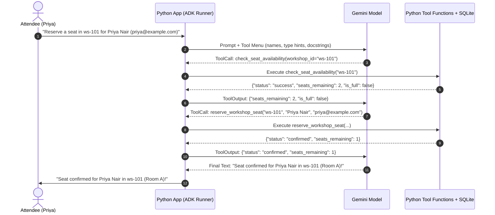

# Chapter 8: Building Apps with Their Own AI Agents Using Google ADK

## 1. What We're Building & Why It Matters

If you have been following along through the first seven chapters, you have already used an AI coding agent—Google Antigravity—to help you design, write, test, and debug Python applications. Up to now, the agent has been **your** teammate sitting inside your editor.

At some point, though, almost every builder has the same realization:

*"Wait a second. Calling Gemini once to extract a receipt or classify a support ticket is great. But what if my users ask a question that takes two or three steps to answer—like checking live inventory in my database, verifying a rule, and then booking a reservation?"*

If you try to build that with a single prompt and a giant `if/else` block, things get messy fast. You end up writing fragile regular expressions to guess what the user wants, or cramming your entire database into the system prompt and hoping the model does not make up numbers.

What you actually want is to put an **AI agent inside your own application**—an assistant that can look at a user's request, decide which Python functions to call, inspect the results from your database, and reply with an accurate answer.

Let's pause here and draw a clear line between the two kinds of agents you will work with as a modern Python developer:

| Question | **Your Coding Agent (Google Antigravity)** | **Your App's Agent (Google ADK)** |
| :--- | :--- | :--- |
| **Who talks to it?** | You (the developer) while building your project | Your end users inside the web app or API you ship |
| **What tools does it have?** | File editor, terminal runner, test runner, browser | Python functions *you* write (`check_seat_availability`, `reserve_workshop_seat`) |
| **Where does it run?** | On your laptop or in your Antigravity workspace | Inside your Python backend (for example, on Google Cloud Run) |
| **How do you build it?** | Configured with `GEMINI.md`, skills, and MCP servers | Built in Python using the **Google Agent Development Kit (`google-adk`)** |

In this chapter, we are going to learn how to build, test, and evaluate in-app AI agents from scratch using the **Google Agent Development Kit (`google-adk`)** and its companion command-line tool (`agents-cli`). Then, in Lab 8, we will build a working **Multi-Agent Conference Concierge** for an event called *Cloud Builders Day* that searches live workshops, checks open seat counts in SQLite, reserves seats safely, and grades its own tool-calling behavior against an evaluation dataset.

---

## 2. The Concept from Scratch

### Why a Single Prompt Isn't Enough for Multi-Step Tasks

Imagine you are running a one-day developer conference called *Cloud Builders Day*. Attendees open a chat box on your event website and ask questions like:

1. *"What Python workshops are happening today?"*
2. *"How many open seats are left in workshop ws-101?"*
3. *"Please reserve a seat in ws-101 for Priya Nair (priya@example.com)."*

Why can't a plain Gemini text call handle that third request on its own?

Because Gemini, by itself, is a brain in a jar. It does not have direct access to your SQLite or PostgreSQL database. It does not know whether workshop `ws-101` has 2 seats left or sold out five minutes ago. And it certainly cannot run an `INSERT INTO reservations` statement unless your Python code executes that query on its behalf.

### How the Agent Tool-Calling Loop Actually Works

When people talk about an "AI agent," it can sound mysterious, as if the model is magically reaching into your server and running code by itself. Let's demystify that right now.

**Gemini never executes your Python functions directly.** Instead, an agent is simply a **while-loop** run by your Python application that coordinates a conversation between the user, the Gemini model, and a list of Python functions you have approved as **tools**.

Here is what happens step by step when Priya asks to book a seat in `ws-101`:

1. **You send the prompt plus your tool menu**: Your Python runner sends Priya's message to Gemini along with a list of the Python functions the agent is allowed to use (their names, parameter types, and docstrings).
2. **Gemini asks to call a tool**: Instead of replying with text for the user, Gemini replies with a structured request: *"Please call `check_seat_availability(workshop_id='ws-101')` and tell me what it returns."*
3. **Your Python code runs the function**: The ADK runner in your Python app calls your real `check_seat_availability("ws-101")` function, which queries your database and returns `{"seats_remaining": 2, "is_full": False}`.
4. **Gemini inspects the result and picks the next step**: The ADK runner sends that dictionary back to Gemini. Gemini sees that seats are open, so it makes a second tool request: *"Now please call `reserve_workshop_seat(workshop_id='ws-101', attendee_name='Priya Nair', attendee_email='priya@example.com')`."*
5. **Your Python code runs the second function and Gemini summarizes**: Your Python function inserts the booking into SQLite and returns `{"status": "confirmed", "seats_remaining": 1}`. Gemini reads that confirmation and writes a friendly final reply to Priya.

Let's visualize this entire back-and-forth with a sequence diagram:



Notice what happens if workshop `ws-102` is completely full (`"is_full": true`). In Step 4, Gemini sees `"seats_remaining": 0`, stops the loop early, **skips** `reserve_workshop_seat`, and politely tells the attendee that the session is full. That ability to look at intermediate data and decide what to do next is what makes an agent different from a fixed script.

### Why Multi-Agent Delegation Beats One Giant "Do-Everything" Agent

When you build your first agent, it is tempting to hand a single `Agent` twenty different Python functions and a 200-line instruction prompt.

Here is the problem you will quickly run into: the more tools you give a single agent, the easier it is for the model to get confused about which tool to pick or which rules apply to which task.

Just like a well-organized software module splits responsibilities across focused functions, a reliable agent system splits responsibilities across **specialist sub-agents**:

- A **Catalog Specialist** whose only job is searching the conference schedule and checking seat counts (`search_workshops`, `check_seat_availability`).
- A **Booking Specialist** whose only job is verifying capacity and creating reservations (`check_seat_availability`, `reserve_workshop_seat`).
- A **Root Coordinator** that greets the attendee and routes schedule questions to the Catalog Specialist and reservation requests to the Booking Specialist.

### How Do We Know Our Agent Actually Works? (Trajectory Evaluation)

In earlier chapters, we wrote `pytest` unit tests to check deterministic Python functions: pass in `2 + 2`, assert that you get `4`.

With an AI agent, checking only the final sentence is dangerous. What if an attendee asks to book a seat in `ws-101`, and the agent replies *"Your seat is confirmed!"* **without ever calling `reserve_workshop_seat`**? If you only checked whether the word `"confirmed"` appeared in the reply, you would think the agent succeeded while your database remained empty!

That is why agent testing looks at two things together:

1. **The Tool Trajectory**: The exact sequence of tools the agent called (for example, `["check_seat_availability", "reserve_workshop_seat"]`).
2. **The Grounded Final Response**: Whether the final answer accurately reflects the data returned by those tools.

---

## 3. The Google Tool from Scratch: Google ADK & `agents-cli`

You could write that `while` loop, tool schema converter, session state tracker, and multi-agent router by hand using the raw `google-genai` SDK. But you would end up writing hundreds of lines of plumbing code before solving your actual problem.

That is why Google created the **Agent Development Kit (`google-adk`)** and its companion workflow tool, **`agents-cli`**.

### Step 1: Scaffolding a Project with `agents-cli`

When starting a brand-new standalone ADK project, Google provides `agents-cli` to set up the standard folder layout, evaluation config, and deployment templates automatically:

```bash
# Install the CLI tool once with uv
uv tool install google-agents-cli

# Create a new ADK project with evaluation folders pre-configured
agents-cli scaffold create event-concierge
```

A scaffolded project gives you a clean structure right out of the box:

```text
event-concierge/
├── app/
│   ├── __init__.py
│   ├── agent.py              # Defines root_agent
│   └── tools.py              # Your Python tool functions
├── tests/
│   └── eval/
│       ├── eval_config.yaml  # Metrics to grade (task success, tool use quality)
│       └── datasets/         # JSON evaluation cases
└── pyproject.toml
```

### Step 2: Writing Tools That Gemini Understands

In Google ADK, you do not need to write complex JSON schemas to describe your tools. You just write a normal Python function and pass it into `Agent(..., tools=[your_function])`.

There is one golden rule you must remember: **ADK inspects your function's name, Python type hints, and docstring, and sends them directly to Gemini as the tool's instruction manual.**

Let's compare a poorly written tool with an ADK-ready tool:

```python
# BAD: No type hints, vague name, no docstring.
# Gemini has no idea what 'x' is or when to call this function!
def do_check(x):
    ...

# GOOD: Clear name, strict Python type hints, and an explicit docstring.
def check_seat_availability(workshop_id: str) -> dict[str, Any]:
    """Checks the current seat availability for a specific workshop ID.

    Always call this tool before attempting to reserve a seat or when an attendee
    asks how many open seats remain in a specific workshop (such as 'ws-101').

    Args:
        workshop_id: The unique workshop identifier, such as 'ws-101' or 'ws-102'.

    Returns:
        A dictionary with 'status', 'workshop_id', 'seats_remaining', and 'is_full'.
    """
    ...
```

When you write a clear `Args:` and `Returns:` docstring and return a dictionary with a clear `"status"` key (`"success"`, `"not_found"`, `"workshop_full"`), Gemini knows both **when** to call the function and **how** to interpret the result.

### Step 3: Defining Agents and Sub-Agents with `google.adk.agents.Agent`

Creating an agent in `google-adk` takes just a few lines of Python:

```python
from google.adk.agents import Agent

catalog_specialist = Agent(
    name="catalog_specialist",
    model="gemini-3-flash-preview",
    description="Handles questions about conference workshop schedules, topics, and open seat availability.",
    instruction=(
        "You are the Catalog Specialist for Cloud Builders Day. "
        "Always use `search_workshops` when attendees ask about topics or schedules, "
        "and use `check_seat_availability` when they ask how many seats are left."
    ),
    tools=[search_workshops, check_seat_availability],
)
```

Notice the two text fields on `Agent`:
- **`instruction`** tells *this* agent how to behave when it is active.
- **`description`** tells a *parent coordinator agent* when to hand the conversation over to this specialist!

When you wire specialist agents into a coordinator using `sub_agents=[catalog_specialist, booking_specialist]`, the root agent reads each specialist's `description` to decide who should handle the user's request:

```python
root_agent = Agent(
    name="event_concierge_coordinator",
    model="gemini-3-flash-preview",
    description="Main conference concierge that routes schedule and booking requests.",
    instruction=(
        "You are the Welcome Desk Coordinator for Cloud Builders Day. "
        "Delegate schedule discovery and seat-count questions to `catalog_specialist`. "
        "Delegate seat booking and reservation requests to `booking_specialist`."
    ),
    sub_agents=[catalog_specialist, booking_specialist],
)
```

### Step 4: Interactive Visual Testing with `adk web` and Automated Grading with `agents-cli eval`

During development, you have two ways to test your ADK agent:

1. **Interactive Visual Debugging (`adk web` or `agents-cli playground`)**:
   Running `uv run adk web` launches a local browser UI bound to `127.0.0.1` where you can chat with your agent and watch every single event, sub-agent handoff, tool call argument, and tool return dictionary in real time.
2. **Automated Evaluation (`agents-cli eval run`)**:
   Instead of manually typing the same five questions after every prompt edit, you store test prompts in an evaluation dataset JSON file and run `agents-cli eval run`. The evaluator runs your agent against every test case and scores metrics like `multi_turn_task_success`, `multi_turn_trajectory_quality`, and `multi_turn_tool_use_quality`—or runs a custom deterministic Python grading function locally.

---

## 4. Hands-On Python Lab Walkthrough

Let's walk through **Lab 8** (`labs/lab08-google-adk-agent/`), where we build and verify our **Cloud Builders Day Multi-Agent Event Concierge**.

### File 1: The Parameterized SQLite Store and Tool Functions (`concierge_agent.py`)

Open [concierge_agent.py](../labs/lab08-google-adk-agent/concierge_agent.py). We start by defining Pydantic v2 models (`WorkshopInfo`, `ToolCallRecord`, `AgentTurnTrace`, `EvalCaseResult`, and `EvalSummaryReport`) so that every piece of data flowing through our tools and evaluator is strictly validated.

Next, look at how our database layer is set up in `_initialize_schema` and queried inside `search_workshops`:

```python
INITIAL_WORKSHOPS: list[tuple[str, str, str, str, int, int]] = [
    ("ws-101", "Build Fast APIs with Gemini & Python", "python", "Room A", 30, 28),
    ("ws-102", "Hands-On Google ADK Agents", "agents", "Room B", 25, 25),
    ("ws-103", "Deploying Containers to Cloud Run", "cloud-run", "Room C", 40, 15),
]
```

Notice our initial state:
- `ws-101` (*Build Fast APIs with Gemini & Python*) has a capacity of 30 and 28 booked seats (**2 open seats left**).
- `ws-102` (*Hands-On Google ADK Agents*) has a capacity of 25 and 25 booked seats (**0 open seats left—completely full!**).
- `ws-103` (*Deploying Containers to Cloud Run*) has 25 open seats left.

Now let's look closely at `search_workshops` in [concierge_agent.py](../labs/lab08-google-adk-agent/concierge_agent.py):

```python
    if cleaned_topic:
        like_pattern = f"%{cleaned_topic}%"
        cursor = conn.execute(
            """
            SELECT workshop_id, title, topic, room, capacity, booked_seats
            FROM workshops
            WHERE LOWER(topic) LIKE ? OR LOWER(title) LIKE ?
            ORDER BY workshop_id ASC
            """,
            (like_pattern, like_pattern),
        )
```

> [!IMPORTANT]
> **Security Rule in Action: Parameterized Queries Inside Agent Tools**
> Remember that tool arguments (`topic`, `workshop_id`, `attendee_name`) come from untrusted user prompts passed through an LLM! If a user prompts *"Search for workshops on topic `python' OR '1'='1`"*, the model might pass that string straight into `search_workshops(topic="python' OR '1'='1")`. Because we use `?` placeholders in `conn.execute(...)`, SQLite treats the input strictly as a literal string value and never as executable SQL commands.

Now check `reserve_workshop_seat` in [concierge_agent.py](../labs/lab08-google-adk-agent/concierge_agent.py). Even though our `booking_specialist` instruction tells the agent to call `check_seat_availability` before calling `reserve_workshop_seat`, **we never rely on a prompt alone to enforce a business rule**. Inside `reserve_workshop_seat`, our Python code enforces three hard checks:

1. It validates that `attendee_name` is non-empty and `attendee_email` contains `@`.
2. It calls `check_seat_availability(normalized_id)` and rejects the booking with `"status": "workshop_full"` if `seats_remaining == 0`.
3. It checks the `reservations` table to prevent duplicate bookings for the same email and workshop.

### File 2: The Multi-Agent Hierarchy (`concierge_agent.py`)

In Section 4 of [concierge_agent.py](../labs/lab08-google-adk-agent/concierge_agent.py), we wire our two specialist `google.adk.agents.Agent` instances (`catalog_specialist` and `booking_specialist`) into `root_agent`:

```python
root_agent = Agent(
    name="event_concierge_coordinator",
    model=MODEL_ID,
    description=(
        "Main conference concierge that routes schedule questions to the "
        "catalog_specialist and booking requests to the booking_specialist."
    ),
    instruction=(
        "You are the Welcome Desk Coordinator for Cloud Builders Day. "
        "Delegate schedule discovery and seat-count questions to `catalog_specialist`. "
        "Delegate seat booking and reservation requests to `booking_specialist`. "
        "Always base your answers strictly on tool outputs."
    ),
    sub_agents=[catalog_specialist, booking_specialist],
)
```

### File 3: Grading Tool Trajectories (`eval_dataset.json`)

Open [eval_dataset.json](../labs/lab08-google-adk-agent/eval_dataset.json). We define four evaluation cases that test both normal paths and edge cases:

1. `discover_python_workshops`: Asks what Python workshops are happening today.
   - Expected specialist: `catalog_specialist`
   - Expected tool trajectory: `["search_workshops"]`
2. `check_open_seats_ws101`: Asks how many open seats remain in `ws-101`.
   - Expected specialist: `catalog_specialist`
   - Expected tool trajectory: `["check_seat_availability"]`
3. `reserve_seat_success`: Asks to reserve a seat in `ws-101` for Priya Nair (`priya@example.com`).
   - Expected specialist: `booking_specialist`
   - Expected tool trajectory: `["check_seat_availability", "reserve_workshop_seat"]`
4. `reserve_seat_full_workshop`: Asks to book a seat in `ws-102` (which has 0 seats left!) for Alex Rivera.
   - Expected specialist: `booking_specialist`
   - Expected tool trajectory: `["check_seat_availability"]` (it must **stop** after checking availability and **not** call `reserve_workshop_seat`!).

Let's run the trajectory evaluator and the automated test suite from the repository root:

```bash
uv run python labs/lab08-google-adk-agent/concierge_agent.py
uv run python labs/lab08-google-adk-agent/test_concierge_agent.py
```

You will see output confirming every trajectory and test case passes:

```text
Evaluated 4 cases | Passed: 4/4 (100.0%)
  [PASS] discover_python_workshops: tools=['search_workshops']
  [PASS] check_open_seats_ws101: tools=['check_seat_availability']
  [PASS] reserve_seat_success: tools=['check_seat_availability', 'reserve_workshop_seat']
  [PASS] reserve_seat_full_workshop: tools=['check_seat_availability']
```

And when running [test_concierge_agent.py](../labs/lab08-google-adk-agent/test_concierge_agent.py):

```text
[PASS] test_adk_agent_hierarchy_and_tools
[PASS] test_search_and_availability_tools
[PASS] test_reservation_and_capacity_guardrails
[PASS] test_sql_injection_safety_in_search
[PASS] test_trajectory_evaluation_dataset_passes_100_percent
[PASS] test_single_turn_runner_delegation

All 6/6 Lab 08 tests passed!
```

---

## 5. Wrapping Up & What's Next

Let's recap what we covered in this chapter:

- **Coding Agents vs. In-App Agents**: You use Google Antigravity to help you write and test code, and you use **Google ADK (`google-adk`)** when you want to embed an AI agent inside your own Python application for your users.
- **The Tool-Calling Loop**: Gemini never runs code directly on your server. Instead, your Python runner sends Gemini a menu of functions (built from your function names, Python type hints, and docstrings), executes the functions Gemini requests, and feeds the outputs back so Gemini can write a grounded answer.
- **Specialist Sub-Agents**: Splitting responsibilities across focused agents (`catalog_specialist` and `booking_specialist` under `event_concierge_coordinator`) keeps instructions short and prevents tool-selection confusion.
- **Defense in Depth**: Prompts guide the agent, but Python code enforces the rules—using parameterized SQL (`?` placeholders) and hard capacity checks inside the tool functions themselves.
- **Trajectory Evaluation**: Grading an agent means checking both the sequence of tools it called (`expected_tool_trajectory`) and the accuracy of its final response.

Now that we have built FastAPI backends, connected databases, and created multi-agent workflows with Google ADK, a big question remains: **How do we package our Python app so anyone on the internet can use it safely, without it crashing when 100 people click at once?**

In **Chapter 9**, we will take our Python service from `127.0.0.1` to a live HTTPS URL on **Google Cloud Run**—covering Docker containers from scratch, pre-launch security checks (Google Cloud Secret Manager, catching hallucinated packages, API key auth, and rate limiting), and load testing with Locust.

---

**Navigation**: [← Previous: Chapter 7 — From Sketch to Full-Stack Web App](./ch07-sketch-to-fullstack-web-app.md) | [🏠 Book Index](../README.md) | [Next: Chapter 9 — Going Live on Google Cloud Run →](./ch09-going-live-on-cloud-run.md)
