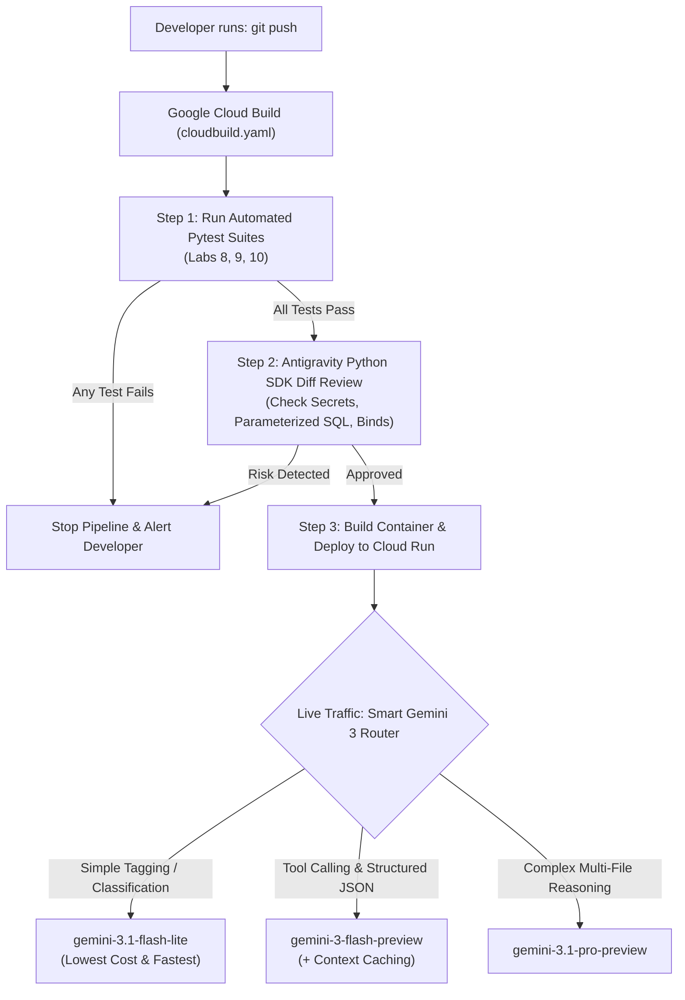

# Chapter 10: Automating Your Workflow & Controlling Costs (Cloud Build, Vertex AI, and the `google-antigravity` Python SDK)

## 1. What We're Building & Why It Matters

Congratulations on making it to the final chapter of this book! Think about how far we have come since Chapter 1. We started by sending a single prompt in Google AI Studio and validating JSON with Pydantic. Since then, we have built FastAPI backends, connected SQLite and vector databases, created multi-agent apps with **Google ADK**, and deployed hardened containers to **Google Cloud Run**.

Once your application is live and real users are relying on it, two new questions pop up almost immediately:

1. *"Do I really have to remember to run `pytest`, run the security checks, build the Docker image, and run `gcloud run deploy` by hand every single time I fix a bug?"*
2. *"How do I keep my monthly Google AI bill predictable when my traffic grows from 100 requests a day to 100,000 requests a day?"*

And right behind those two questions is an exciting third one:

3. *"Up to now, I've been chatting with Google Antigravity by typing in the IDE or CLI. Can I write a Python script that spins up an Antigravity agent automatically—for example, to review every code change before a release or run a recurring morning check?"*

In this final chapter, we are going to answer all three questions from first principles:
- **CI/CD 101 with Google Cloud Build**: How a 35-line `cloudbuild.yaml` file automatically runs your tests and deploys your container to Cloud Run only if every check passes.
- **Keeping Your Google AI Bill Low**: Why output tokens cost more than input tokens, how to route tasks across **Gemini Flash-Lite**, **Gemini Flash**, and **Gemini Pro** (plus **Vertex AI Model Optimizer**), and how **Gemini Context Caching** and the **Gemini Batch API** cut token bills by 50% to 75%.
- **The `google-antigravity` Python SDK & Scheduled Automations (`/schedule`)**: How to spawn and stream an Antigravity agent directly from Python code (`from google.antigravity import Agent, LocalAgentConfig, CapabilitiesConfig`) and schedule recurring tasks.

---

## 2. The Concept from Scratch

### CI/CD 101: What "Continuous Integration" and "Continuous Deployment" Actually Mean

Software teams love acronyms, and **CI/CD** is one of the most common. Let's strip away the jargon:

- **Continuous Integration (CI)** simply means: *"Every time someone pushes code to Git, an automated computer downloads the repo in a clean room and runs the test suite immediately."* If a test fails, you find out in 60 seconds—and the broken code is blocked from going live.
- **Continuous Deployment (CD)** simply means: *"If—and only if—every single test passes, that same automated computer builds the Docker container and deploys the new revision to Cloud Run for you."*

Why is this such a relief when you build with AI? Because even when you move fast with an AI coding assistant, your `cloudbuild.yaml` pipeline acts as an unbreakable safety gate that never forgets to run your tests before updating production.

### AI Cost Economics 101: How Token Billing Actually Works

When you are prototyping on your laptop, sending a few dozen prompts to `gemini-3.1-pro-preview` costs pennies. But when your app goes live, understanding three simple rules of token pricing will save you hundreds or thousands of dollars:

#### Rule 1: Output Tokens Cost More Than Input Tokens (Usually 4x More!)
Many builders assume that sending a long prompt is expensive and getting a short reply is cheap. In reality, generating **output tokens** requires the GPU to run a full forward pass for every single word it writes, whereas reading **input tokens** happens in parallel. As a result, across almost every Gemini tier, **1 million output tokens cost roughly 4 times as much as 1 million input tokens**.
- **Practical takeaway**: When you only need a category label (`"billing"`, `"technical"`) or a tiny JSON object, instruct the model (or enforce a Pydantic schema) to return *only* those fields—not a three-paragraph essay explaining its choice!

#### Rule 2: Don't Use a Heavy Truck to Deliver a Postcard (Smart Model Routing)
Not every prompt in your application needs your largest, most expensive reasoning model:
- **`gemini-3.1-flash-lite`**: Built for high-volume classification, sentiment tagging, yes/no checks, and simple field extraction at a fraction of a cent per thousand calls.
- **`gemini-3-flash-preview`**: The sweet spot for 85% of everyday production tasks—structured JSON extraction, customer chat, and multi-step ADK tool calling.
- **`gemini-3.1-pro-preview`**: Reserved for the hardest 10–15% of tasks—complex multi-file code refactoring, deep root-cause debugging, and intricate architectural tradeoffs.
- **Local Gemma via Ollama**: For offline development tests or zero-cost local text processing on your own machine, Google's open-weight **Gemma** models run for free locally.

#### Rule 3: Use Context Caching and the Batch API When Applicable
What if every request to your customer-support agent includes the same 25,000-token product manual in the system prompt?
- **Without Context Caching**: You pay full input price for those 25,000 tokens on every single user message.
- **With Gemini Context Caching**: You upload the 25,000-token manual once, and subsequent requests reuse the cached tokens at a **75% discount**.
- **With the Gemini Batch API**: If you have a job that does not need an instant interactive reply—like summarizing 5,000 conference survey responses overnight—submitting it to the **Gemini Batch API** gives you a flat **50% discount** across all tokens.

Let's visualize how our CI/CD pipeline, Antigravity SDK diff reviewer, and smart model router work together from `git push` to production:



---

## 3. The Google Tool from Scratch: Cloud Build, Vertex AI & the `google-antigravity` SDK

Let's look at the three Google tools that power this automation workflow.

### 1. Google Cloud Build (`cloudbuild.yaml`) & `agents-cli` CI/CD

**Google Cloud Build** is Google Cloud's serverless CI/CD runner. You place a file named `cloudbuild.yaml` in your repository, and each entry under `steps:` runs inside a fresh container in order. If Step 1 (`run-automated-tests`) exits with a non-zero error code, Cloud Build stops immediately and never runs Step 2 (`build-container-image`) or Step 3 (`deploy-to-cloud-run`).

Even better, when you are building an ADK agent project with **`agents-cli`**, you don't even have to write your CI/CD pipelines from scratch—one command adds ready-to-use Cloud Build or GitHub Actions workflows that run your unit tests, run your `agents-cli eval` suite, and deploy to staging and production:

```bash
# Automatically generate CI/CD pipelines for Google Cloud Build (or github_actions)
agents-cli scaffold enhance . \
  --deployment-target agent_runtime \
  --cicd-runner google_cloud_build
```

### 2. Vertex AI Model Optimizer & Context Caching

When you run Gemini workloads on Google Cloud's **Vertex AI**, you can either write your own explicit model-routing rules in Python (as we will do in Lab 10) or enable **Vertex AI Model Optimizer**, which automatically routes each prompt between Gemini Flash and Gemini Pro based on your cost-versus-quality preference slider.

### 3. The `google-antigravity` Python SDK

Throughout this book, we have used Google Antigravity interactively. But what if you want to embed an Antigravity coding or review agent inside your own Python automation scripts?

Google publishes the official **`google-antigravity` Python SDK** on PyPI (`uv add google-antigravity`). It gives you an asynchronous context manager—`async with Agent(config) as agent:`—that spawns the agent runtime, manages tool permissions safely, and lets you stream three separate channels in real time:
1. **Text tokens** (`async for token in response:`)
2. **Internal reasoning / thinking steps** (`async for thought in response.thoughts:`)
3. **Tool invocations** (`async for call in response.tool_calls:`)

Here is the core pattern from the official SDK:

```python
import asyncio
import sys
from google.antigravity import Agent, LocalAgentConfig, CapabilitiesConfig

async def main() -> None:
    # By default, LocalAgentConfig runs in read-only mode for safety.
    config = LocalAgentConfig(
        system_instructions="You are a pre-release security reviewer.",
        capabilities=CapabilitiesConfig(),
    )

    async with Agent(config) as agent:
        response = await agent.chat("Review the latest git diff for security risks.")

        # Stream the agent's internal reasoning steps
        async for thought in response.thoughts:
            print(f"[Thinking] {thought}")

        # Stream any tool calls the agent makes
        async for call in response.tool_calls:
            print(f"[Tool] {call.name}({call.args})")

        # Stream the final text response tokens
        async for token in response:
            sys.stdout.write(token)
            sys.stdout.flush()

if __name__ == "__main__":
    asyncio.run(main())
```

#### Controlling Agent Permissions (`CapabilitiesConfig`) and Multi-Turn Chats

Notice two details about `Agent(config)` that make the `google-antigravity` SDK so safe and practical for automation:

1. **Read-Only by Default**: When you create `CapabilitiesConfig()` with no arguments, the agent can read files and search your workspace, but it **cannot** overwrite files or run arbitrary shell commands unless you explicitly opt in (for example, inside a disposable CI container). That makes it completely safe to run an automated code reviewer or bug triager on your repository.
2. **Multi-Turn Memory Inside `async with Agent(config) as agent:`**: As long as you stay inside the same `async with` block, the agent remembers earlier turns in the conversation! You can ask a follow-up question right after the first turn:
   ```python
   async with Agent(config) as agent:
       first_reply = await agent.chat("Scan labs/lab09-cloud-run-deploy/ for any hardcoded secrets.")
       # The agent remembers what it just found in the first turn:
       second_reply = await agent.chat("Now format your findings as a 3-bullet release checklist.")
   ```

### 4. Recurring Background Automations with `/schedule` (and `/automation`)

What if you want Antigravity to run a task every morning at 9:00 AM—like checking open pull requests for failing tests or summarizing new bug reports—without writing a custom cron server?

Inside Antigravity 2.0, you can type the **`/schedule`** (or `/automation`) slash command. Antigravity walks you through a quick setup:
1. Pick your cadence (`Hourly`, `Daily`, `Weekly`, or custom cron with `CRON_TZ=America/New_York 0 9 * * *`).
2. Describe the self-contained prompt the agent should execute on each run.
3. Run a one-time test run so Antigravity can record the exact least-privilege `access_grants` (such as `command(gh pr list)`) in your automation configuration before you enable it in the Automations dashboard.

### 5. Provisioning Stateful Server-Managed Agents (`Gemini Enterprise Managed Agents API`)

Throughout this book, we have seen two ways to run agents:
1. **Locally in your workspace** via the `google-antigravity` Python SDK (`LocalAgentConfig`).
2. **Inside your own Python backend** via Google ADK (`google-adk`) on Cloud Run or Vertex AI Agent Engine.

What if you want a **stateful, server-managed agent** hosted directly by the **Gemini Enterprise Agent Platform** (`https://{LOCATION}-aiplatform.googleapis.com/v1beta1/projects/{PROJECT_ID}/locations/{LOCATION}/agents`)—where you simply register an `Agent` resource via REST or Python, mount your team's skills from **Google Cloud Skill Registry** at `/.agent/skills/`, and let Google Cloud provide a built-in `code_execution` sandbox?

In [automation_hub.py](../labs/lab10-sdk-and-automation/automation_hub.py), look at how `build_managed_agent_payload()` constructs a Gemini Enterprise Managed Agent definition:

```python
{
  "displayName": "Release Readiness Reviewer",
  "definition": {
    "model": "gemini-3-flash-preview",
    "systemInstruction": "You are a pre-release security and cost reviewer.",
    "tools": [
      {"type": "code_execution"},
      {"type": "web_search"},
      {
        "mount": {
          "path": "/.agent/skills/release-audit",
          "source": {
            "skillSource": {
              "skillReference": "projects/my-project/locations/global/skills/release-audit"
            }
          }
        }
      }
    ]
  }
}
```

Once created, any application in your company can start a stateful conversation with that managed agent resource by ID—and whenever you update the `release-audit` skill in Skill Registry, the managed agent picks up the new playbook automatically!

---

## 4. Hands-On Python Lab Walkthrough

Let's open **Lab 10** (`labs/lab10-sdk-and-automation/`) and walk through the files we built and tested.

### How to Build This Lab with Antigravity (Prompts + Active Skills)

Here is how to generate and verify Lab 10 inside **Google Antigravity** with your workspace rules and skills active:

1. **Active Customizations in Your Workspace**:
   - [`GEMINI.md`](../GEMINI.md) + `antigravity-guide` + `automation` + `gemini-agents-api` + `google-agents-cli-deploy`.
2. **The Prompt to Run in Antigravity**:
   > `/plan Build labs/lab10-sdk-and-automation/automation_hub.py, cloudbuild.yaml, and test_automation_hub.py. Include a Gemini 3 model router (gemini-3.1-flash-lite, gemini-3-flash-preview, gemini-3.1-pro-preview), a Context Caching + Batch API cost calculator, an async google-antigravity SDK git diff security reviewer, and a Managed Agents API payload builder with Skill Registry mounts. Run pytest when finished.`
3. **What to Check in `git diff`**:
   - Confirm `cloudbuild.yaml` runs all automated test suites in Step 1 before building or deploying the container.
   - Confirm `LocalAgentConfig` defaults `enable_write_tools=False` so automated diff reviews run in safe read-only mode.

### File 1: The Automated CI/CD Pipeline (`cloudbuild.yaml`)

Open [cloudbuild.yaml](../labs/lab10-sdk-and-automation/cloudbuild.yaml). Notice how clean and readable the pipeline is:

```yaml
steps:
  # Step 1: Run automated Python test suites across labs using uv
  - name: "ghcr.io/astral-sh/uv:python3.12-bookworm-slim"
    id: "run-automated-tests"
    entrypoint: "sh"
    args:
      - "-c"
      - |
        uv run python labs/lab08-google-adk-agent/test_concierge_agent.py
        uv run python labs/lab09-cloud-run-deploy/test_production_app.py
        uv run python labs/lab10-sdk-and-automation/test_automation_hub.py
```

Step 1 runs all three of our Part 4 test suites inside an official `uv` + Python 3.12 container. Only if all three exit with code `0` does Cloud Build proceed to `build-container-image`, `push-container-image`, and `deploy-to-cloud-run` (which mounts `SERVICE_API_KEY` from Google Cloud Secret Manager).

### File 2: Smart Gemini Cost Router & SDK Diff Reviewer (`automation_hub.py`)

Open [automation_hub.py](../labs/lab10-sdk-and-automation/automation_hub.py). It contains two practical tools you can drop into your own projects.

#### Part A: `select_optimal_gemini_model` & `estimate_workload_cost`
Look at `select_optimal_gemini_model` in [automation_hub.py](../labs/lab10-sdk-and-automation/automation_hub.py):
- When given a high-volume classification or sentiment prompt, it selects `gemini-3.1-flash-lite`.
- When given an everyday tool-calling or structured extraction prompt, it selects `gemini-3-flash-preview`.
- When given a multi-file refactoring or root-cause analysis task, it selects `gemini-3.1-pro-preview`.

Right below it, `estimate_workload_cost` calculates the exact dollar cost of running a workload under three modes:
1. **Standard On-Demand Pricing** (`standard_cost_usd`)
2. **With Gemini Context Caching** (`cached_cost_usd`—reusing `shared_system_tokens` across requests at a 75% discount)
3. **With the Gemini Batch API** (`batch_cost_usd`—a flat 50% discount for async background jobs)

Let's run [automation_hub.py](../labs/lab10-sdk-and-automation/automation_hub.py) from the terminal to see the numbers for 1,000 requests that share a 20,000-token system prompt:

```bash
uv run python labs/lab10-sdk-and-automation/automation_hub.py
```

```text
Workload Cost (gemini-3-flash-preview): Standard=$3.22 | With Context Cache=$0.98 (69.8% saved) | With Batch API=$1.61 (50% saved)
```

Caching that 20,000-token context cuts the bill for 1,000 requests from **\$3.22 down to \$0.98**—nearly a **70% savings** with zero loss in model quality!

Here is a quick side-by-side comparison of how much 100,000 requests per month (each sharing a 20,000-token reference guide + 500-token user query + 300-token reply) cost across different strategies:

| Strategy | Model & Feature Used | Estimated Monthly Cost (100k Calls) | Best Used When... |
| :--- | :--- | :--- | :--- |
| **1. Unoptimized Baseline** | `gemini-3.1-pro-preview` (No caching) | ~\$2,862 / mo | You send every single request—even simple ones—to Pro with full uncached context. |
| **2. Smart Model Routing** | `gemini-3-flash-preview` (No caching) | ~\$322 / mo (**88% saved**) | You route everyday extraction & tool-calling tasks to Flash and save Pro for hard reasoning. |
| **3. Flash + Batch API** | `gemini-3-flash-preview` (Batch API) | ~\$161 / mo (**94% saved**) | The job runs overnight or in the background (e.g., nightly report summarization). |
| **4. Flash + Context Caching** | `gemini-3-flash-preview` (Cached 20k prompt) | ~\$98 / mo (**96% saved**) | Live interactive traffic that reuses the same large system instructions, docs, or codebase context. |
| **5. High-Volume Tagging** | `gemini-3.1-flash-lite` | ~\$25 / mo (**99% saved**) | Simple classification, routing, or yes/no filtering. |

#### Part B: Automated Pre-Release Diff Review (`run_automated_diff_review`)
In Section 2 of [automation_hub.py](../labs/lab10-sdk-and-automation/automation_hub.py), we implement `run_automated_diff_review(diff_text: str)` following the exact `google-antigravity` Python SDK async context manager and streaming interface (`response.thoughts`, `response.tool_calls`, and `async for token in response:`).

When you pass a `git diff` string into `run_automated_diff_review`, the agent scans every added line (`+`) for three critical production risks we learned about across this book:
- **`SEC-001-HARDCODED-SECRET`**: Catches hardcoded API keys or literal fallback secrets inside `os.environ.get("...SECRET...", "fallback")`.
- **`SEC-002-SQL-INJECTION`**: Catches unparameterized f-string SQL queries (`execute(f"SELECT ...")`).
- **`SEC-003-WILDCARD-BIND`**: Catches local test servers binding to `0.0.0.0` instead of `127.0.0.1`.

### File 3: Running the Automated Tests (`test_automation_hub.py`)

Let's run [test_automation_hub.py](../labs/lab10-sdk-and-automation/test_automation_hub.py) to verify our router, cost calculator, Antigravity SDK diff reviewer, and `cloudbuild.yaml` pipeline:

```bash
uv run python labs/lab10-sdk-and-automation/test_automation_hub.py
```

```text
[PASS] test_smart_model_routing_Across_tiers
[PASS] test_context_cache_and_batch_cost_savings
[PASS] test_antigravity_sdk_reviewer_blocks_unsafe_diff
[PASS] test_antigravity_sdk_reviewer_approves_clean_diff
[PASS] test_cloudbuild_yaml_is_valid_and_runs_tests_before_deploy
[PASS] test_build_managed_agent_payload

All 6/6 Lab 10 tests passed!
```

---

## 5. Wrapping Up: Your Journey from Prompt to Production

Take a moment to look back at the ten chapters and ten runnable Python labs you have completed:

- **Part 1 — Getting Started (Chapters 1–2)**: You learned how Gemini predicts tokens, why **Structured Outputs (`Pydantic`)** and deterministic Python checks beat fragile text parsing in **Google AI Studio** (`google-genai`), and how to set up a clean local workspace with `.env`, **`uv`**, **Git** save points, and **Google Antigravity** (`Tab`, `Cmd+I`, `/plan`).
- **Part 2 — Writing Solid Code (Chapters 3–5)**: You stopped bad data and floating-point money bugs with **`Pydantic v2`** and **`Decimal`**, caught edge cases automatically with **`pytest`** and property checks, taught Antigravity your project rules with **`GEMINI.md`**, **Skills (`SKILL.md`)**, and **Hooks (`hooks.json`)**, and built a real **`FastAPI`** + **SQL** backend with atomic capacity checks and parameterized queries.
- **Part 3 — Connecting Live Tools & UI (Chapters 6–7)**: You connected Antigravity to live official docs with the **Google Developer Knowledge MCP**, built your own safe read-only **`FastMCP`** server in Python, turned a wireframe sketch into a full-stack **`FastAPI` + `HTMX`** web app with defense-in-depth XSS protection, and tested it with Antigravity's **`/browser`** tool.
- **Part 4 — Agents, Cloud Run & Automation (Chapters 8–10)**: You built and evaluated a multi-agent concierge with **Google ADK (`google-adk`)**, hardened and load-tested a Docker container for **Google Cloud Run** (with Secret Manager, anti-slopsquatting package checks, rate limiting, and TTL caching), and automated your entire test, review, and cost-optimization workflow with **Google Cloud Build**, **Gemini Context Caching**, and the **`google-antigravity` Python SDK**.

Prompting an AI to generate a quick prototype is a superpower. Pairing that speed with clear specifications, Pydantic validation, parameterized queries, automated tests, and Google Cloud's serverless tools is what turns a weekend prototype into real software that people can trust.

Happy building—and we can't wait to see what you ship next!

---

**Navigation**: [← Previous: Chapter 9 — Going Live on Google Cloud Run](./ch09-going-live-on-cloud-run.md) | [🏠 Book Index](../README.md) | [Next: Appendix — Cheat Sheet, Tool Picker & Troubleshooting Guide →](./appendix-cheatsheet-and-troubleshooting.md)
